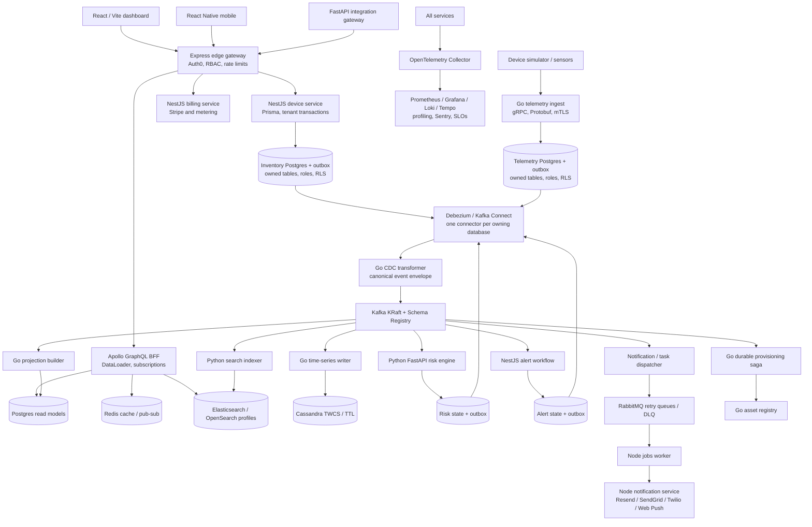
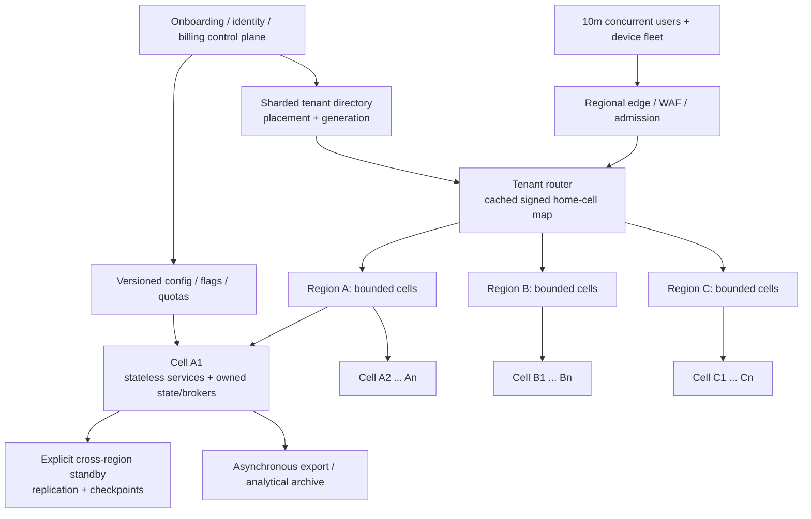
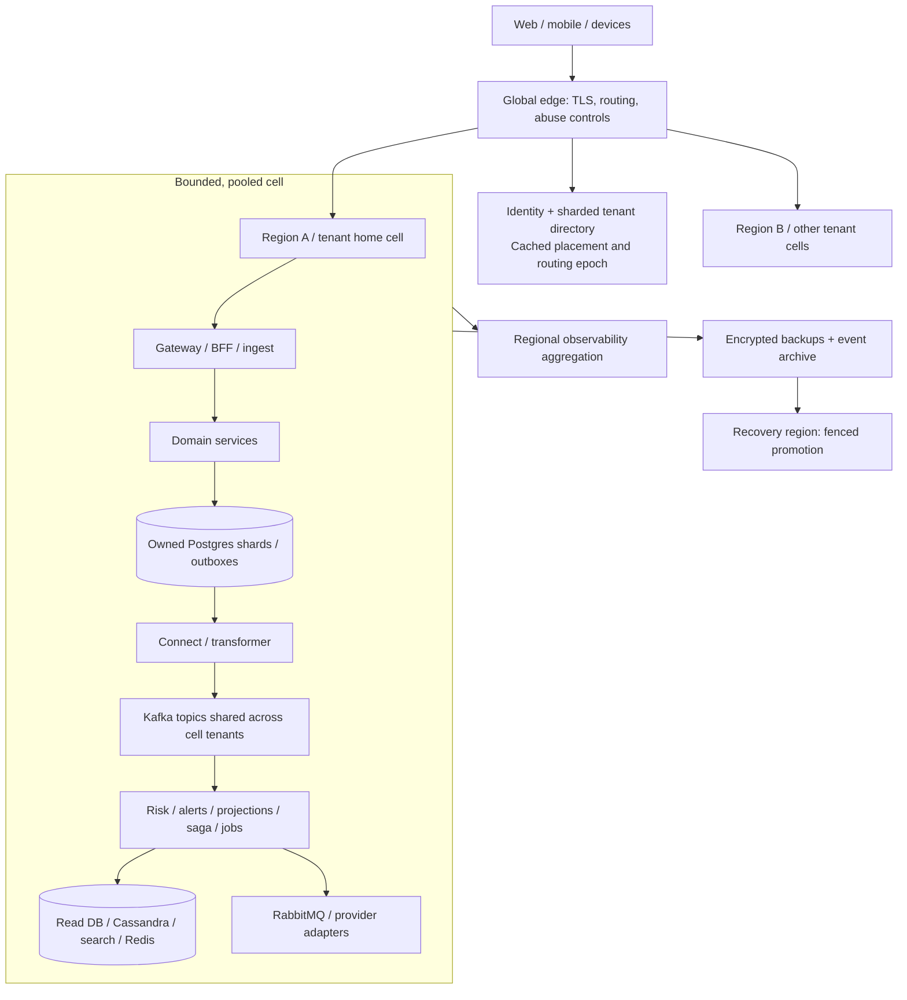

# GreenGuard — complete architecture and build-from-scratch plan

**One project. One agricultural SaaS domain. The combined technologies, patterns, tools and lessons from GrainGuard- and CarePulse.**

**Confirmed target:** 10 million registered accounts, 10 million tenant organizations, and 10 million concurrently active users. Production readiness is a set of measured acceptance gates, not a status claimed for this scaffold.

This single Markdown document includes the entire proposed architecture, 141 coverage requirements, 368 dependency/technology entries with destinations, a 14-stage implementation sequence, concrete service/event/API/data ownership, the first transaction-to-screen design, and scale/operational gates. The original source snapshots and GitHub evidence remain separate reference archives.

**Current deliverable:** a reviewed architecture and project scaffold, proposed event schema/fixture, reproducible capacity arithmetic, and historical evidence. The Stage 01 local foundation has now been implemented; see the [current setup](docs/SETUP.md) and [milestone status](docs/MILESTONES.md). Domain functionality and distributed services remain planned. Every planned capability must earn completion evidence.

## Read in this order

1. [Unified product, architecture and service ownership](#architecture)
2. [10-million scale target and production-readiness gates](#scale)
3. [Reproducible capacity calculations](#capacity)
4. [Whole-platform contracts, flows, deployment and operations](#contracts)
5. [Every architecture, pattern and technology-family requirement](#coverage)
6. [Build from scratch: ordered implementation stages](#implementation)
7. [First durable vertical slice: proposed contracts, SQL and crash tests](#first-flow)
8. [Technology and dependency evidence catalog](#technologies)
9. [Destination and implementation stage for every catalog entry](#destinations)

For the first coding session, begin with Stage01 in Chapter6, then implement the tenant/device/outbox vertical slice in Chapter7. Design for tenant placement and service ownership immediately; introduce the full cell fleet only after the single-cell behavior is proven.

All alternatives from the source material remain covered through named implementations or required comparison profiles. Historical versions and indirect libraries are accounted for without installing mutually incompatible versions into one production process. Healthcare-specific FHIR/scoring material stays in a synthetic reference profile; the live product uses agricultural semantics.

[Local project entry point](README.md) · [Archive and provenance](../ARCHIVE_AND_REBUILD.md) · [GrainGuard source audit](../GRAINGUARD_INVENTORY_AND_PLAN.md) · [CarePulse source audit](../CAREPULSE_INVENTORY_AND_PLAN.md)

---

<a id="architecture"></a>

## 1. Unified product, architecture and service ownership

Source chapter: [docs/REBUILD_BLUEPRINT.md](docs/REBUILD_BLUEPRINT.md).

### Objective and evidence

Build **one GreenGuard agricultural SaaS platform from scratch**, using the combined technologies and patterns of GrainGuard- and CarePulse. The learning and implementation scope includes the basics, the BFF, all service boundaries, transactional outbox, CDC, CQRS, sagas, data stores, security, reliability, operations, infrastructure, developer tools, and delivery practices.

The confirmed scale target is **10 million registered accounts, 10 million tenant organizations and 10 million concurrent active users**. See [scale and production readiness](docs/SCALE_AND_PRODUCTION_READINESS.md) for workload assumptions, regional cells, capacity arithmetic and mandatory release gates. This is a target to demonstrate, not existing capacity. The service diagram below depicts the domain flow inside a cell; the regional/control-plane topology is defined in that scale document.

Source snapshots: GrainGuard- `c00a3810897921a4bf4d1065014776ff45dbc044`; CarePulse `3c4b79688182fe5ee29baa0d106fc2536ea0c852`. Full available refs include 376 and 103 reachable commits respectively (including additional history recovered from Actions/PR commit references). The historical manifest index covers 292 GrainGuard path/blob versions and 101 CarePulse path/blob versions. These are source observations, not an assurance that the old code is fully working.

The source audits and machine-readable catalog are part of this blueprint, not optional appendices. The catalog records individual dependencies and historical versions; the coverage matrix gives architectural families an owner, stage, and acceptance target. Blueprint-only and historical capabilities must stay explicitly labeled. New architecture described below is **proposed**, not already deployed.

### Product and domain

Tenants operate farms, sites, grain bins/silos, lots, and sensor devices. Devices emit temperature, humidity, moisture and equipment readings. The platform validates and stores observations, computes spoilage risk, raises alerts, delivers notifications, tracks acknowledgements and escalation, and supports search, analytics, teams, SSO, metering, subscriptions and audit.

Domain boundaries: identity/tenancy; assets/devices; telemetry; risk; alerts/incidents; notifications/jobs; search/read models; billing; integrations. Clinical patient records, NEWS2 and qSOFA do not become grain-scoring formulas. Preserve their validation, scoring strategy and interoperability lessons in a clearly labeled synthetic FHIR lab. Agricultural risk thresholds require separate product calibration and versioning.

### Target architecture



An arrow to CDC denotes each owning database's independently configured outbox connector, not a shared cross-service transaction. Rabbit dispatch and saga commands also need durable publication and deduplication. Redis subscription fan-out is ephemeral; clients recover state through read models and cursors after disconnects.

### Service ownership

| Component | Runtime / framework | Responsibility and boundary |
|---|---|---|
| dashboard | React, TypeScript, Vite, Tailwind | Device/site views, live risk and alerts, admin, billing, audit. TanStack Query for REST; Apollo Client for GraphQL. Storybook and virtualized lists. |
| mobile | React Native | Mobile alert and acknowledgement flow using the same public contracts. |
| gateway | Node/TypeScript, Express | Edge authentication, tenant membership, authorization, quotas, API keys, CORS/CSP/Helmet, CSRF where cookie credentials are used; routing and request correlation. |
| bff | Node/TypeScript, Express, Apollo | UI-specific GraphQL composition, DataLoader, pagination, cache-aside, tenant-bound WebSocket subscriptions; no domain writes hidden in resolvers. |
| device-service | NestJS, Prisma, Postgres | CarePulse's CRUD/transaction model adapted to farms, sites, bins, devices and ownership; one authoritative write owner per aggregate. |
| telemetry-ingest | Go, gRPC/Protobuf, grpc-gateway / HTTP | Authentication, validation, device binding, idempotency and atomic reading/outbox transaction. One durable ingest path even when transports differ. |
| asset-registry | Go, gRPC | Provisioning/configuration commands and external asset bindings. Device-service owns inventory facts; commands interact through versioned contracts. |
| cdc-transformer | Go | Convert Debezium envelopes into canonical domain events; preserve ID, tenant, aggregate version and tracing. |
| projection-builder | Go | CQRS device dashboard, site/lot summaries, risk/alert aggregates and replay; combines the projection/read-model responsibilities from both sources. |
| cassandra-writer | Go | Append time-bucketed readings with tenant partition keys, retention and query-shaped tables. |
| risk-engine | Python, FastAPI, Pydantic, NumPy / scikit-learn | Versioned agricultural risk scoring; input validation, feature extraction, deduplication, reproducible results, atomic scoring state/outbox. |
| workflow-alerts | NestJS, Prisma | Alert rules, acknowledgement routes, deduplication, escalation and lifecycle state; transactional event publication. |
| saga-orchestrator | Go | Durable device provisioning state machine, deadlines, retries, idempotent commands and compensations. |
| billing-service | NestJS, Prisma, Stripe | Metering ledger, plans/entitlements, Checkout, webhook inbox, Customer Portal. |
| jobs-worker | Node, Express health API, amqplib | Email/webhook/export tasks, explicit ack, bounded retry, idempotency, poison-message isolation and DLQ tooling. |
| notification-service | Node, Express | Provider adapters and templates, delivery ledger, preferences and escalation destinations. |
| search-indexer | Python asyncio | Bulk indexing with per-document failures, tenant-safe mapping and rebuild into versioned index aliases. |
| integration-gateway | Python, FastAPI, SQLAlchemy Core / Alembic where appropriate | Agricultural imports/exports and external schema adapters; MySQL CDC comparison and synthetic FHIR preserved in explicit lab profiles. |
| dlq-reprocessor | Go | Audited selective replay with original identity, replay metadata, dry run, bounds and authorization. |

Shared packages: event types/generated clients; tenant/auth context; OTel bootstrap for Go/Node/Python; structured logging; audit logger; idempotency/inbox helpers; test fixtures. Avoid a shared ORM model that lets services bypass ownership.

At fleet scale, add the tenant control-plane and cell-router modules described in the scale plan. The first-slice tenant module can begin inside device-service with an explicit interface; Stage09 extracts authoritative membership/placement/billing control responsibilities before fleet rollout. Placement has a single fenced writer per directory partition; an eventually replicated cache cannot independently promote a second owner.

### Core data and event rules

1. **Transactional outbox:** persist the domain change and outbox row in the same local database transaction. Publish only after commit through CDC. A crash must result in retry or duplicate delivery, never a silently missing event.
2. **Inbox / idempotent consumer:** transactionally apply a projection or state transition with its `(consumer, tenant_id, event_id)` receipt, then acknowledge the broker. Duplicate receipt handling cannot commit half a business operation.
3. **Canonical envelope:** `event_id`, `event_type`, `schema_version`, `occurred_at`, `tenant_id`, `aggregate_type`, `aggregate_id`, `aggregate_version`, `correlation_id`, `causation_id`, `traceparent`, `payload`. Version contracts explicitly and test backward compatibility.
4. **Ordering:** Kafka key includes tenant and aggregate; no promise of global ordering. Detect obsolete/out-of-order aggregate versions. Define late telemetry and event-time windows.
5. **Delivery guarantee:** at-least-once transport with idempotent effects. Do not claim end-to-end exactly-once across databases, Kafka, RabbitMQ and notification providers.
6. **Outbox recovery:** CDC is the normal relay. If a fallback polling relay is retained from CarePulse, it must share event IDs, use safe leasing/fencing, and tolerate racing CDC. Retention must respect broker/connector recovery checkpoints.
7. **CQRS:** command state is authoritative. Read stores are rebuildable, tenant-scoped and eventually consistent with visible freshness/lag. Replays write versioned projections and switch after validation.
8. **Saga:** save state plus outbound command in the same transaction. Compensations are business actions, not database rollback across services. Test repeated, late and reordered success/failure messages.
9. **Tenant isolation:** derive tenant from authenticated membership/device credentials, never trust an arbitrary request tenant. Postgres non-owner roles, forced RLS where needed, transaction-local tenant settings, PgBouncer tests, and tenant keys in every cache/search/Cassandra/DynamoDB operation.
10. **Concurrency:** aggregate versions/optimistic locking for normal writes; serializable transactions plus bounded retries for critical invariants. Redis leases require owner checks and fencing where protected effects need it; etcd leadership requires lease expiry/fencing tests. No distributed two-phase commit is planned; preserve the ADR explaining why.

### Storage and provider profiles

| Technology family | Role in the unified project | Profile |
|---|---|---|
| Postgres 16 family + PgBouncer | Authoritative relational state, outbox/inbox, audit, projections, RLS; separate owner credentials | core |
| Kafka KRaft, Connect, Debezium, Schema Registry | Domain event backbone, schema compatibility, replay and CDC | events |
| Redis single-node and cluster | Cache, quotas/rate limits, short-lived dedup helpers, pub/sub and guarded leases | core; cluster reliability |
| RabbitMQ | Work queues, explicit acknowledgement, TTL/backoff retry queues and DLQs | workflows |
| Cassandra | Long telemetry history, time buckets, TWCS/STCS comparison, TTL and LWT examples | timeseries |
| Elasticsearch + Kibana | Original GrainGuard search backend and diagnostics | search-elastic |
| OpenSearch | CarePulse search backend implementing the same tested port | search-opensearch |
| DynamoDB | Feature flags / alert mirror / escalation records, tenant keys, conditional writes and TTL | aws |
| S3, Lambda, SQS, EventBridge | Exports, validation, scheduled escalation and event integration | aws |
| MySQL 8 + Debezium binlog | External-import/legacy integration with normalized contracts | integration-lab |
| Memcached | Compare a simple read cache with Redis through one cache port | cache-lab |
| Citus | Explicit multi-tenant sharding/routing exercise with RLS and migration tests | scale-lab |
| etcd | Singleton coordination and fencing exercise beyond Redis leases | coordination-lab |
| Terraform + AWS CDK | Terraform owns shared platform; CDK owns a separately named serverless stack. Never let both manage one resource | aws |
| Istio + Linkerd | Separate service-mesh profiles to compare mTLS, traffic policy and metrics | mesh-istio; mesh-linkerd |
| Pyroscope + Parca | Separate continuous-profiling profiles, plus pprof and py-spy investigations | profiling |
| Resend / SendGrid / Twilio / Web Push | Distinct notification adapters with contract tests and sandbox delivery ledgers | notifications |
| FHIR R4 / NEWS2 / qSOFA | Preserve CarePulse-specific contracts/scoring as synthetic reference fixtures; not agricultural decision logic | clinical-reference-lab |

“Use all technologies” means every discovered capability has an explicit implementation or comparison exercise and acceptance evidence. It does not mean installing every historical package version or running redundant caches, meshes and search engines on every request. The core flow remains explainable. Full coverage includes executing each named profile later.

### Security, quality and operations

Auth0 OIDC/JWKS is consistent across HTTP and WebSockets. RBAC and optional ABAC protect commands, queries and subscriptions. API keys are hashed and scoped. Validate payloads at edges and contracts at brokers. mTLS protects selected internal RPCs; secrets enter through AWS Secrets Manager / External Secrets. Audit records exclude credentials and unnecessary payloads. Stripe/provider webhooks verify signatures and persist receipts before processing. Exports and signed URLs have tenant authorization and bounded lifetime.

Instrument with OpenTelemetry and W3C propagation across HTTP/gRPC/Kafka/RabbitMQ. Use structured Go/Node/Python logs correlated to traces. Prometheus, Grafana, Loki and Tempo provide metrics/logs/traces; exporters and synthetic probes validate user flows. Add Sentry and profiling with data minimization. SLOs need measured baselines, burn-rate alerts, error budgets, on-call ownership and tested runbooks.

CI includes language unit tests, integration tests with real stores, Pact/contract compatibility, migration-from-empty and upgrade tests, tenant adversarial tests, Testcontainers, Playwright, property/fuzz tests, k6 and chaos/Toxiproxy. CI must fail when required checks are skipped or fail. Include CodeQL, Trivy, ZAP, GitLeaks, dependency checks, SonarCloud, SBOM and Cosign signatures with verifiable provenance. Developer tooling includes formatters, linters, hooks, AI/MCP integration configs and CodeRabbit; tool configuration is not proof that an external integration is installed.

Deploy in stages: local Compose; images; Kubernetes/Helm; Terraform platform and CDK serverless stacks; ArgoCD GitOps; Argo Rollouts with real metric-based analysis; backup/restore; multi-region failover with RDS/Aurora, Redis replication and Kafka MirrorMaker2. Local-first planning does not require cloud spending to begin.

### What is already accomplished in this restart

- Source code and full available Git ref histories downloaded; commit and historical manifest evidence indexed.
- Fresh GreenGuard directory created with service ownership scaffolds, this blueprint, detailed coverage and ordered backlog.
- Historical defects and incomplete integrations recorded as acceptance requirements for the new implementation.

The new application has not been built, dependencies have not been installed, and end-to-end capability has not been claimed. [Stage 01](docs/IMPLEMENTATION_BACKLOG.md) is the starting implementation task. Archive availability, including missing/expired console logs, is reported separately in the archive manifest.

Concrete implementation design: [first vertical slice](docs/FIRST_VERTICAL_SLICE.md), [platform contracts and operations](docs/PLATFORM_CONTRACTS_AND_OPERATIONS.md), and [10-million-scale production gates](docs/SCALE_AND_PRODUCTION_READINESS.md).

---

<a id="scale"></a>

## 2. 10-million scale target and production-readiness gates

Source chapter: [docs/SCALE_AND_PRODUCTION_READINESS.md](docs/SCALE_AND_PRODUCTION_READINESS.md).

### Confirmed goal and current status

The user explicitly selected **all three**: 10,000,000 registered user accounts, 10,000,000 customer organizations/tenants, and 10,000,000 concurrently active users. These are separate dimensions to validate together. Active users can belong to multiple organizations; a tenant is an authorization/business boundary, not a Kubernetes namespace or an identity-provider installation.

**This is a proposed architecture and capacity model. It is not a verified capacity claim or a production deployment.** The original repositories contain useful implementations and substantial gaps. The fresh GreenGuard project must earn production readiness through the gates below. The workload rates, device counts, payloads and service levels in this document are explicit planning assumptions until measured or approved as product requirements.

### Workload model

| Dimension | Initial sizing assumption | Consequence |
|---|---:|---|
| Registered accounts | 10 million | Identity, recovery, consent/preferences and membership storage; not 10m requests/s by itself |
| Tenant organizations | 10 million | Sharded tenant directory, pooled storage, billing/onboarding quotas and lifecycle automation |
| Concurrent active users | 10 million | Session/socket state, API throughput, fan-out and reconnection capacity |
| Foreground API request interval | One request per active user every 5 seconds | 2,000,000 API requests/s before retries and telemetry |
| Devices per organization | 10 | 100,000,000 devices; assumption, not user-supplied inventory |
| Device reporting interval | One reading every 60 seconds | About 1,666,667 readings/events/s |
| Encoded event size | 1 KiB | About 1.707 GB/s and 147.456 TB/day of logical event payload, before compression/replication/indexes |
| Kafka replica count | 3 | 442.368 TB of replicated payload per day; 3.097 PB for seven days before compression/overhead |
| Connected sessions | One WebSocket per active user | 10,000,000 sockets plus reconnect/TLS/login work |
| Delivered UI updates | 0.1 messages/s per session at 1 KiB | 1,000,000 messages/s; 1.024 GB/s payload egress before protocol overhead |
| Device burst | 5× baseline, bounded duration | About 8,333,333 events/s during burst; size buffering and drain capacity explicitly |
| API burst | 2× baseline, bounded duration | 4,000,000 API requests/s; all expensive query classes still have admission budgets |
| Token refresh example | 15-minute interval, distributed evenly | About 11,111 refreshes/s; jitter avoids synchronized spikes. This is not a proposed default until IdP limits are verified |

Units here are decimal GB/TB/PB; the payload assumption is binary KiB = 1,024 bytes. Replication arithmetic describes payload copies, not billed provisioned disk. Postgres rows, outbox copies, WAL, indexes, read stores, broker metadata and backups add amplification. Compression ratios must be measured on actual payloads. Seven days of raw broker retention is an example to price and test, not a free default.

The reproducible [capacity model](scripts/capacity_model.py) and [assumption input](docs/capacity_assumptions.json) generate [CAPACITY_MODEL.md](docs/CAPACITY_MODEL.md). Change inputs and rerun it. It reports arithmetic, not observed service throughput. Device telemetry and human traffic are independently scalable; never estimate one solely from account count.

### Regional cells and tenant routing

Use **bounded, independently operated cells**. Each holds a subset of tenants and has its own application capacity, relational shards, event backbone, work queues, cache and projections. An enterprise tenant with disproportionate load can receive a dedicated placement. Core domain calls remain inside the tenant's cell; cross-cell analytics and management are asynchronous.

This applies AWS's cell/bulkhead guidance to the GreenGuard design: bounded independent workload instances limit failure propagation, and deployments should progress across cells rather than update every cell at once. The exact cell boundary and capacity are GreenGuard design decisions to test. [AWS cell architecture guidance](https://docs.aws.amazon.com/wellarchitected/2025-02-25/framework/rel_fault_isolation_use_bulkhead.html).



- **Control plane:** account/tenant lifecycle, placement directory, subscription/entitlement distribution, provider account assignment, global config and fleet rollout coordination. Partition and replicate it; its outage must not stop every existing tenant request. Onboarding/relocation can pause independently.
- **Data plane:** gateway/BFF, device/ingest/risk/alerts/saga/jobs and tenant-owned data in a cell. Signed/validated placement generation prevents stale routers from sending writes to the wrong owner. Cached routing is not a bypass for authorization or revoked tenant state.
- **Isolation:** a shared Kafka cluster or relational writer across all “cells” would undermine the failure boundary. A Kubernetes cluster can host several workload groups, but those groups share cluster failure risk; only independently bounded infrastructure is counted as a cell for resilience certification.
- **Placement:** consistent-hash/virtual-bucket directory plus explicit hot-tenant overrides. Membership lookup and placement lookup are separate from a user-provided tenant header. Cell capacity is bounded in accounts, tenants, devices, bytes and request rates.
- **Tenant movement:** prepare target; snapshot and stream changes; reconcile counts/checksums; drain/fence old writes; persist ownership-generation change; route new traffic; retain recoverable source state. Never dual-write an aggregate into two active owners without a separately designed conflict protocol.
- **Region strategy:** active regions serve different home tenants. Each tenant still has one authoritative write owner. Failover uses an explicit fenced promotion and checkpoint policy; this is not a claim of conflict-free active-active writes to the same tenant.

Pooling, dedicated tenancy and hybrid placement are separate isolation/cost choices. GreenGuard uses pooled cells by default and dedicated placement where required, rather than creating ten million databases or per-tenant clusters. [AWS multitenant architecture guidance](https://docs.aws.amazon.com/solutions/multi-tenant-architectures-on-aws/).

### Capacity certification per cell

Define a **safe measured cell envelope** for each workload mix: API RPS, concurrent sockets, telemetry EPS, payload bytes/s, DB write/read rate, CPU/memory/IO, tenant/device count and replay backlog. Safe capacity includes operational headroom and successful component-failure tests; a single benchmark maximum is not the safe envelope.

Illustrative targets to benchmark—not known hardware capabilities—are 20,000 API RPS, 20,000 telemetry EPS, 100,000 connected sessions and 100,000 tenant placements per cell. Treat the joint workload as one test, not four independent best-case results added together.

```text
required_cells = max(
  ceil(API_RPS / safe_cell_API_RPS),
  ceil(telemetry_EPS / safe_cell_telemetry_EPS),
  ceil(concurrent_sessions / safe_cell_sessions),
  ceil(tenant_count / safe_cell_tenant_count),
  capacity bounds for DB, storage, bandwidth, devices and replay
)
```

The four illustrative dimensions yield 100 cells for baseline traffic and 417 for the stated simultaneous API/telemetry burst. Those are lower bounds until the omitted storage/device/network/replay dimensions are measured. With three evenly provisioned regions and a requirement to survive one region's loss without exceeding the safe cell envelope, the simple reserve formula is `ceil(required_cells / (1 - 1/3))`: 150 baseline cells or 626 burst cells. Placement fragmentation, unavailable tenants' replicas, migration capacity and AZ failures can increase these counts. A spare slot does not contain the tenant's replicated data automatically.

If short bursts are buffered, calculate maximum queue depth and drain time explicitly and keep the ingestion acceptance/alert freshness SLOs. Capacity to process backlog must exceed ongoing arrival rate. Autoscaling cannot repair a saturated database or increase a consumer group's concurrency beyond its effective partition parallelism.

### Data and messaging at this scale

| Component | Production scaling rule | Required experiment |
|---|---|---|
| Postgres/PgBouncer | Tenant-hash shards within cells, time-partitioned telemetry, bounded app pools, batch writes preserving atomic receipts/outbox; dedicated ownership credentials | Joint ingest/outbox/WAL/CDC test with skew and failover, not insert-only benchmarking |
| RLS | Non-owner, non-superuser application roles without BYPASSRLS; forced policies where needed; transaction-local tenant context | Cross-tenant reads/writes through pooled connections, migrations and maintenance paths |
| Outbox/inbox | Partition/retain based on recovery horizon and delivery state; archival and compact receipts must not allow harmful old replays | Replay past retention, connector downtime, fallback relay races and dedupe policy tests |
| Kafka | Shared domain topics per cell, partitions keyed by tenant/aggregate—not one topic or partition per customer | Mixed producer/consumer byte rate, rebalance, broker loss, lag, replication and skew |
| Cassandra | Tenant/device/time buckets with event identity and bounded partitions; compression/TTL/tombstone/repair policy | Late arrivals, equal timestamps, compaction/repair during peak load, rollup reconciliation |
| Search | Bounded cell indexes with tenant filtering, routing and lifecycle tiers—not ten million small indexes | Mixed search/index load, per-item failures, shard relocation and alias rebuild |
| Redis | Clustered where appropriate, bounded TTLs and memory, tenant-scoped keys, safe degradation, no authoritative business state | Hot key, slot imbalance, failover, cache miss storm, revoked-key propagation |
| RabbitMQ | Partition task queues by cell/work class; consumer limits, publisher confirms, quorum queues where chosen | Leader failover with publish/ack races, bounded retries and drain after provider outage |
| WebSockets | Regional connection gateways, consistent tenant authorization, coalesced latest-state updates and bounded send queues | 10m joint connections with traffic, slow clients, deploy drain, reconnect and token refresh storm |
| Metrics/traces/logs | Bounded metric labels; tenant/event IDs belong in controlled logs/traces, not unbounded Prometheus labels; sampling and retention budgets | Cardinality/memory/storage/cost budget, trace continuity for sampled failures |
| Object archive | S3 lifecycle/export partitions with tenant ownership; replay manifests and checksums | Rebuild from durable source after retention expiry of broker hot data |

Postgres table owners normally bypass RLS unless configured otherwise; enabling a policy alone is insufficient to establish tenant isolation. [PostgreSQL RLS documentation](https://www.postgresql.org/docs/17/ddl-rowsecurity.html).

For MSK, validate broker/partition sizing against the chosen broker type. The published guidance recommends replication of at least three and explains `min.insync.replicas=2` with RF3; clients and operational headroom also affect availability. GreenGuard will benchmark the whole replication/consumer workload, not derive broker counts from a generic EPS claim. [MSK sizing and availability guidance](https://docs.aws.amazon.com/msk/latest/developerguide/bestpractices.html).

### External-provider and infrastructure quota gates

- **Identity:** retain Auth0/OIDC and the historical Keycloak adapter in named profiles. Keep GreenGuard tenant membership/placement in its own control plane; do not assume each business tenant can be one Auth0 Organization in a single Auth0 tenant. Auth0 currently documents 100,000 Organizations per tenant. Ten million organizations require a provider-approved partitioning/contract strategy or a different first-party membership mapping; ten million SSO connections are a separate challenge. Validate MAU, login, refresh, Management API and enterprise-connection entitlements before selecting the production topology. [Auth0 entity limits](https://auth0.com/docs/troubleshoot/customer-support/operational-policies/entity-limit-policy).
- **Authorization:** verify JWTs locally using bounded JWKS caches; do not synchronously call the IdP for each API request. Define revocation freshness, issuer mapping and strict issuer/audience/algorithm validation. Administrative changes propagate through durable events.
- **Billing/notification vendors:** cache distributed entitlements; batch or aggregate metering; durable provider queues, receipts and reconciliation. Confirm Stripe/email/SMS/push throughput and commercial contracts before load tests. Do not send synthetic scale traffic to real users.
- **Cloud:** maintain a quota register per account/region for VPC/IPs/ENIs, EC2/vCPU, EKS API/pods/controllers, ALB/NLB targets/connections, MSK, RDS connections/storage, Lambda/SQS/EventBridge, S3 requests, KMS, IAM and DNS. Distribute service accounts and quotas by bounded fleet unit where necessary.
- **Kubernetes:** an HPA definition is not fleet capacity. Certify control plane, network/IP allocation, DNS, scheduling, controllers, telemetry agents and node startup alongside pods. AWS's EKS guidance identifies distinct control-plane, data-plane, cluster-service and workload limits and requires validation. [EKS scalability guidance](https://docs.aws.amazon.com/eks/latest/best-practices/scalability.html).

### SLOs and measurable production acceptance

The following are **proposed launch targets**, to be ratified against the product's economics and failure policy. The user's p95/p99/error values remain the performance target; stricter availability budgets are additional proposed requirements.

| Surface | Proposed target and measurement boundary | Gate |
|---|---|---|
| Interactive API | p95 <500ms, p99 <1s; edge arrival to response at nominated regional probes; report by critical endpoint/query class | Full specified joint load and workload mix, including auth/cache miss cases; do not hide slow endpoints in aggregate percentiles |
| Valid-request error rate | <1% under nominated load; report 429/load shedding, timeouts and 5xx separately; no silent denominator exclusion | Define valid input and client cancellation handling; count offered traffic and dropped requests |
| Ingest durability | Return accepted only after owning database commit of reading+receipt+outbox | Crash/duplicate/failover matrix and reconciliation establish no lost acknowledged writes inside the certified failure domain |
| Pipeline freshness | Candidate p95 <2s and p99 <5s from accepted reading to queryable projection/alert decision under normal load | Measure each stage plus cumulative lag; record degraded/recovery envelope separately |
| API/ingest availability | Candidate 99.95% over 30 days for core accepted workload | Synthetic + real request SLIs, burn alerts, owner and error-budget release policy; not equivalent to <1% load-test error |
| Notifications | Durable enqueue and processing latency SLO; provider delivery tracked separately | A successful queue write is not evidence the customer received a message |
| AZ failure | No lost acknowledged writes within verified synchronous store/broker guarantees; bounded recovery measured per component | Kill/drain an AZ during load and reconcile all event identities |
| Regional disaster | Candidate RPO ≤5min and RTO ≤30min, subject to measured cross-region replication and promotion | Async replication cannot promise zero regional data loss; explicit fence/promote/reconcile drill |
| Security | No unresolved release-blocking findings, verified tenant boundaries and signed immutable build provenance | Adversarial tests and review of risk exceptions with owner/expiry; zero scanner findings alone is not proof of safety |
| Quality | Meaningful tests of critical invariants; enforce agreed new-code gates | Retain dated branch/commit reports before claiming 100% coverage or zero duplication/issues/hotspots |

### Validation ladder and production-readiness gates

| Gate | Evidence required before progressing |
|---|---|
| G0: reproducible baseline | Fresh machine and empty database bootstrap, pinned tools/images, migrations and secret-free config; all required CI gates actually fail when broken |
| G1: correctness | Tenant/device/outbox slice; atomic inbox/projection; saga/notification/billing crash races; backward-compatible contracts and schema migration proof |
| G2: secure single cell | Threat model, tenancy adversarial tests across every store/transport, cert/key rotation, secrets/IAM, vulnerability gates and audit retention |
| G3: measured cell envelope | Distributed load generators; mixed API/device/socket traffic; burst and at least 24h soak; saturation curves, memory bounds, replay and component failures |
| G4: cell fleet | Routing hot spots, placement skew, control-plane outage, tenant movement, staged rollout and quota changes; 1%,10%,100% target-scale progression |
| G5: regional resilience | AZ/broker/database/cache/node failures at load; capacity after failure; isolated bad rollout; no fleetwide shared choke point |
| G6: multi-region recovery | Replicated tenant state, fenced promotion, forced split-brain prevention, measured RPO/RTO, failback and event reconciliation |
| G7: commercial operations | Provider quota/contract approval, abuse response, incident rotation, cost budgets/alerts, usage/billing reconciliation, support/onboarding/deletion workflows |
| G8: 10m certification | Simultaneous 10m accounts +10m tenant dataset +10m active sessions at the stated request/device rates, regional distribution and duration; archived reproducible evidence |

Run synthetic tests with controllable clocks, seeded skew and recorded generator headroom. Use open-loop arrival rates where appropriate to reveal queueing; report coordinated-omission handling. Ten million idle sockets alone do not validate ten million active customers. Summed per-cell benchmarks are a forecast; validate fleet routing, shared control services and provider bottlenecks as well.

### Cost and phased build order

Estimate monthly cost from measured cell compute, replicated storage, broker/read/search copies, database IO, inter-AZ/inter-region transfer, internet fan-out, observability volume, identity MAU/SSO, notification delivery and support capacity. Model baseline, burst, one-region-loss and replay scenarios. Track cost per active tenant, device-million-readings and user session. Provider prices and discounts are inputs to refresh when choosing regions; no dollar estimate or affordable budget has been assumed.

Start with one local cell and the same domain/tenant/contract boundaries, then a production pilot, certified cell, regional fleet and multi-region scale. Do not provision hundreds of cells to begin learning. The existing 14-stage backlog remains the implementation sequence, with these gates required at Stages 01/02 (scale-aware boundaries), 09 (identity/billing quotas), 11 (SLIs), 12 (cell deployment), 13 (capacity) and 14 (regional recovery/certification).

Every technology from the two source projects remains in the coverage matrix. A production deployment uses a coherent selected provider profile; required comparison/historical profiles still have separate reproducible tests. Combining all educational alternatives into one critical request path would add failure modes without establishing scale.

---

<a id="capacity"></a>

## 3. Reproducible capacity calculations

Source chapter: [docs/CAPACITY_MODEL.md](docs/CAPACITY_MODEL.md).

arithmetic forecast only; excludes unmeasured storage/network/device-count/skew/replay bottlenecks.

Inputs: [capacity_assumptions.json](docs/capacity_assumptions.json). Method: [capacity_model.py](scripts/capacity_model.py). Context: [scale and production readiness](docs/SCALE_AND_PRODUCTION_READINESS.md).

| Quantity | Calculated value |
|---|---:|
| api_rps | 2,000,000.000 |
| device_count | 100,000,000.000 |
| telemetry_eps | 1,666,666.667 |
| telemetry_payload_bytes_per_second | 1,706,666,666.667 |
| logical_event_payload_TB_per_day | 147.456 |
| replicated_kafka_payload_TB_for_retention | 3,096.576 |
| concurrent_websockets | 10,000,000.000 |
| delivered_push_messages_per_second | 1,000,000.000 |
| push_payload_bytes_per_second | 1,024,000,000.000 |
| refresh_requests_per_second_if_evenly_distributed | 11,111.111 |

### baseline_cell_forecast

```json
{
  "dimension_lower_bounds": {
    "api": 100,
    "telemetry": 84,
    "sessions": 100,
    "tenants": 100
  },
  "required_cells_lower_bound": 100,
  "provisioned_cells_with_region_reserve_lower_bound": 150
}
```

### burst_cell_forecast

```json
{
  "dimension_lower_bounds": {
    "api": 200,
    "telemetry": 417,
    "sessions": 100,
    "tenants": 100
  },
  "required_cells_lower_bound": 417,
  "provisioned_cells_with_region_reserve_lower_bound": 626
}
```

Cell values are unverified targets. These calculations are lower bounds and not a deployment recommendation, hardware benchmark, provider quota approval or production readiness certificate.

---

<a id="contracts"></a>

## 4. Whole-platform contracts, flows, deployment and operations

Source chapter: [docs/PLATFORM_CONTRACTS_AND_OPERATIONS.md](docs/PLATFORM_CONTRACTS_AND_OPERATIONS.md).

**Status: proposed target design; no application, capacity, provider integration or production readiness is demonstrated by this document.** It extends [the blueprint](docs/REBUILD_BLUEPRINT.md), [the first vertical slice](docs/FIRST_VERTICAL_SLICE.md), [the coverage matrix](docs/COVERAGE_MATRIX.md), and [the staged backlog](docs/IMPLEMENTATION_BACKLOG.md). Source implementation, scaffolds, historical dependencies and document-only capabilities remain distinguished in those records.

The requested scale has three independent dimensions: **10 million registered accounts, 10 million organizations/tenants, and 10 million simultaneously active users**. These are goals, not inferred request rates or proof of a feasible deployment. [Scale and production readiness](docs/SCALE_AND_PRODUCTION_READINESS.md) owns workload assumptions, sizing scenarios, cell counts, costs and qualification evidence. Every numerical operating target below is proposed unless explicitly identified as the user's target.

### 1. Ownership and consistency boundaries

A service owns its domain writes, migration history, credentials and outbox/inbox. Other services consume contracts or call its authorized API. A shared physical database in local development does not grant cross-service write permission. Production cells contain pooled tenant data partitioned by tenant and measured shard capacity; **no database, Kafka topic, identity realm, Kubernetes namespace or deployment per tenant** is assumed.

| Owner | Authoritative state / storage ownership | Read or external dependencies |
|---|---|---|
| `device-service`, initial tenancy module | Stage 02 tenant profile/membership/roles plus sites, bins, grain lots, devices, binding versions, receipts/audit/outbox; `greenguard_inventory` per cell; tenancy authority extracted at Stage 09 | Identity subject IDs and signed control-plane placement; no passwords |
| Tenant control plane, Stage 09 | Authoritative tenant profile/membership/role partitions, placement directory and lifecycle workflows; separately owned sharded control-plane storage | Cell-local membership/profile projections; provider identity linkage; single fenced placement writer per directory partition |
| `telemetry-ingest` | Accepted observations, source-message receipts, per-device stream versions, local binding projection, audit/outbox; `greenguard_telemetry` | Inventory events; device credential verifier |
| `asset-registry` | Provisioning reservation, external binding, configuration generation and command receipts; `greenguard_assets` | Inventory contracts; equipment/provider adapters |
| `risk-engine` | Scoring configuration versions, input window/checkpoint, result revisions, model references and outbox; `greenguard_risk` | Telemetry and inventory events; immutable model artifacts |
| `workflow-alerts` | Rule versions, incident episodes, alert state, acknowledgement, escalation deadlines, audit/outbox; `greenguard_alerts` | Risk and inventory events; notification outcomes |
| `saga-orchestrator` | Saga state/version, step attempts, deadlines, compensation state and command outbox; `greenguard_sagas` | Participant result events; no participant table writes |
| `billing-service` | Stage 09 sharded billing control owns subscription/entitlement/provider state; cell metering modules own unique usage ledgers; separate logical partitions/credentials under the billing boundary | Stripe; unique accepted-usage events; versioned entitlement distribution to cells |
| `jobs-worker`, dispatcher module | Task/delivery intent, durable relay state, export jobs, retry metadata and inbox; `greenguard_jobs` | Kafka, RabbitMQ, notification/integration command APIs |
| `notification-service` | Preferences, verified destinations, templates, delivery attempts/provider receipts; `greenguard_notifications` | Provider adapters and secrets; no alert state ownership |
| `integration-gateway` | Import/export runs, external ID mappings, adapter checkpoints, receipts/outbox; `greenguard_integrations` | S3 and external systems; owner APIs for imported domain changes |
| `projection-builder` | Rebuildable device/site/lot/risk/alert views, source receipts, watermarks and projection notifications; `greenguard_read` | Canonical events; BFF has restricted read access |
| `cassandra-writer`, `search-indexer` | Rebuildable history/index representations, delivery checkpoints and versioned rebuild metadata | Kafka; Cassandra; selected Elasticsearch/OpenSearch profile |
| `gateway`, `bff`, dashboard, mobile | No authoritative domain tables; bounded session/cache state only | Owner APIs and scoped read models; no bypass through shared ORM |
| `cdc-transformer`, `dlq-reprocessor` | Transport/checkpoint or authorized replay state, not domain truth | Scoped outboxes, registry, Kafka; replay preserves original identity |

The global control plane owns a sharded tenant placement directory `(tenant_id, home_region, cell_id, routing_epoch, state)`, public identity linkage, cell inventory, configuration rollout and placement/migration workflows. Stage 02's first-slice tenancy module begins inside device-service behind an explicit interface. Stage 09 extracts authoritative membership/profile/placement and billing control responsibilities before fleet rollout; home cells retain authorized projections and bounded caches. Migrate ownership with one writer, versioned events and reconciliation; the gateway never becomes the database owner. Directory caches cannot independently promote a second owner.

The first slice has only inventory, telemetry and read logical databases. Later databases above arrive with their owning stage. Its `app.tenant_id` PostgreSQL setting is the new-project convention; archived `app.current_tenant_id` code must be adapted. Use transaction-local `set_config`, forced RLS, tenant-aware foreign keys, non-owner/non-BYPASSRLS runtime roles and PgBouncer transaction-pooling tests.

Inventory `binding_version` and telemetry `aggregate_version` are independent decimal-string counters. The first slice registers an inventory device as active while its ingest binding is still pending. Stage 07 introduces a versioned provisioning lifecycle (`provisioning → active`, or `failed/compensating`); it must migrate that contract and existing records explicitly, not silently redefine `device.registered`.

### 2. Cell architecture and deployment boundaries



Home-cell routing is validated server-side from authorized tenant context; clients cannot choose a cell or advance an epoch. Cache directory results with bounded lifetime and explicit invalidation. A write carries the current placement epoch; old owners reject stale epochs after a migration fence. Shared DNS/edge routing and pooled identity structures avoid ten-million-per-tenant infrastructure objects. Gateway/WS connection pools, tenant directory lookups, membership caches and identity-provider limits need independent capacity tests.

Cell-local synchronous dependencies bound blast radius. Cross-cell analytics and global billing reconciliation consume asynchronous exports/events; ordinary telemetry acceptance and alert acknowledgement do not require synchronous fan-out to all cells. Define per-tenant and per-cell quotas, reserved headroom, admission shedding and noisy-neighbor isolation. Dedicated placement for exceptional tenants is a capacity decision, not the default tenant provisioning path.

Use one Kubernetes namespace per environment/cell/service group, scoped service accounts, workload identity, default-deny network policy and explicit egress allowlists. Only the public gateway, device ingress and signed provider-webhook endpoints are exposed through ingress. Kafka, Connect, Registry, databases, RabbitMQ, Redis, exporters and administration UIs remain private. Restrict operator access through audited short-lived credentials.

| Network path | Authentication and permitted traffic |
|---|---|
| Client → edge | HTTPS/WSS; OIDC bearer/session policy for humans; scoped device credential or client certificate for devices |
| Edge → owner/BFF | TLS; verified end-user context bound to audience, tenant and expiry; reject caller-supplied internal identity headers |
| Service → service | Workload mTLS identity plus operation authorization; device/config gRPC additionally authorizes tenant/resource; encryption alone is not permission |
| Producer/consumer → broker | TLS and workload-scoped broker credentials/ACLs; only intended topics/groups; tenant boundaries enforced in application contracts |
| Service → database | TLS and owner-specific least-privilege role; transaction tenant context; migration role separate from runtime role |
| Service → provider | Bounded HTTPS egress, provider-specific credentials; signatures on incoming webhooks; no arbitrary user-supplied internal URL fetch |

Select **one** production mesh profile after qualification: Istio or Linkerd. Their comparison labs stay isolated. Pin CA/trust-domain policy, certificate lifetimes, rotation overlap and service identity authorization; verify peer hostname/identity and test expired/revoked certificates. Local development can use generated development CA material in ignored files, never production keys.

AWS Secrets Manager with External Secrets is the proposed deployment path; workload identity/IRSA avoids static cloud keys. Separate secret scopes by environment, cell, owner and provider. Git and logs hold names/references only. Rotation tests cover DB reconnects, broker clients, webhook verification overlap and device credential revocation. Terraform owns shared platform/network/state; CDK owns a distinctly named serverless stack; ownership tags and CI forbid both tools managing the same resource.

### 3. Canonical event and command catalog

Retain the first slice's UTF-8 JSON envelope, exact decimal-string versions, tenant-plus-aggregate key, immutable event ID, registry subject `<topic>-value`, explicit schema headers and validator checks. This is the documented application JSON convention, not Confluent binary framing. Strict v1 schemas reject unrecognized fields; evolution requires actual old/new fixture checks, consumer-first rollout and a new contract/topic where necessary.

Every row below is **proposed**, except the telemetry schema and fixture already exist as design artifacts. Each listed family contains a finite reviewed event set. Topics are per cell and contract family, never per tenant; their identical logical names may exist in different cell clusters. Partition count, retention and cross-region replication follow measured workloads.

| Canonical topic | Owner / event types | Aggregate/key; principal consumers |
|---|---|---|
| `greenguard.inventory.tenant.v1` | Tenancy module, extracted to control plane at Stage 09: `tenant.created`, `tenant.updated`, `membership.changed`, `tenant.suspended` | Tenant; authorization/entitlement projections, audit export; restrict membership payload access; retain contract through owner migration |
| `greenguard.inventory.facility.v1` | Inventory: `site.changed`, `bin.changed`, `lot.changed`, `lot.retired` | Site/bin/lot; projections, risk, integrations |
| `greenguard.inventory.device.v1` | Inventory: `device.registered`, `device.binding_changed`, `device.disabled`; versioned activation addition later | Device/binding version; ingest binding, projections, saga, search |
| `greenguard.telemetry.recorded.v1` | Ingest: `telemetry.recorded` | Device telemetry stream; read projection, risk, Cassandra, selected indexing/usage consumers |
| `greenguard.risk.assessment.v1` | Risk: `risk.assessed`, `risk.assessment_invalidated` | Assessment stream for tenant/bin or device; alerts, projections, search |
| `greenguard.alerts.lifecycle.v1` | Alerts: `alert.opened`, `alert.updated`, `alert.acknowledged`, `alert.escalated`, `alert.resolved` | Alert; projections, dispatcher, search, AWS mirror |
| `greenguard.assets.provisioning.v1` | Asset registry: `asset.reserved`, `asset.configured`, `asset.released`, `asset.command_failed` | Provisioning reservation/configuration; saga, inventory integration |
| `greenguard.sagas.lifecycle.v1` | Orchestrator: `provisioning.started`, `provisioning.completed`, `provisioning.compensated`, `provisioning.intervention_required` | Saga; operator views, audit, integration consumers |
| `greenguard.billing.lifecycle.v1` | Billing: `subscription.changed`, `entitlements.changed`, `usage.accepted`, `billing.reconciliation_required` | Subscription or metering batch; gateway entitlement projection, views, audit |
| `greenguard.jobs.lifecycle.v1` | Jobs: `job.requested`, `job.completed`, `job.failed`, `export.ready` | Job; notification delivery, views, integration clients |
| `greenguard.notifications.delivery.v1` | Notifications: `delivery.requested`, `delivery.provider_accepted`, `delivery.confirmed`, `delivery.failed` | Delivery; alert escalation, audit, preferences UI |
| `greenguard.integrations.lifecycle.v1` | Integration: `import.started`, `import.completed`, `import.failed`, `external_binding.changed` | Import run or external binding; views and operators |
| `greenguard.platform.config.v1` | Configuration control plane: `flag.configuration_changed`, `cell.placement_changed` | Config/placement record; authorized local cache refreshers; restricted ACL |
| `greenguard.commands.results.v1` | Participant owners: `command.completed`, `command.rejected` | Command result keyed by tenant/command ID; requester/saga; owner/topic ACL and origin allowlist enforced |
| `greenguard.quarantine.v1` | Transport: invalid event bytes and source coordinates/error/attempt/schema metadata | Source coordinate; operator tooling only; tenant present only if verified |

Each event schema defines payload, owner, key, authorization classification, causal IDs, deterministic replay behavior and retention before its producer is implemented. Search and read models do not originate alternative inventory/alert truth. Audit rows are written locally with mutations; a separately authorized audit exporter assembles them without publishing credentials or unrestricted personal data on general topics.

Raw CDC topics retain `greenguard.raw.inventory.outbox` and `greenguard.raw.telemetry.outbox`; add `greenguard.raw.<owner>.outbox` only for an introduced database owner. One scoped connector/slot per owned database in the first profile; shard expansion supplies explicit mappings. Capture outbox insert records, not every internal table by default. Transformer routes against an allowlist and preserves identity/version/trace. Initial single raw partitions are a learning profile, not the final scale topology.

Commands are requests to one owner, while events report committed facts. Introduce `command_id`, `command_type`, `tenant_id`, `target_id`, `expected_version`, `deadline`, `idempotency_key`, correlation/causation/trace and validated payload in a separately versioned command envelope. Do not call the command a successfully completed event.

| Command topic / target owner | Commands | Durable completion evidence |
|---|---|---|
| `greenguard.commands.inventory.v1` | `ActivateDevice`, `DisableDevice`, `ApplyBinding`, `RetireLot` | Inventory event with originating command ID; rejection recorded in receipt/result event |
| `greenguard.commands.assets.v1` | `ReserveAsset`, `ConfigureAsset`, `ReleaseAsset`, `RevertConfiguration` | Asset result event and idempotent receipt |
| `greenguard.commands.alerts.v1` | `EvaluateEscalation`, `ResolveAlert` | Alert transition or recorded no-op for obsolete expected version |
| `greenguard.commands.jobs.v1` | `RequestNotification`, `GenerateExport`, `DeliverWebhook` | Durable task intent then job/delivery result |
| `greenguard.commands.billing.v1` | `RecordUsageBatch`, `ReconcileSubscription` | Unique ledger acceptance or reconciliation result |
| `greenguard.commands.integrations.v1` | `StartImport`, `CancelImport`, `ValidateUpload` | Import/job state and result |

Persist command dispatch in a dedicated `command_outbox` with unique command ID and `(saga_id, step, attempt)` or owner command-stream sequence. This preserves the first slice's **one domain event per aggregate version** outbox uniqueness. Commands and events may share a physical broker, not an ambiguous schema. Add command-outbox CDC mappings explicitly; participants atomically commit command receipt, effect and result outbox. A retry of the same logical command preserves its command ID; a deliberate new business attempt gets a new ID and linkage.

Completed/rejected command results use their own `command_result` aggregate keyed by command ID and version `1`, with owning service, status/reason and resulting domain event/version references. They never consume a second event at the domain aggregate's existing version. Re-delivery returns the original terminal result; timeout alone is not a terminal rejection if a participant may still commit. Repeated transport attempts are attempt metadata, not new business command IDs.

The dispatcher is a module of `jobs-worker`, not an unowned extra service. It consumes authorized intents into its inbox/task ledger, then a durable relay publishes to RabbitMQ with publisher confirms before marking publication. A crash after confirm may duplicate a message; task identity makes that safe. Use durable queues, bounded backoff/dead-letter routing, explicit acknowledgements and a tested quorum profile. Provider tasks run outside SQL transactions.

### 4. Public API boundaries and authorization

| Public route / transport | Owning boundary and behavior |
|---|---|
| `/v1/tenants`, `/v1/memberships`, `/v1/sites`, `/v1/bins`, `/v1/lots`, `/v1/devices` | Gateway → device-service tenancy/inventory APIs; versioned DTOs and explicit command receipts |
| `/v1/telemetry/readings`; gRPC `TelemetryService.RecordReading` | Same ingest domain handler and atomic write path; accepted receipt is not projected visibility |
| `/v1/provisioning`, `/v1/provisioning/{id}` | Gateway → saga start/status API; asynchronous accepted operation and progress |
| `/v1/risk-configurations` | Gateway → risk owner; authorized versioned configuration; measured agronomic calibration required |
| `/v1/alerts/{id}/acknowledgements`, `/v1/alerts/{id}/resolution` | Gateway → alert owner; expected version, scoped actor, durable receipt/audit/event |
| `/v1/billing/checkout`, `/v1/billing/portal`, `/v1/usage`, `/v1/entitlements` | Gateway → billing owner; server-authorized tenant/customer relation and return URLs |
| `/v1/notification-preferences`, `/v1/destinations` | Gateway → notification owner; destination verification and scoped preferences |
| `/v1/imports`, `/v1/exports`, `/v1/uploads` | Gateway → integrations/jobs; authorized object keys, bounded signed URL lifetime, content validation |
| `/graphql`, `/graphql` over WSS | Gateway → BFF; tenant-scoped views/DataLoader/search and invalidation subscriptions |
| `/webhooks/stripe`, `/webhooks/notifications/{provider}` | Narrow provider routes; raw-body signature verification and durable deduplicated webhook inbox |
| `/internal/health/live`, `/internal/health/ready`, `/metrics` | Internal only; readiness reflects required dependency/contract state, not always-200 stubs |

Command endpoints require an idempotency key and normalized-body comparison where retries may cause effects; version-sensitive mutations require an expected version/ETag. Reject conflicting key reuse with `409`, malformed input with `400/422`, unauthenticated with `401`, denied scope with the consistently chosen `403/404`, and admission shedding with `429/503` plus retry guidance. `201` denotes completed creation; `202` returns an operation/receipt ID after durable acceptance. Never report success before commit.

BFF queries remain read-only initially. Future GraphQL mutations may forward explicitly to the owning command API and expose its receipt; they cannot write domain tables. HTTP and WebSocket use the same OIDC issuer/audience/algorithm/expiry and membership normalization. Tokens are revalidated on expiry and membership revocation refresh. Subscription tenant/resource scope is server-derived; reconnect refetches state/cursors because Redis invalidations are ephemeral.

| Principal / tenant-scoped role | Read | Domain writes | Administration / billing |
|---|---|---|---|
| `viewer` | Permitted sites, readings, risk and alerts | None | Own profile/preferences only |
| `operator` | Assigned sites and devices | Register/configure assigned devices; acknowledge alerts; permitted lot operations | No membership, pricing or scoring-policy change |
| `agronomist` | Assigned farm/lot observations and risk history | Versioned risk/rule proposals and approved configuration; alert resolution | No tenant membership/payment permissions |
| `tenant_admin` | Tenant domain data | Inventory/rule administration subject to policy | Teams/roles/API keys; billing only if separately granted `billing_admin` |
| `billing_admin` | Tenant plan, usage and invoices | Subscription/checkout/portal actions | No automatic access to sensor payloads or memberships |
| Device principal | Its binding/allowed configuration | Its own telemetry only | No human APIs, search or other-device access |
| Workload principal | Named operation, topic/group and tenant scope | Specific service contract permission | No inherited human administrator authority |
| Platform operator | Fleet/cell health and redacted diagnostics | Authorized recovery operations | Tenant access only through time-bounded, reasoned, audited support grant |

Roles compose; optional site/lot restrictions form ABAC checks after tenant membership. Deny wins for suspension/revocation. Membership changes increment an authorization version and invalidate scoped caches; establish a measured maximum revocation delay before production. High-impact administration can require recent authentication. Hash API keys with a keyed lookup/verifier design and constant-time verification; expose a prefix/last-used metadata, never the stored verifier. Historical bcrypt password patterns stay in an explicit identity lab if Auth0 owns production passwords.

GreenGuard's tenant membership is first-party state, distinct from Auth0 Organizations. The provider-limit review in the [scale plan](docs/SCALE_AND_PRODUCTION_READINESS.md) records a documented limit of 100,000 Organizations per Auth0 tenant; a single Auth0 tenant is not the proposed mapping for ten million business tenants. Require a provider-approved identity/SSO topology, organization mapping, MAU/login/refresh/Management API quotas and commercial agreement before production selection. Verify JWT signatures through bounded JWKS caches rather than an identity-provider request on every API call. The historical Keycloak comparison remains an isolated adapter profile, not an assumed shortcut around capacity proof.

### 5. End-to-end flow examples

**Risk → alert → delivery.** (1) Ingest commits observation, receipt, audit and outbox. (2) CDC publishes `telemetry.recorded`; risk deduplicates input and computes against a versioned window/config/model. (3) Risk commits result and outbox; result includes source window, model/config version, input quality and evaluation timestamp. (4) Alerts atomically open/update a deduplicated rule/subject/episode and publish its transition. (5) Jobs persists delivery intent before Rabbit dispatch. (6) Notifications records provider attempt/result; alert escalation consumes confirmed outcomes or reaches a durable deadline. Late data creates a reviewed assessment revision and cannot silently overwrite a newer authoritative result.

Temperature/humidity v1 is the initial observation contract. Moisture, equipment state, additional units and new aggregates require reviewed schema evolution. Isolation Forest and clinical NEWS2/qSOFA remain separately labeled experiments; no unvalidated score becomes an agricultural safety guarantee. Grain thresholds and calibration acceptance need domain evidence.

```mermaid
sequenceDiagram
  participant U as User / gateway
  participant S as Durable saga
  participant A as Asset registry
  participant I as Inventory
  participant T as Telemetry binding
  U->>S: Start provisioning (idempotency key)
  S->>S: Save saga + ReserveAsset command
  S-->>A: Durable command / repeated safely
  A->>A: Reservation + receipt + result outbox
  A-->>S: asset.reserved
  S-->>A: ConfigureAsset
  A-->>S: asset.configured
  S-->>I: ActivateDevice (expected binding version)
  I-->>T: Committed activation/binding event
  I-->>S: Command completion event
  S->>S: Complete; readiness may still be pending
  Note over S,A: On timeout/failure persist compensation commands; never pretend cross-service rollback
```

Reservations use explicit expiration, ownership token and fencing where external configuration requires it. TCC exercises distinguish try/reserve, confirm and cancel; late confirms after cancel are rejected or reconciled. Saga completion tracks business provisioning; ingestion readiness separately tracks binding application. The UI shows both. Serializability/OCC prevents conflicting device assignments; Redis or etcd leadership cannot substitute for an authoritative database invariant.

**Billing.** Count unique billable facts from accepted reading/job events into a tenant-period ledger with source-event identity. Do not increment usage per Kafka delivery. Aggregate meter submissions and persist provider idempotency keys before calls. Checkout selects server-known price/customer mappings; signed webhooks enter an inbox before subscription state changes. Reconcile out-of-order notifications against provider state; publish versioned entitlements, then refresh cell caches. Define grace/suspension policy explicitly: billing disruption must not silently discard already-accepted telemetry or erase audit.

**Acknowledgement and escalation.** An operator acknowledges through the alert command API with expected version and request identity. Alert owner commits actor/time/state/audit/outbox together; dashboard is eventually updated. Durable scheduled commands check current alert version, acknowledgement and due time before escalation. DynamoDB/Lambda/EventBridge profiles mirror this contract and conditional-write behavior, not a second competing alert owner.

Provider acceptance, confirmed delivery and user acknowledgement are different states. After an ambiguous provider timeout, reconcile or retry with supported idempotency; do not switch providers blindly and promise one SMS/email. Exports/webhooks use the same receipt/attempt ledger pattern, tenant-bound signed URLs and explicit delivery policy.

### 6. Profiles and proposed local ports

These are reserved design values, **not a runnable Compose file**. Bind optional published ports to `127.0.0.1`; internal containers address service DNS and container ports. Production uses private service discovery/ingress on TLS 443, not these host mappings. Version/image pins are selected and vulnerability-checked during implementation.

| Profile / component | Proposed local host port(s) | Dependency / purpose |
|---|---|---|
| Core UI/gateway/BFF | `5173`, `8080`, `4000` | BFF is internal except explicit local debugging |
| Inventory / alerts / billing | `3100`, `3101`, `3102` | Scoped owner APIs; core then Stages 06/09 |
| Ingest / asset registry | HTTP `8082` / `8084`; gRPC `9095` / `9096` | Common ingest handler; provisioning Stage 07 |
| Risk / integration gateway | `8001`, `8002` | Scoring then integration labs |
| Saga / jobs / notifications | `8085`, `4001`, `4002` | Status/health APIs, no public direct access |
| Postgres / PgBouncer / Redis | Optional `15432`, `16432`, `16379` | Container `5432`, `6432`, `6379`; bounded pools per cell |
| Kafka / Connect / Registry | `19092`, `18083`, `18081` | Broker advertised listeners tested for host/container clients |
| RabbitMQ | `15672` management; optional `15673` protocol | Container protocol `5672`; workflows profile |
| Cassandra | `19042` | Container `9042`; timeseries profile |
| Elasticsearch + Kibana | `19200`, `15601` | Search-elastic profile |
| OpenSearch + dashboard | `29200`, `25601` | Alternative search-opensearch profile; adapter equivalence |
| MySQL / Memcached / etcd | `13306`, `11211`, `12379` | Separate integration/cache/coordination labs |
| OTel / Prometheus / Grafana / Loki / Tempo | `14317/14318`, `19090`, `3000`, `13100`, `13200` | Internal scrape/export routes; observation profile |
| Citus / Redis cluster / mesh / profiling | Assigned by profile manifest | Isolated capacity or Kubernetes labs; avoid implicit simultaneous enablement |
| AWS / notifications / clinical reference | No required core host port | Sandbox providers or stubs, signed fixtures, synthetic clinical data only |

One profile selection file records active search/cache/mesh/provider variants and compatibility. Core+events reaches the first slice; workflows/timeseries/search expand it. Named labs exercise every cataloged technology without forcing all variants into the latency-critical path. A port-conflict/profile validation check becomes part of `make verify` once manifests exist.

### 7. SLOs, performance and operational signals

The user's API performance targets are **p95 < 500 ms, p99 < 1 s and errors < 1%**. Evaluate each critical operation and overall mixed workload at declared offered load, concurrency, payload, dataset, tenant skew, geography and cache state. The normative boundary in the scale plan is regional edge arrival through response at nominated probes; report client-observed geography/network latency separately. Do not average percentiles or omit timed-out requests. The workload is specified in the scale plan, not derived merely from ten million accounts.

| Signal / proposed acceptance | Measurement and action |
|---|---|
| API latency/error targets above | Baseline cold/warm reads, durable ingest acceptance, alert acknowledgement and commands separately; unexpected 5xx/protocol failures/timeouts are errors; report 4xx/429 and shed load separately, never hide overload in exclusions |
| Availability objective: proposed `99.95%` over 30 days for core accepted workload | Distinct from the `<1%` release-load error bound; classify dependency/maintenance impact explicitly; burn-rate alerts and release freeze policy |
| Async freshness: candidate p95 < 2 s, p99 < 5 s under qualified normal load | Accepted reading→queryable projection/alert decision, measured cumulatively and by stage; proposed values require baseline approval; UI exposes stale/pending/gap status; no medical response promise |
| Durable correctness | Zero unexplained loss among acknowledged receipts during fault/restore tests; reconcile accepted IDs against owner rows, outbox, projections and billing |
| AZ failure | No lost acknowledged writes inside the verified synchronous store/broker failure domain; measure component recovery and reconcile all identities under load; do not extend this guarantee to async regional replication |
| Backlog/recovery | Track oldest outbox age, WAL/slot growth, consumer lag, retry/DLQ age and drain rate; shed admission before disk exhaustion; never drop committed work silently |
| Tenant/cell fairness | Per-cell saturation and sampled/aggregated tenant quotas; cap cardinality rather than use every tenant/device as a Prometheus label |
| Provider delivery | Queue age, attempts, provider acceptance, confirmation and ambiguous outcomes separately; page on sustained actionable failure |
| Control plane / identity / WS | Directory lookup/cache/epoch errors, revocation lag, login/refresh rates, connection counts/reconnect storms and fan-out bytes |

OpenTelemetry propagates original and processing trace context across HTTP/gRPC/Kafka/Rabbit; retries retain business causation but have distinct attempt spans. Logs are structured and redact tokens, destination data and unnecessary payloads. Prometheus/Grafana own service metrics; Loki logs and Tempo traces connect to runbooks; Sentry and profiling require sampling/data controls. Collector/backends have quotas so an incident does not exhaust the cell through telemetry volume.

Alert on symptoms and impending saturation with an owner/runbook: database pool/replication/WAL, connector stall, partition skew, inbox conflicts, schema quarantine, RLS failures, provider backlog and backup age. Alert routing integrations are tested with a sink before enabling real destinations. Infrastructure health alone never certifies the user flow.

### 8. Backup, restore, failover and retention

Proposed **regional-disaster** objectives are **RPO ≤ 5 minutes and RTO ≤ 30 minutes**, subject to workload, replication mode, provider limits and verified restore exercises. They are design goals, not present guarantees. Ordinary in-cell/AZ failures must preserve acknowledged writes within the certified synchronous failure domain; the regional RPO is not permission to lose acknowledged local commits. A zero-loss regional promise would require a separately costed cross-region commit design; asynchronous replication cannot establish it. Local RF1 development has no HA claim.

1. Back up authoritative Postgres with encrypted full backups and continuous WAL/PITR; record schema version, cell/routing epoch and recovery metadata. Test independently of the original cluster/credentials.
2. Maintain immutable contract/model/config artifacts and an event archive or reproducible authoritative export sufficient for the declared rebuild horizon. Coordinate outbox, inbox, receipt and Kafka retention; Kafka retention alone is not a permanent backup.
3. Protect S3 with versioning/lifecycle and access controls; enable/test DynamoDB PITR where used. Cassandra snapshots/repair policy and search rebuild checkpoints are explicit. Redis and disposable caches can be rebuilt; do not store sole authoritative state there.
4. Restore an isolated cell, keep external delivery disabled, restore owner DBs/roles/policies and verify integrity/tenant isolation. Establish connector slots/offsets against the restored database state; blindly reusing old offsets can skip events or reference absent WAL.
5. Reconcile outbox/event archive and replay into new projection/search versions with existing event IDs. Keep dedup history for the replay horizon; rebuilding authoritative billing/notification effects needs separate reconciliation, not indiscriminate external resend.
6. Fence the former writer and advance placement epoch before traffic promotion. Verify broker lineage, identity/secrets, control-plane placement and provider webhook routing. Resume staged traffic and compare receipts/lag before unrestricted admission.
7. Measure actual lost-data interval, restore duration, backlog catch-up and failback behavior. Save evidence and unmet objectives; a backup job succeeding is not a restore test.

Multi-region MirrorMaker2, database replicas and Redis replication are separate technology profiles until failover semantics are proven. Replicated offsets/topics do not create global ordering or shared transactions. Tenant migration pauses/fences writes at an explicit boundary, copies/reconciles state, advances epoch, drains old traffic and validates counts before retiring the old placement. Prevent split brain during network partition and operator error.

Retention is a product/operating policy per telemetry, audit, receipt, export, destination and backup class. Define restore/deletion conflicts and maximum replay age. No healthcare retention period is inherited from CarePulse. Tombstone/retirement events must remove data from search/cache/read models within a stated measured interval.

### 9. Flags, development and release workflow

OpenFeature is the application evaluation port; DynamoDB-backed configuration and a local static provider are target adapters. Evaluate using authorized tenant/cohort context with typed defaults and last-known-good cache. Record configuration version in decisions that affect scoring, billing or behavior. Flag outages cannot bypass authorization, outbox durability or receipt checks. Emergency flags can stop new optional processing/provider sends while preserving queued accepted work.

Use stable tenant cohorts for canaries; globally deploying a flag change does not mean synchronously querying one global store on every request. Regional/cell configuration refresh has a measured propagation bound. Destructive schema transitions are deployment migrations, not a reversible boolean. Remove expired flags through reviewed cleanup with evidence.

1. Implement in [backlog](docs/IMPLEMENTATION_BACKLOG.md) order with a pinned toolchain, lockfiles, documented environment contract and synthetic seed fixtures. `make bootstrap`, `make dev`, full application `make verify`, and `make reset-local` are proposed interfaces; the existing planning-check target only validates scaffold bookkeeping.
2. Generate event/API clients from reviewed schemas, run formatting/static checks, real-store contract/integration tests, adversarial two-tenant cases and focused failure tests. No ignored exit codes, empty security reports or skipped required checks passing a release gate.
3. Pull request evidence links changed contracts, migration compatibility, relevant coverage IDs and reproducible transcripts. Build immutable images with SBOM/provenance, vulnerability policy and signature verification; do not deploy mutable tags by convention alone.
4. Apply expand-first database/contract changes; deploy compatible consumers, then producers, then backfill/verify before removing old shape. Migration jobs use bounded locks and separate credentials. Rollback application images only while old contract/schema support remains; irreversible migration recovery is forward repair or tested restore.
5. Terraform plans and CDK diffs are reviewed against resource ownership/cost; ArgoCD reconciles approved desired state. Argo Rollouts uses real per-cell latency/error/lag analysis, minimum sample size and automatic pause/rollback conditions.
6. Promote one internal tenant cohort/cell, then bounded cohorts/regions with observation windows. Release capacity headroom and failure budgets are explicit. No simultaneous fleet-wide data migration, broker upgrade and application rollout.
7. Record commit, image digests, schema/contract IDs, migration version, flags, cell placement and qualification results under stage/release evidence. Maintain searchable ADRs, Docusaurus/Mintlify documentation profiles, operator runbooks and developer troubleshooting.

### 10. Production qualification gates

| Gate | Required proof before the capability is called production ready |
|---|---|
| Ownership/contracts | Every owner/topic/command/API above has schema, authorization, compatibility fixtures, active consumer wiring and a traced end-to-end test |
| Correctness/security | Real SQL RLS/pooling tests, cross-tenant API/cache/search/WS attacks, duplicate/reordered delivery, ambiguous provider outcomes, credential rotation and scoped recovery tests pass |
| Capacity | Independently qualify 10m account records, 10m tenant lifecycle/directory records and 10m active users under declared behavior; demonstrate API/WS/device rates and regional/cell failure headroom, not just synthetic table cardinality |
| Reliability | Broker/database/process/AZ failures, network partitions, overload, reconnect storms, replay and fenced regional promotion meet measured error/freshness/recovery bounds |
| Operability | Actionable dashboards/alerts, tested on-call runbooks, capacity and cost limits, restore evidence, upgrade strategy, audit access and incident ownership exist |
| Supply chain/release | Required CI is fail-closed; deploy artifacts are scanned/signed/provenanced; migration, canary, rollback and multi-cell rollout are exercised |
| Full technology coverage | Every catalog/coverage entry has implementation or isolated lab evidence; historical/document-only items remain labeled until demonstrated; unsupported historical versions never become an implicit production requirement |

Open decisions are recorded rather than guessed: actual customer activity/device mix; per-cell tested capacity and count; identity-provider commercial/rate limits; grain-model calibration; retention/cost budgets; production regions and residency; selected mesh/search/cache variants; provider delivery semantics; exact revocation/freshness thresholds. Owners and evidence deadlines belong in the stage/release backlog. A complete architecture plan makes those decisions reviewable; it does not replace implementation, measurement or operation.

---

<a id="coverage"></a>

## 5. Every architecture, pattern and technology-family requirement

Source chapter: [docs/COVERAGE_MATRIX.md](docs/COVERAGE_MATRIX.md).

This is the **target coverage register**, not a claim of completed implementation. All rows start **planned**. Existing-source maturity and concrete defects are documented in the two source audits. The exact dependency/version union is in [TECHNOLOGY_CATALOG.md](docs/TECHNOLOGY_CATALOG.md); every catalog entry also receives a destination in [DEPENDENCY_DISPOSITION.md](docs/DEPENDENCY_DISPOSITION.md).

Stage numbers refer to [IMPLEMENTATION_BACKLOG.md](docs/IMPLEMENTATION_BACKLOG.md). “Both” means evidence in both code/document sets, not equal maturity. “CP blueprint” identifies an architecture intention that must not be described as previously working code. A comparison/lab row remains required for the requested full coverage; it is not an excuse to omit it.

### Structure, interfaces and user experience

| ID | Technology / pattern | Evidence origin | Destination / stage | Required proof |
|---|---|---|---|---|
| A01 | Monorepo, polyglot microservices, bounded contexts | Both | Whole project / 01 | Independent build/test entry point per service; dependency boundary checks |
| A02 | DDD aggregates, value objects, application/domain/infrastructure separation, repositories and unit of work | GG Go layers; CP CRUD | device-service, ingest / 02 | Domain tests without network; aggregate ownership and transaction boundary documented |
| A03 | React, TypeScript, Vite, Tailwind | GG; CP blueprint | dashboard / 08 | Accessible device and alert journey against real APIs |
| A04 | React Native | CP blueprint | mobile / 10 | Authenticated alert/ack journey; offline/reconnect, token expiry/tenant switch, duplicate ack, secure credentials and accessibility; authorize push/deep links where implemented |
| A05 | TanStack Query, Apollo Client, react-window, Storybook | CP blueprint; GG UI dependencies | dashboard / 08 | Correct invalidation, paginated/virtualized views, component states |
| A06 | Express API Gateway / middleware pipeline | Both | gateway / 02,08 | Auth and tenant policy enforced consistently on every route |
| A07 | BFF / Backend for Frontend, Apollo GraphQL composition | Both | bff / 08 | One UI query composes read models without leaking domain ownership |
| A08 | GraphQL DataLoader, pagination, batching, persisted/cache-aware queries | Both / blueprint | bff / 08 | Tenant-specific loaders/cache keys; verified hash-to-operation production allowlist; reject unknown/mismatched operations before resolvers; variable-aware cost, depth, page/list/batch limits, deadlines and bounded WS subscriptions |
| A09 | GraphQL subscriptions, graphql-ws, Redis pub/sub | Both | bff + alerts / 08 | Tenant-bound websocket auth, reconnect/refetch, no arbitrary tenant argument |
| A10 | REST, OpenAPI, API versioning, input validation | Both | gateway/contracts / 02 | Generated schema and implementation contract agree; reject invalid versions |
| A11 | gRPC, Protobuf, grpc-gateway, Buf/generated clients, gorilla/mux | Both / CP blueprint | telemetry, assets / 02 | Compatible generated clients, cancellation, deadline and status mapping |
| A12 | NestJS controllers/providers/DI, Prisma ORM | CP | devices, alerts, billing / 02,06,09 | Working HTTP routes and migrations, tenant transaction tests |
| A13 | FastAPI, Pydantic, asyncio | Both | risk, integrations, indexer / 06,10 | Schema validation, cancellation, health/readiness and bounded concurrency |
| A14 | SOLID, ports/adapters, provider strategy, dependency injection | Structural source patterns | service adapters / 02 onward | Swap provider against same contract suite without changing domain rules |

### Persistence, transactions and distributed coordination

| ID | Technology / pattern | Evidence origin | Destination / stage | Required proof |
|---|---|---|---|---|
| D01 | Postgres, ACID, constraints, indexes, transactions and MVCC | Both | domain stores / 02 | Invalid state rejected; rollback and concurrency tests |
| D02 | Transactional outbox | Both | every publishing write owner / 03 | Crash before/after commit never loses committed event; payload and business row atomic |
| D03 | Inbox / processed-events, idempotency keys | Both | all stateful consumers / 03,05 | Duplicate delivery yields one business effect, including crash before ack |
| D04 | CDC, Debezium, WAL/pgoutput, replication slots | Both | database/connect / 04 | Snapshot plus streaming continuity, connector outage/restart, WAL growth alert |
| D05 | CDC envelope transformation, topic routing | GG; CP outbox config | cdc-transformer / 04 | All producers/consumers share the same event schema/topic registry |
| D06 | Outbox relay/reaper, SKIP LOCKED, leasing, purge policy | Both | recovery worker / 03,04 | CDC/poller race preserves event identity; no premature purge or duplicate effects |
| D07 | CQRS, materialized read models, projection rebuild | Both | projection-builder / 05 | Replay reproduces state; offset/lag/freshness visible; tenant-scoped aggregate queries |
| D08 | Event replay, durable audit journal; event sourcing distinction | Both; CP blueprint | replay tools / 05 | Distinguish rebuildable projections from event-sourced command state; optional aggregate event-sourcing lab has version checks |
| D09 | Separate write/read stores, read replicas and consistency boundaries | Both | database/read ports / 05,13 | Read-your-write UX and replication-lag behavior documented/tested |
| D10 | Serializable isolation, optimistic concurrency, conflict retries | GG ADRs | billing/provisioning / 03,07 | Concurrent operations preserve invariant under bounded retry |
| D11 | Saga orchestration, compensation, durable state machine | Both | saga-orchestrator / 07 | Timeout/late/duplicate events, retries, restart and compensation tested |
| D12 | No distributed 2PC; local transactions and compensation | GG ADR | ADR / 03,07 | Explicit consistency tradeoff and recovery path per cross-service operation |
| D13 | Postgres row-level security, FORCE RLS, tenant transaction context | Both | every relational store / 02 | Cross-tenant and pooled-connection adversarial tests under application role |
| D14 | PgBouncer transaction pooling, bounded connection pools | Both | core infra / 02 | Tenant context cannot survive checkout; pool saturation handled predictably |
| D15 | SQL migrations: golang-migrate, Prisma, Alembic | Both; CP blueprint | owning services / 02 | Unique versions, empty-database setup, upgrade from previous release, rollback policy |
| D16 | Cassandra, time-bucket partitions, TWCS/STCS, TTL, LWT | GG; CP blueprint | cassandra-writer / 05,13 | Bounded partitions, retention, late-event behavior, consistency tests |
| D17 | DynamoDB conditional writes, TTL, tenant keys / alert mirror | Both infra; CP code | feature flags/escalation / 09,10 | Conditional/idempotent writes, TTL not relied on for immediate correctness |
| D18 | MySQL 8 binlog / CDC, SQLAlchemy Core | CP blueprint | integration-lab / 10 | External record updates become compatible domain imports; restart/replay test |
| D19 | Citus sharding and tenant placement | CP blueprint | scale-lab / 13 | Tenant routing, distributed-query constraints and shard migration exercise |
| D20 | Redis leases, locks, ownership checks, fencing | GG ADR / code | coordination / 07 | Expired owner cannot mutate protected resource; lock release checks owner |
| D21 | etcd leases, leader election, singleton jobs, fencing | GG ADR; CP blueprint | coordination-lab / 07,13 | Leader dies/partitions; replacement starts; stale leader blocked |

### Messaging, caching, search and resilience

| ID | Technology / pattern | Evidence origin | Destination / stage | Required proof |
|---|---|---|---|---|
| M01 | Kafka KRaft, partitions, consumer groups, offsets | Both | events / 04 | Rebalance, consumer crash and offset-after-effect tests |
| M02 | Kafka Connect, Schema Registry, schema evolution | GG; CP CDC | contracts/events / 04 | Backward compatibility gate and poison-schema quarantine |
| M03 | Partition ordering, aggregate versioning, late/out-of-order events | Both distributed flows | event envelope / 04,05 | Reordering cannot regress current state |
| M04 | At-least-once delivery / idempotent effects | Both | all brokers / 03 onward | No unsupported end-to-end exactly-once claim; duplicate-effect tests |
| M05 | RabbitMQ, acknowledgements, retry queues, TTL/backoff, DLX/DLQ | Both | jobs/workflows / 06 | Ack after durable effect; exhausted retry isolated; broker loss recovery |
| M06 | Kafka DLQ and controlled reprocessing | Both | dlq-reprocessor / 04,06 | Failed event visible, replay audit, dry run, preservation of original ID |
| M07 | Backpressure, bounded queues, batching, worker pools | Both | ingest/consumers / 04,13 | Overload test proves bounded memory and admission control |
| M08 | Exponential retry with jitter, deadlines, timeouts | Both | transport packages / 03 onward | Bounded retries within request/work deadline; no retry storm |
| M09 | Circuit breakers, bulkheads and graceful degradation | GG; CP blueprint | gateway/cache/providers / 08,13 | Store outage does not exhaust unrelated request capacity |
| M10 | Graceful shutdown, readiness vs liveness, drain | Both | all runtimes / 02 onward | SIGTERM drains in-flight work without early ack or forced data loss |
| M11 | Redis single-node/cluster, cache-aside, TTL, invalidation | Both | bff/cache / 08 | Tenant keys, stampede control, stale cache behavior and invalidation tests |
| M12 | Memcached cache adapter | CP blueprint | cache-lab / 10 | Same cache contract; correctness unchanged on eviction/outage |
| M13 | Redis pub/sub fan-out and dedup helpers | Both | live UI / 08 | Pub/sub loss recovered through durable read model; TTL dedup limitations explicit |
| M14 | Elasticsearch + Kibana, mapping, bulk indexing, aliases | GG | search-elastic / 05,08 | Tenant filter required; per-item bulk errors handled; zero-loss reindex exercise |
| M15 | OpenSearch alternate search adapter | CP | search-opensearch / 10 | Same search acceptance suite and explicit API/version differences |
| M16 | Cache/data/search abstraction and compatibility adapters | Combined target | packages/adapters / 08,10 | Both provider profiles run in CI/lab; neither is only a README |

### Domain, integration and SaaS capabilities

| ID | Technology / pattern | Evidence origin | Destination / stage | Required proof |
|---|---|---|---|---|
| P01 | Device provisioning, site/bin/lot/device aggregates | GG; adapted CP CRUD | device-service / 02,07 | Full create/update/retire journey with ownership and uniqueness |
| P02 | Telemetry ingestion, validation, high-volume persistence | Both | ingest / 03 | Invalid/duplicate/out-of-order readings covered; no direct broker bypass |
| P03 | NumPy/scikit-learn, deterministic scoring, risk strategy | Both | risk-engine / 06 | Versioned grain-specific fixtures and deterministic score events |
| P04 | NEWS2/qSOFA clinical algorithms | CP | clinical-reference-lab / 10 | Synthetic clinical fixtures only; never used as grain risk formulas |
| P05 | Alert rules, dedup, acknowledgement, escalation | Both | workflow-alerts / 06 | Real route and lifecycle, notification and acknowledgement race tests |
| P06 | Stripe Checkout, subscriptions, metering, Customer Portal | Both | billing / 09 | Signature verification, inbox, duplicate/reordered webhook tests, accurate entitlements |
| P07 | Auth0 Organizations, invitations, teams, SAML/OIDC SSO | GG; CP blueprint | gateway/identity / 09 | Membership changes revoke access; tenant-scoped admin journeys |
| P08 | API keys, quotas, plan limits, request throttling | GG; CP blueprint | gateway/ingest / 09 | Hashed scoped keys, rotation, atomic limits and metering tests |
| P09 | Email/webhooks/exports, Resend, SendGrid, Twilio, Web Push | Both / blueprint | notifications/jobs / 06,10 | Sandbox adapters, retry ledger, signatures, preferences and delivery idempotency |
| P10 | FHIR R4 validation, adapters, anti-corruption layer | CP | clinical-reference-lab/integrations / 10 | Synthetic reference interoperability; agricultural imports use their own schema |
| P11 | AWS S3 presigned transfers, exports, lifecycle | CP | integrations / 10 | Tenant ownership, expiry, content validation, authorized retrieval |
| P12 | Lambda, SQS, EventBridge scheduled/event-driven escalation | CP | aws profile / 10 | Idempotency, DLQ, schedule cancellation and failed-event recovery |
| P13 | OpenFeature + DynamoDB feature configuration | CP blueprint | feature package / 09,10 | Tenant evaluation, safe fallback, kill switch and rollout audit |
| P14 | Audit logging, trace-linked change records, CSV export | Both | audit package / 03,09 | Append-only privilege policy, actor/tenant metadata, controlled export |

### Security, observability, delivery and tools

| ID | Technology / pattern | Evidence origin | Destination / stage | Required proof |
|---|---|---|---|---|
| S01 | Auth0 OIDC, OAuth2, JWT/JWKS, RBAC/ABAC | Both | auth package / 02,08 | Issuer/audience/algorithm checks; HTTP/WS agree; deny cross-tenant requests |
| S02 | mTLS, certificate rotation, internal service identity | GG; CP blueprint | gRPC/mesh / 07,12 | Invalid/expired certificate denied; rotation exercise |
| S03 | Zod/Pydantic validation, Helmet, CORS, CSP, CSRF double submit | Both | gateway/UI / 02,08 | Middleware mounted and tested; CSRF matched to actual credential transport |
| S04 | Secrets Manager, External Secrets, least privilege IAM/IRSA | Both infra / blueprint | cloud/security / 12 | No committed credentials; separate roles; rotation and workload access tests |
| S05 | Structured logs: zerolog, Winston/Pino, structlog | Both | shared OTel/logger packages / 02,11 | Trace/tenant/correlation fields, redaction, bounded cardinality |
| S06 | OpenTelemetry, W3C Trace Context, Collector | Both | all services / 03,11 | One trace follows HTTP/gRPC → outbox/CDC → Kafka → RabbitMQ |
| S07 | Prometheus, Grafana, Loki, Tempo | Both | observability / 11 | Working metrics/logs/traces dashboards against real traffic |
| S08 | Postgres exporter, Blackbox exporter, synthetic probes | CP | observability / 11 | Real routes probed, actionable alerts with verified labels |
| S09 | Pyroscope/Parca, pprof, py-spy, Sentry | CP blueprint | profiling / 11,13 | Reproduce CPU/memory fault, identify cause, connect error to trace |
| S10 | SLIs/SLOs, burn rate, error budget, runbooks, on-call/postmortems | Both | operations / 11,14 | Tested alert delivery, incident drill and measured recovery |
| Q01 | Go test/race/fuzz, Jest, Vitest, pytest, coverage | Both | every service / 02 onward | Assertions of business behavior; coverage retained; no suppressed failures |
| Q02 | Pact, Testcontainers, schema/consumer-driven contracts | CP blueprint; GG integration | tests/contract,integration / 02 onward | Breaking producer change fails before merge; real database semantics |
| Q03 | Playwright, browser E2E and accessibility | Both tool config / blueprint | tests/e2e / 08 | Tenant login → device → telemetry → alert → acknowledgement |
| Q04 | k6, load/soak/performance budgets | Both | tests/performance / 13 | Reproducible workload, bounded resource usage and percentile targets |
| Q05 | Toxiproxy, chaos drills, network partitions | Both | tests/chaos / 07,13,14 | Measured recovery, no lost committed events, documented fault injection |
| Q06 | ESLint, TypeScript, Ruff, Black, mypy, gofmt, golangci-lint | Both / historical manifests | tooling / 01 | One portable command per language; no developer-specific absolute paths |
| Q07 | Husky, lint-staged, pre-commit, Commitlint/commit conventions | Both tooling | hooks / 01 | Optional developer hook plus enforced CI equivalent |
| Q08 | CodeQL, Trivy, OWASP ZAP, GitLeaks, dependency review | Both / blueprint | CI/security / 12 | Real reports, blocking policy, no fabricated empty success output |
| Q09 | SonarCloud, coverage publishing, CodeRabbit | Both | CI/review / 12 | Config and external connection separately verified; links/evidence retained |
| Q10 | SBOM (CycloneDX/SPDX), Cosign, provenance/image verification | Both / blueprint | release pipeline / 12 | Generated inventory and verified signatures for immutable images |
| Q11 | Claude Code, Codex, MCP, code-review graph, Playwright tooling | Both agent configs | developer tooling / 01 | Portable config, explicit installation/connection checks and fallback instructions |
| I01 | Docker/Docker Compose, runtime images, healthchecks/profiles | Both | infra/compose / 01 onward | Fresh-machine bootstrap, pinned image digests, services actually wired |
| I02 | Kubernetes, Helm, config/secrets, probes/resources/HPA/PDB | Both / blueprint | infra/kubernetes,helm / 12 | Render/lint and rollout test; case-sensitive Dockerfiles; real health routes |
| I03 | Terraform AWS VPC/EKS/RDS/MSK/ElastiCache/ECR/IAM | GG; CP blueprint | infra/terraform / 12 | Plan validation, independent environments, state ownership and destroy-cost plan |
| I04 | CDK Python, S3/Lambda/SQS/EventBridge/DynamoDB | CP | infra/cdk / 10,12 | Synthesized templates; separate resource ownership from Terraform |
| I05 | ArgoCD GitOps and Argo Rollouts canary/analysis | GG; CP blueprint | infra/gitops / 12 | Image promoted by immutable digest; observed bad canary rolls back |
| I06 | Istio / Linkerd mesh profiles | CP blueprint | infra/mesh / 12,13 | Separate equivalent mTLS/traffic-policy tests, no simultaneous mesh ownership |
| I07 | Route53, CloudFront, WAF, TLS/ingress | GG / CP blueprint | cloud edge / 12 | DNS/cert/origin and WAF smoke tests; private backend boundary |
| I08 | Backups, restore, PITR, retention, RPO/RTO | Both | operations / 14 | Restore into clean environment and verify domain + replay invariants |
| I09 | Aurora/RDS multi-region, Redis global replication, Kafka MirrorMaker2 | Both infra / blueprint | disaster recovery / 14 | Timed failover/failback, measured data loss, duplicate reconciliation |
| I10 | GitHub Actions, path filters/matrices, required gates, archived console evidence | Both | .github/workflows / 01,12 | All required jobs gate merge; logs/artifacts retained and exportable |

### Supplemental coverage from the source and blueprint audit

These rows fill details that are not fully represented by the broader families above. Their target status is also **planned**. Source maturity is stated explicitly: **current code**, **configuration only**, **historical**, **blueprint only**, or **new learning exercise**. A historical integration is not presumed operational at the archived HEAD. References to “CP blueprint” mean the archived 41-page healthcare blueprint and 17-page sprint plan; both are inventoried in the [CarePulse audit](../CAREPULSE_INVENTORY_AND_PLAN.md). “GG audit” refers to the [GrainGuard audit](../GRAINGUARD_INVENTORY_AND_PLAN.md).

| ID | Additional technology / pattern | Evidence origin and source maturity | Destination / profile / stage | Required proof |
|---|---|---|---|---|
| X01 | PostgreSQL `LISTEN`/`NOTIFY`, PL/pgSQL triggers, in-process PubSub versus Redis-backed multi-instance fanout | **GG current code:** `apps/bff/src/telemetryWatcher.ts:15,47` creates trigger/function, listens and publishes; Redis bridge exists in history. Notifications are not a durable queue. | bff notification adapter / core plus multi-instance lab / 05,08 | Put trigger DDL in owned migrations; prove tenant filtering, reconnect/relisten, two BFF instances and catch-up after lost notifications; compare Redis adapter using the same subscription suite. |
| X02 | Keycloak OIDC/JWKS compatibility, identity-provider migration | **GG historical/stale config:** `k8s/base/gateway.yaml:37` references Keycloak; production Compose retains an override; current main Compose says Auth0 is exclusive. SSO route names Keycloak as an external OIDC provider. | identity-provider lab / extended / 10 | Local Keycloak synthetic realm passes issuer/audience/roles/tenant/token-expiry tests; document claim mapping and migration to Auth0; no shared bypass or two ambiguous issuers on the production path. |
| X03 | ZooKeeper-era Kafka versus current KRaft | **GG historical:** old Compose/bootstrap and ADR-008; both current projects choose KRaft. | Kafka history/migration lab / isolated extended / 10,13 | Pin a compatible historical lab stack, explain metadata ownership/quorum differences, exercise restart/migration or documented supported transition; keep historical broker dependencies out of core production profile. |
| X04 | TCC (Try/Confirm/Cancel), reservation expiry and sweeper | **CP blueprint only**, section29 and sprint10; distinct from the existing saga source. | storage-capacity/quota reservation / coordination lab / 07,10 | Concurrent reservations never exceed silo or tenant capacity; confirm/cancel/retry are idempotent; timeout recovery cancels expired holds; failed confirm cannot consume capacity twice. |
| X05 | Snowflake-style IDs, monotonic sequence versus UUID, clock rollback handling | **CP blueprint only**, release7 and sprint10. Current source mainly uses UUIDs. | identifier package / scale lab / 13 | Multi-worker uniqueness, worker-ID collision prevention, timestamp rollback and sequence-exhaustion tests; record ordering/clock/storage tradeoffs; retain original event identity across replay. |
| X06 | Storage-engine fundamentals: B-tree, LSM, WAL/commitlog, MVCC, SSTables, Bloom filters, TWCS/STCS compaction | **CP blueprint only** as an explanatory taxonomy; Postgres/Cassandra use these concepts, but no independent custom engine is claimed. | fundamentals workbook + datastore experiments / learning and scale / 02,05,13 | Capture query plans/index effects, WAL/CDC observations, partition size, TTL/compaction and read/write amplification; map each result to its actual engine; do not add a second database implementation merely to list a concept. |
| X07 | Consistency/consensus: linearizable versus causal/eventual/read-your-write, quorum, Raft/Paxos, CAP failure choices | **CP blueprint** sections30-33; **GG ADRs** explain etcd/KRaft/serializable tradeoffs. Deployment configuration alone is not a distributed correctness proof. | distributed-systems lab / coordination and DR / 07,13,14 | Controlled partition/leader-loss experiments show acknowledged-write, stale-read and recovery behavior; explain quorum and fencing; Cassandra LWT experiment measures contention; document assumptions instead of assigning simplistic global CAP labels. |
| X08 | Algorithm fundamentals: complexity analysis, arrays/maps/sets, queues/heaps, sorting/searching and graph/state-machine traversal | **New learning exercise** supporting the user's “from basics” rebuild, grounded in existing buffers, event-ID maps, deadline/retry queues, priority projections and saga graphs. No separate DSA library is claimed in either source. | learning exercises beside domain packages / fundamentals / 01,03,06,07 | Implement small deterministic examples, state time/space bounds and property tests; connect them to dedup maps, bounded queues, priority scheduling and legal saga transitions; benchmark the relevant workload before selecting a structure. |
| X09 | Runtime concurrency details: `sync.Mutex`/`RWMutex`, semaphore channels, asyncio locks/tasks, Python multiprocessing, Node `worker_threads` | **Current:** Go channels/worker pools and Python async buffer lock. **CP blueprint only:** several mutex/process/thread-pool uses. | ingest/scoring/export executors / core and CPU lab / 03,06,10,13 | Race/cancellation/drain tests; CPU work does not block API event loop; queues and pool size are bounded; compare process/thread/async costs with representative grain scoring/report data. |
| X10 | Five cache layers: CDN, HTTP ETag/Cache-Control, Memcached, Redis, database projections; SWR/refresh-ahead/jitter/mutex-on-miss | **CP blueprint only** for full five-layer design; GG contains real cache/stampede fragments. Expands M11/M12 with HTTP/edge behavior. | dashboard/API cache policy / core plus edge lab / 08,10,12,13 | Cross-tenant keys/cache headers safe; conditional GET works; simultaneous expiry does not stampede backend; stale-while-revalidate has a bounded age; cache flush/outage never changes authoritative state. |
| X11 | Seven quota/backpressure layers and algorithms: token bucket, sliding window/Redis Lua, gateway/device/method/tenant/provider budgets | **CP blueprint only** for full seven-layer scope; **GG current code** has Redis sorted-set request counts and identity cache. | quota package / core and load profile / 03,08,09,13 | Name WAF, gateway, gRPC, ingest, consumer, DB-pool and worker limits; concurrent requests obey atomic quota; 429/retry-after and fairness tested; consumption still bounded when Redis/provider fails. |
| X12 | API-key cryptography and identity cache chain: bcrypt-issued keys versus SHA-256 high-entropy token digests; L1→Redis→SQL lookup | **CP current code:** bcrypt device provisioning. **GG current code:** SHA-256 key lookup and multi-level cache. This is a design comparison, not a recommendation to hash the same secret twice. | device identity adapters / core plus comparison / 02,03,09 | High-entropy key generation, one-time disclosure, tenant/device scoping, expiry/revocation on cache hits, rotation and invalid-key rejection; record threat model/performance and chosen production adapter. |
| X13 | Soft delete, retention/archive, restore and minimum-data projection | **CP current:** patient soft delete and partial mutation audit; **blueprint only:** full retention guards/access audit. **GG:** retirement/deletion and export journeys. | silo/lot lifecycle + audit/export / core and archive / 05,09,10,14 | Retired/deleted records disappear from search/cache/read views; authorized restore is explicit; append-only audit covers relevant reads/writes; archival/hard-delete obey agricultural policy. Do not transplant healthcare retention periods or claim HIPAA compliance for grain data. |
| X14 | Zero-downtime expand/contract migrations, backfills and online projection/index swaps | **CP blueprint only** section10.7; both sources have migrations/replay but no complete safe upgrade proof. | migration/rebuild operator / core and staging / 05,12 | Previous and new app versions coexist during expansion; resumable backfill has verification/checkpoint; shadow projection or index alias swaps atomically; rollback does not lose writes; no global inbox truncation. |
| X15 | Raw SQL/COPY/bulk writes versus ORM/eager loading; query-plan inspection | **CP current:** pgx COPY, Prisma transaction, DataLoader; billing actually uses pg. **GG:** SQL/CQL batches. Blueprint prescribes SQLAlchemy Core/Prisma repository boundaries. | data adapters / core and performance / 02,03,05,13 | Same domain invariant across adapters; measure transaction time/round trips/query count and EXPLAIN plans; validate RLS and parameterization with real SQL, not mocks; ORM stays behind repository port. |
| X16 | RabbitMQ publisher confirms, quorum queues, durable delayed retry versus process timers | **Both current** queue consumers/DLX; incomplete confirmations/retry persistence. **CP blueprint only** quorum topology. Extends M05 for explicit durability mechanism. | task transport / core plus resilience / 06,13 | A producer crash after confirm and consumer crash before ack produce one logical effect; retry survives process restart; three-node quorum profile demonstrates broker loss; DLQ publication failure never permits early acknowledgment. |
| X17 | Telemetry rollups and event-time processing: window aggregation, missing/stale values, late arrivals, hourly/day buckets | **GG current** Cassandra rollup schema is not a completed writer; **CP blueprint** telemetry rollups and broader derived-data/batch-processing concepts. | rollup/feature-builder / core and time-series / 05,06 | Boundary/time-zone/late/duplicate events handled deterministically; recomputation matches incremental result; every row has units/source time and provenance; raw history remains replayable within policy. |
| X18 | ML anomaly lifecycle: IsolationForest, SimpleImputer, NumPy/pandas feature transforms, model artifacts and drift | **CP current isolated code:** `risk-engine/anomaly.py`; not wired to consumer. **pandas/feature SQL:** blueprint only. **GG current:** threshold scoring. | agricultural anomaly adapter / extended risk / 06,10,13 | Grain/sensor-specific features and versioned synthetic datasets; missing-feature handling, train/infer separation, deterministic model fixtures, threshold baseline comparison, drift/error monitoring; no clinical feature reuse disguised as agricultural ML. |
| X19 | Full clinical reference interoperability: HAPI FHIR models/validator, CDS Hooks, LOINC/UCUM, Patient/Observation/Device/Condition/Encounter/AllergyIntolerance/DiagnosticReport, NDJSON `$export` | **CP current:** simplified Patient/Observation/Bundle, CDS and LOINC/unit strings. **Blueprint only:** HAPI/full resource set/bulk export. Expands P04/P10, without making clinical formats part of grain-domain truth. | clinical-reference-lab / isolated synthetic / 10 | Known-valid/invalid reference resources validated, discovery/hook/async export exercised, terminology/unit fixtures explicit, auth/tenant restrictions tested; agricultural import/export uses its own schema and separate namespace. |
| X20 | AWS event chain semantics: DynamoDB Streams, S3 ObjectCreated validation/quarantine, SQS FIFO delay/dedup, EventBridge targets/failed entries | **CP current code/config** exists but target wiring and failure/replay behavior incomplete; no deployment verified. | serverless integration profile / extended AWS / 10,12 | Replay and out-of-order create/ack preserve latest state; actual service APIs accept configuration; partial failures retry; validation precedes object release; delayed escalation uses supported queue-level FIFO delay or an explicit scheduler, never per-message FIFO DelaySeconds; partial timing/retry and cancel-or-suppress after authoritative ack are tested. See AWS SQS SendMessage API cited below. |
| X21 | Docusaurus/Mintlify API documentation, pricing/status pages, SLA and synthetic demo | **CP blueprint only** sections45/47 and sprint14. **GG current:** generated OpenAPI HTML and user dashboard, not proof of these product surfaces. | docs/product surface / extended and release / 10,12,14 | Select one published docs engine and exercise the alternative in a comparison profile; regenerate API pages from contracts, detect drift/broken links, seed a realistic grain demo, expose measured status/incident history; SLA claims match evidence. |
| X22 | React Router, Recharts, toast UX, PostCSS/Autoprefixer, Chromatic visual review | **GG current source/dependencies:** routing/charts/toasts/styling, Storybook addons and Chromatic package; external Chromatic deployment not verified. Broad React/Storybook rows do not establish these flows. | dashboard design system / core and visual-test / 08 | Grain history charts, protected navigation and success/failure feedback operate against real APIs; component a11y states; visual baseline caught regression; external visual service connection recorded separately from package installation. |
| X23 | Promtail log shipping and log-agent migration compatibility | **GG current configuration/historical integration**, absent active Compose shipper at HEAD; CP blueprint promises Loki aggregation. | log-shipper compatibility profile / observability lab / 11 | Demonstrate archived Promtail configuration against synthetic logs in an isolated compatibility test; select a currently supported production shipper during implementation; verify labels/redaction/checkpoints/restart and real Loki queries. |
| X24 | Chaos Toolkit plus Kubernetes/raw-CLI experiments, beyond Toxiproxy | **GG current** `tests/chaos` experiment/config/scripts; requires external runtime. CP Toxiproxy validates different fault mechanisms. | tests/chaos / staging resilience / 13,14 | Pod kill/network partition/consumer pause/Redis eviction/Cassandra-node-loss experiments include steady-state, rollback and domain-invariant probes; save experiment JSON and recovery evidence; run only in scoped test environments. |
| X25 | Grafana alerting contact points, Slack routing and incident delivery verification | **GG current config:** `infra/docker/grafana/provisioning/alerting/contact-points.yaml`; provider secret/live routing unverified. CP SLO rules alone do not deliver notifications. | on-call adapter / observability / 11,14 | Route synthetic alerts to a test sink by default; demonstrate dedup/grouping/escalation/resolution and missing-destination failure; live Slack delivery only through separately authorized destination setup. |
| X26 | Language-specific vulnerability/SBOM tooling: Syft SPDX, npm audit, govulncheck, Safety, dependency checks | **GG current workflow/tooling**, with nonblocking/fallback weaknesses documented in audit; Q08/Q10 list scanner categories but not these distinct engines. | security evidence / CI / 12 | All scanners execute against actual locked/build artifacts; distinguish scanner failure from zero findings; retain reports and policy decisions; generated SBOM covers final image and matches immutable digest. |
| X27 | Portable operator tooling: Bash/PowerShell, Make, curl/jq/psql/cqlsh/redis-cli/Kafka CLI, protoc/OpenAPI generator | **Both current scripts**, GG PowerShell replay variants; some commands/names are stale. | developer/operator CLI / core and labs / 01,05,14 | One documented entry point per supported platform; dry-run/target validation and safe resource scoping; seeded replay/inspect/restore operations reproduce expected results; no developer-home absolute paths. |
| X28 | Go synthetic load generator, seeded dataset/traffic simulators, deterministic replay fixtures | **GG current** load-generator app plus manual publishers and k6; CP blueprint demo data. These are traffic tools, not measured performance themselves. | test-data/load package / core and performance / 03,06,13 | Synthetic tenant/site/device/measurement scenarios carry stable IDs/seed; configurable rate/late/duplicate/error patterns; generator output validates against contracts and avoids real user/clinical data. |
| X29 | Cloud infrastructure state and diagnostics: S3 remote Terraform state, DynamoDB locks, CloudWatch MSK logs, OIDC/IRSA, NAT/VPC failure boundaries | **GG Terraform/configuration only** until plan/apply evidence; broad I03 covers resources but not state/recovery semantics. | infra state/identity/diagnostics / staging / 12,14 | Document one owner/backend per environment; concurrent apply/state recovery test, workload identity denied outside scope, broker diagnostics visible, NAT/zone failures characterized with cost implications. |
| X30 | VPA, topology spread/rack-aware placement, Kafka min-ISR/RF, Cassandra repair/hinted handoff, S3 tiered Kafka storage | **CP blueprint only** for complete scale design; GG manifests contain portions of autoscaling/replication topology. | storage/scale profiles / staging and scale / 13,14 | Explicit local-versus-resilient settings; one-node/AZ loss preserves documented guarantees; measure rebalance/repair and quota skew; HPA/VPA do not fight; tiered-storage replay/retention verified against supported provider configuration. |
| X31 | Cost/capacity math, DDIA/book-to-code traceability, rejected alternatives and ADR reconciliation | **Both source docs**, CP 50-section blueprint and divergent ADR numbering. Numerical targets are aspirational, not benchmark evidence. | architecture evidence register / fundamentals to release / 01,13,14 | Link each principle to code/test or explicit lab; compute rate/payload/retention/replication/network/storage budgets from chosen grain workload; reconcile 13-versus14-service claims and all source ADRs; compare estimates with measured bills/resources. |

### Completion rule

Each row needs a source link, implementation path, test command/result and reviewable evidence before its status becomes complete. The raw histories and source audits preserve details beyond this grouped matrix. Each dependency catalog item must also be assigned in DEPENDENCY_DISPOSITION; unresolved assignments block declaring full technology coverage. The user requested all capabilities, so changes to scope must be recorded explicitly rather than hidden by deleting a row.

### Required profile policy and reviewed contract details

Every named capability/profile in this matrix is required for full requested coverage. A historical dependency disposition cannot waive its executable comparison/compatibility scenario. Obsolete package versions, types-only declarations and indirect dependencies may close through a reviewed migration/compatibility record instead of installing an unsupported version in production. This rule takes precedence over any “if needed” wording in per-package historical notes.

For GraphQL, compile approved operations into an authenticated deployment manifest; verify the identifier/document relationship before execution. Automatic persisted-query registration alone is not an operation allowlist. Test variable-aware complexity, nested lists, maximum page/batch sizes, alias expansion, execution deadlines and per-connection subscription limits. Rejected queries must not invoke resolvers or backend clients. Depth and nested-list limits cover different forms of amplification. [GraphQL depth-limit guidance](https://goldenpath.graphql.org/solutions/depth-limits/).

For ML-driven risk, require held-out/time-separated evaluation, device/site/tenant leakage checks, versioned models/features, rollback and agreed quality thresholds before enabling predictive alerts. Synthetic deterministic fixtures validate processing mechanics, not agronomic predictive quality.

For delayed escalation, SQS FIFO does not accept per-message DelaySeconds. Choose supported queue-level delay or explicitly scheduled dispatch; separately test deduplication, retries and suppression after acknowledgement. [AWS SendMessage API](https://docs.aws.amazon.com/AWSSimpleQueueService/latest/APIReference/API_SendMessage.html).

### Confirmed ten-million-scale and production requirements

These are new user-requested target requirements, not capabilities demonstrated by the old repositories. All are planned. See [scale and production readiness](docs/SCALE_AND_PRODUCTION_READINESS.md).

| ID | Requirement / pattern | Origin | Destination / stage | Required proof |
|---|---|---|---|---|
| Z01 | 10m accounts +10m tenants +10m concurrent active users | User confirmed all three | Full platform / 13,14 | Joint dataset/session/workload benchmark; report activity and event rates |
| Z02 | Regional cells, bounded fault domains, staged cell rollout | New scale architecture | cell deployment / 12–14 | Bad rollout/component failure isolated; routing/control services do not collapse fleet |
| Z03 | Tenant placement directory, hot-tenant isolation, movement and ownership fencing | New scale architecture | tenant-control-plane/cell-router / 09,12 | Snapshot/catch-up/drain/fence/cutover; stale routing cannot write old owner |
| Z04 | Control/data-plane separation and cached placement/config | New scale architecture | shared contracts / 02,09,12 | Existing tenants served during bounded control-plane outage; new placement fails safely |
| Z05 | Workload-aware admission, fairness, cost limits and bounded buffering | Combined reliability plus scale | gateway/ingest/queues / 08,13 | Offered load, rejected load and lag measured; hot tenant cannot starve peers |
| Z06 | Certified joint cell envelope and regional failover reserve | New scale architecture | capacity model/fleet tests / 13,14 | Hardware-qualified API/EPS/socket/storage/skew/replay envelope with component loss |
| Z07 | Provider identity/SSO/MAU/API and cloud quota validation | New scale requirement | identity/platform ops / 09,12 | Provider-approved topology; no unsupported per-tenant resource multiplication |
| Z08 | Ten-million socket fan-out, slow-client bounds, reconnect/refresh storms | New scale requirement | BFF/connection tier / 08,13 | Joint active connection test with traffic/auth/tenant switching and rolling deploy |
| Z09 | Shard/partition lifecycle, retention and full rebuild source | Combined stores at scale | Postgres/Kafka/Cassandra/search/S3 / 05,13,14 | Retention/replay/dedup horizons compatible; migration and reindex under load |
| Z10 | Regional single-owner failover, RPO/RTO and failback | Combined DR plus scale | operations / 14 | Fence old writer, promote verified replica, measure acknowledged-data loss and recovery |
| Z11 | SLOs distinct from load-test error targets | New production gates | observability / 11,13 | p95/p99 per endpoint, valid-request denominator, burn rate and freshness budgets |
| Z12 | Unit economics, capacity budget and provider cost guardrails | New production gate | capacity/operations / 13,14 | Region-price inputs + measured usage; cost per tenant/session/million readings |
| Z13 | Progressive launch and operational ownership | New production gate | release/on-call / 12–14 | Pilot→cell→fleet→multi-region gates, named owners, rehearsed rollback/restore |
| Z14 | Evidence-based production readiness | User production requirement | every stage | Reproducible signed builds, security review, correctness/scale/fault/restore evidence; no readiness claim from architecture alone |

---

<a id="implementation"></a>

## 6. Build from scratch: ordered implementation stages

Source chapter: [docs/IMPLEMENTATION_BACKLOG.md](docs/IMPLEMENTATION_BACKLOG.md).

Build in this order. Stage 00 is complete. Stage 01 now has a locally verified foundation; remote CI remains pending. Stages 02–14 remain planned. See [current milestone status](docs/MILESTONES.md). Estimates are intentionally omitted until the first vertical slice is measured. One feature is complete only when its executable acceptance evidence is saved.

The confirmed target is all three dimensions: 10m accounts, 10m tenant organizations, and 10m concurrent active users. [Scale and production readiness](docs/SCALE_AND_PRODUCTION_READINESS.md) is part of every stage: introduce bounded tenancy/placement contracts early, then certify cells and the regional fleet in Stages12–14. A passing local demo does not satisfy those capacity gates.

| Stage | Deliverable | Dependencies | Acceptance / exit gate |
|---|---|---|---|
| 01 | Reproducible foundation: Git conventions, runtime pins, package/workspace layout, Make targets, Docker profiles, lint/test entry points, CI, local secrets templates | Archive + coverage register | Fresh machine runs documented bootstrap; supported versions locked; no cloud account needed; CI fails deliberately broken sample test |
| 02 | Domain and contracts: tenant/site/bin/device models, Postgres, migrations, RLS/PgBouncer, Go gRPC and Nest CRUD, HTTP/GraphQL/event schemas, shared auth/OTel helpers | 01 | Two tenants can create/read only their data; empty and upgrade migrations pass; generated clients compatible |
| 03 | First durable vertical slice: authenticated device reading → atomic reading/outbox transaction; inbox/idempotency and audit | 02 | Duplicate request returns same result; injected crashes before/after commit lose no committed reading/event; concurrent writes preserve invariant |
| 04 | Kafka KRaft, Registry, Debezium/Connect, canonical CDC transform, topic provisioning, consumer idempotency, DLQ, bounded recovery relay | 03 | Committed reading arrives after connector/broker outage; duplicate/reordered delivery safe; poisoned event isolated; CDC offset/WAL retention visible |
| 05 | CQRS dashboard/site/alert projections, separate read DB, Cassandra history, Elasticsearch indexing, replay tooling | 04 | Rebuild from retained source matches reference state; tenant reads isolated; freshness visible; Cassandra retention/index failures tested |
| 06 | Grain risk, alert lifecycle, acknowledgements, RabbitMQ jobs, notifications and DLQ replay | 05 | Synthetic telemetry drives score → alert → delivery → acknowledgement; duplicates/retries do not duplicate effect; acknowledge route works |
| 07 | Durable provisioning saga, asset bindings, compensation, serializable/optimistic concurrency, Redis and etcd coordination exercises, mTLS | 04,06 | Timeout/duplicate/late response and process-crash matrix passes; state/commands atomic; stale leader fenced; compensation observable |
| 08 | Express edge + GraphQL BFF, DataLoader, subscriptions, cache-aside, React dashboard, Storybook, virtualized lists and browser tests | 05,06 | User registers device, sees reading/risk, acknowledges alert; cross-tenant REST/GraphQL/WS/cache tests all deny access; reconnect restores state |
| 09 | SaaS: Auth0 teams/SSO, roles, API keys, quotas, Stripe metering/subscriptions, audit export, feature flags | 08 | Sandbox purchase/webhook/replay/cancel flows correct; membership revocation works; tenant-scoped entitlements and audit proven |
| 10 | Full technology profiles: OpenSearch, Memcached, MySQL import CDC/SQLAlchemy/Alembic, DynamoDB/OpenFeature, CDK serverless S3/Lambda/SQS/EventBridge, all notification adapters, mobile, synthetic FHIR reference lab | 06,08,09 | Every profile has a run command and equivalent contract suite; reference clinical data cannot enter grain scoring; provider errors/retries tested |
| 11 | Complete observability: OTel collector, metrics/logs/traces, exporters/probes, Grafana, Sentry/profiling, SLOs/error budgets, runbooks | Instrumentation from 02; end-to-end flow from 08 | One trace crosses all transports; synthetic fault triggers correct actionable alert; dashboard matches actual labels/routes |
| 12 | Delivery: images, SBOM/Cosign, scanners, Terraform/CDK ownership, Kubernetes/Helm, secret injection, ArgoCD/Rollouts, mesh profiles, cloud edge | 09,10,11 | Required CI gates block bad code/image; canary rollback triggered by real metrics; staging reproduces core flows before production promotion |
| 13 | Capacity and resilience: k6, soak, backpressure, Redis cluster, Citus lab, profiling, chaos, autoscaling and mesh comparison | 11,12 | Measured load meets chosen SLOs; no unbounded resource growth; faults have bounded recovery; all scale/comparison profiles executed |
| 14 | Operational completion: backup/restore, PITR, multi-region, MirrorMaker2, failover/failback, incident exercises, cost/capacity and final coverage audit | 12,13 | Measured RPO/RTO, clean-environment restore, repeatable operations, all coverage rows with evidence and no unclassified dependency |

### First implementation ticket — Stage 01

Create a thin workspace with `services/telemetry-ingest` (Go), `services/device-service` (NestJS), `apps/dashboard` (React/Vite), and the first Postgres profile. Pin runtime and tool versions based on reproducible compatibility checks against the archived manifests. Add health/readiness contracts, format/lint/test commands, `.env.example` with placeholders, and a non-masking CI workflow. Do not start every datastore in the first exercise.

Acceptance: a new checkout can bootstrap using documented commands; the database reports healthy; every initial component has a real test; `make verify` fails for a failed required check. Save the resulting command transcript, dependency locks, image digests and CI run URL under a stage evidence directory. Next implement the tenant/site/device model and two-tenant RLS tests before publishing telemetry.

Use [the first vertical slice design](docs/FIRST_VERTICAL_SLICE.md) for the exact transaction/outbox/inbox/acknowledgement sequence and proposed contracts. Use [platform contracts and operations](docs/PLATFORM_CONTRACTS_AND_OPERATIONS.md) for later domain and deployment boundaries.

### Defects the rebuild must not carry forward

The source audits provide exact file/line evidence. Use these as targeted regression requirements:

- GrainGuard: duplicate migration numbers; Dockerfile case mismatches; required CI jobs missing from final gate; nonblocking security scans that can manufacture empty reports; alternate ingest path bypassing the outbox; saga dual writes; missing middleware wiring; tenant checks absent from latest-device path; deployment probe/metric drift.
- CarePulse: advertised 13 vs actual 14 service directories; dashboard/contracts scaffolds; telemetry write path disconnected from risk topic; incompatible event envelopes; competing projection schemas and a consumer not started; alert table ownership conflict; acknowledgement route missing; GraphQL subscription tenant argument risk; inconsistent HTTP/WS JWT policy; search resolver pointing to an absent API; Python CI suppressing failures.

### Definition of done per feature

Contract and owner documented; implementation wired at runtime; reproducible tests cover happy path, tenant isolation, duplicates and relevant failures; migration/rollback policy clear; logs/metrics/traces present; local and CI commands pass without suppression; operational failure/recovery described. Retain the source reference and coverage IDs in the implementation change.

Archive console output after each stage while it is still available. Retained GitHub records are useful historical evidence; rerunning a pipeline creates new evidence and does not recover an expired original log.

---

<a id="first-flow"></a>

## 7. First durable vertical slice: proposed contracts, SQL and crash tests

Source chapter: [docs/FIRST_VERTICAL_SLICE.md](docs/FIRST_VERTICAL_SLICE.md).

**Status: proposed implementation design. No application in this slice has been implemented or run in the new GreenGuard project.** This document makes Stages 01–08 of [the backlog](docs/IMPLEMENTATION_BACKLOG.md) concrete. The [blueprint](docs/REBUILD_BLUEPRINT.md) remains the overall architecture. The original repositories stay preserved as evidence.

The first result is deliberately small: create a tenant, site and device; submit a temperature/humidity observation through the Go ingest boundary; atomically persist the reading and its outbox event; carry the event through Debezium, a canonical transformer and Kafka; atomically record a consumer receipt and update a read projection; query it through the authenticated BFF; show the reading and its freshness in the React dashboard. The result is complete only when failure and tenant-isolation tests pass, not when a graph of containers is running.

### 1. Invariants and definitions

- **Tenant**: the authorization and data-partition boundary. The server derives its ID from authenticated membership or device credentials. A body/header supplied by the caller cannot select an unrelated tenant.
- **Inventory aggregate**: a device and its site/bin assignment and lifecycle. `device-service` owns this state. Its `binding_version` advances when that assignment/lifecycle changes.
- **Telemetry stream aggregate**: the accepted observations for one tenant/device. `telemetry-ingest` owns its monotonically increasing `aggregate_version`. This sequence is independent of inventory `binding_version` and independent of the device clock.
- **Observation identity**: `(tenant_id, device_id, source_message_id)`. A device creates `source_message_id` before its first transmission and reuses it on every retry. A new HTTP retry ID does not mean a new reading.
- **Event identity**: a server-generated immutable `event_id` persisted once. Normal delivery, retry, replay and fallback publication preserve it. The same identity with changed semantic content is corruption, not a duplicate success.
- **Commit guarantee**: an acknowledged reading has a committed domain row, outbox row, request receipt and audit record in the **same owning PostgreSQL transaction**.
- **Delivery guarantee**: at-least-once event transport plus idempotent effects. PostgreSQL, Kafka and the screen do not participate in a distributed transaction.
- **Projection guarantee**: consumer receipt, history row, latest-view update and projection notification outbox are committed together before the source offset is committed.
- **Isolation guarantee**: every tenant-bearing row has a tenant key and enforced access policy; tenant-scoped aggregate keys/references, Kafka keys, queries, caches and subscription channels preserve it. Globally unique immutable event/notification UUID primary keys are an intentional exception to composite primary keys, not an exception to tenant columns, RLS or tenant-aware references.
- **Freshness guarantee**: “stored” and “projected” are distinct states. A 202 response does not assert that the BFF has already observed the event.

Outbox, inbox and audit correctness are part of the first slice. Billing, complex quotas, risk calibration, multiple delivery providers, long-term Cassandra/search projections and production HA are separate additions in the same master plan.

### 2. Concrete boundaries and ownership

Use one local PostgreSQL server initially, with **three logical databases and separate roles**. That makes the local setup understandable without allowing cross-service table writes. Each logical database needs its own logical-replication connector/slot if it publishes CDC.

| Owner | Database / tables | Allowed behavior |
|---|---|---|
| NestJS `device-service`, using Prisma | `greenguard_inventory`: `tenants`, `sites`, `bins`, `devices`, `command_receipts`, `outbox_events`, `audit_events` | Own tenant/site/device CRUD for the first slice. Identity-provider configuration and later tenancy boundary are explicit modules. Write inventory facts and inventory events in one transaction. |
| Go `telemetry-ingest`, using pgx | `greenguard_telemetry`: `device_bindings`, `device_streams`, `ingest_receipts`, `readings`, `outbox_events`, `audit_events`, `consumer_inbox` | Apply inventory binding events to local authorization/validation facts; accept observations and own their ordering/idempotency. Never update inventory tables. |
| Go `cdc-transformer` | No domain database writes; connector offsets live with Kafka Connect and consumer-group offsets with Kafka | Validate raw outbox CDC and publish the canonical event with unchanged identity. Never create a second reading/event ID. |
| Go `projection-builder` | `greenguard_read`: `consumer_inbox`, `device_views`, `reading_history`, `device_latest`, `projection_notifications` | Apply inventory/telemetry events transactionally and emit durable projection-change notifications. Own read schema migrations. |
| Express gateway | No domain table writes | Authenticate, normalize tenant/user/device claims, authorize routes, enforce limits, pass correlation, route commands/queries. |
| Apollo BFF | Restricted read role on `greenguard_read`; Redis cache/pub-sub after baseline works | Tenant-scoped query composition; request-scoped DataLoader; subscriptions with reconnect recovery. |
| React dashboard | Browser state and Apollo cache | Display device state, accepted/pending/projected status, measurement time and projection freshness. |

The first database instance is a deployment convenience. Ownership already matches the future service split; no shared Prisma model grants every service unrestricted access. BFF cannot mutate inboxes or domain tables. Migrator, application, projector and CDC replication credentials are separate.

#### Inventory binding contract

`POST /v1/devices` routes to `device-service`; one transaction creates an inventory device with `status=active`, its command receipt, audit entry and `device.registered` outbox event. Inventory status and ingestion readiness are separate: the new device cannot ingest until the event has installed its local binding. A consumer in the telemetry service applies the inventory event to `device_bindings` with that status and initializes `device_streams` once; its inbox and binding changes share a transaction. The UI can display “Registered; preparing ingestion.” This first-slice registration does not claim to complete a multi-step provisioning workflow; Stage 07 adds that business lifecycle and its activation event.

The companion inventory event contract must be added before Stage 02 implementation: common envelope, `event_type=device.registered`, `aggregate_type=device`, `aggregate_id=device_id`, `aggregate_version=binding_version`; payload includes `device_id`, `serial_number`, `site_id`, nullable `bin_id`, and lifecycle status. Use `device.binding_changed` and `device.disabled` for later changes. The same inventory version is an identical duplicate; an older version cannot overwrite a newer binding.

This asynchronous binding has a defined consistency limit: revocation/disable changes become effective after the binding consumer applies them. It does not promise an atomic global revocation across two databases. Stage 04 must measure propagation lag and reject new ingest when the binding feed is stale beyond a chosen configured bound; Stage 07 adds provisioning saga/compensation. Short-lived credentials and later revocation policy complement that bound. Cross-tenant permission is checked on every request regardless of feed freshness.

Prove feed freshness with periodic source/connector heartbeat checkpoints consumed and persisted by the binding consumer, including source commit time/position, consumer-observed position and bounded clock-skew assumptions. An old `device_bindings.applied_at` or last device-event timestamp alone is insufficient: a healthy idle stream has no device changes. Admission fails closed when the checkpoint/lag bound is exceeded. Test a healthy idle tenant, stalled connector, stalled binding consumer, delayed disable, and recovery before allowing the device to resume ingest.

### 3. Canonical event contract

The proposed contract is [telemetry-recorded.v1.schema.json](contracts/events/telemetry-recorded.v1.schema.json); the example is [telemetry-recorded.v1.valid.json](tests/fixtures/events/telemetry-recorded.v1.valid.json). These are **new proposed artifacts**, not translations already running against archived data. Old producers must use explicit adapters if replayed into the new model.

```json
{
  "event_id": "0d72ff07-a646-4d41-9b5b-52c5f25e4ca8",
  "event_type": "telemetry.recorded",
  "schema_version": 1,
  "occurred_at": "2026-09-21T15:00:00.125000Z",
  "tenant_id": "11111111-1111-4111-8111-111111111111",
  "aggregate_type": "device_telemetry_stream",
  "aggregate_id": "33333333-3333-4333-8333-333333333333",
  "aggregate_version": "42",
  "correlation_id": "4d9d9d30-d209-446e-99ea-d40ab0953d0d",
  "causation_id": "8a2d3d4f-6b73-4fca-9348-4a0a6d3ce7a1",
  "traceparent": "00-4bf92f3577b34da6a3ce929d0e0e4736-00f067aa0ba902b7-01",
  "payload": {
    "reading_id": "bb70cd06-0720-461a-8ecf-a56754985f87",
    "device_id": "33333333-3333-4333-8333-333333333333",
    "site_id": "22222222-2222-4222-8222-222222222222",
    "bin_id": "55555555-5555-4555-8555-555555555555",
    "binding_version": "3",
    "source_message_id": "sensor-003.boot-018.reading-000042",
    "observed_at": "2026-09-21T14:59:59.500000Z",
    "received_at": "2026-09-21T15:00:00.100000Z",
    "measurements": {
      "temperature_c": 28.75,
      "relative_humidity_percent": 66.2
    }
  }
}
```

#### Field rules beyond JSON Schema

1. UUID strings are lowercase and server-generated identity fields reject the all-zero UUID. `payload.device_id` equals `aggregate_id`; authenticated tenant equals `tenant_id`; site/bin/binding come from the server's accepted device binding, not caller input.
2. PostgreSQL signed bigint versions are encoded as **decimal strings** to avoid JavaScript integer precision loss. Parse exactly; enforce `1 <= version <= 9223372036854775807`; do not use `Number()` for version comparison. Inventory and telemetry versions are different counters.
3. `observed_at` is the device observation time; `received_at` is server arrival time; `occurred_at` is server time when accepting the domain event inside the transaction. It is not a claim of PostgreSQL's eventual commit timestamp. Serialize all to UTC with no more than six fractional digits, matching the stored precision.
4. Accept finite temperature and relative humidity values only. The proposed v1 input envelope is temperature `[-80,120]` Celsius and relative humidity `[0,100]` percent; at least one must be present. These are explicit initial device validation limits, **not spoilage thresholds or a validated agricultural scoring model**. Do not replace a missing metric with zero.
5. Reject an observation more than five minutes ahead of `received_at` with a clear clock-error response in the first local profile; make the allowed future skew an explicit later device policy. Historical observations remain eligible; read models select latest by observed time and do not erase history. Replayers validate using original timestamps, not today's clock.
6. `correlation_id` follows the user/device request chain. `causation_id` is the accepted command ID. Keep both stable across delivery retries. Record each delivery attempt's trace span separately; do not overwrite the origin `traceparent`. Reject all-zero trace/span IDs even though the JSON regex alone accepts them.
7. V1 is immutable and strict (`additionalProperties: false`). Adding a field that old validators reject needs a reviewed new contract/version and consumer-first rollout; do not silently loosen this file. Retain v1 fixtures and replay adapters. Topic/subject evolution is an explicit migration, not a magic `schema_version` bump.
8. JSON Schema `format` is not universally an assertion. CI and consumers must enable actual UUID/date-time checks, then apply these semantic cross-field rules. Merely parsing JSON does not validate the contract.

#### Kafka topics, key, value and registry

| Topic | Content / partitioning | First-slice consumer |
|---|---|---|
| `greenguard.raw.inventory.outbox` | Debezium envelope for inventory outbox inserts; one partition initially | Canonical transformer inventory adapter |
| `greenguard.raw.telemetry.outbox` | Debezium envelope for telemetry outbox inserts; one partition initially | Canonical transformer telemetry adapter |
| `greenguard.inventory.device.v1` | Canonical inventory events; key `tenant_id:device:device_id` | Telemetry binding consumer and read projection |
| `greenguard.telemetry.recorded.v1` | Canonical telemetry v1; key `tenant_id:device_telemetry_stream:device_id` | Read projection; later Cassandra/risk/search consumers |
| `greenguard.quarantine.v1` | Original bytes/source coordinates/error/attempt/schema metadata, tenant only when valid | Operator tooling; replay is explicit |

Provision topics explicitly. The small local profile can use one broker/RF1 and must be labeled non-HA; the reliability profile uses multiple brokers, RF3/minISR2 and tests leader failures. Producers request all in-sync replica acknowledgements and hash the complete aggregate key. `acks=all` on RF1 does not provide replica-failure tolerance.

The initial canonical Kafka value is UTF-8 JSON conforming to the schema. Register that exact contract in Schema Registry under `greenguard.telemetry.recorded.v1-value`; keep a deployment mapping from subject/version to schema ID and file checksum. Headers carry `content-type=application/json`, `schema_subject`, `schema_id`, `event_id`, `traceparent`, and correlation ID. **This is an explicit application header convention, not Confluent's binary serializer framing.** Consumers validate the expected subject/schema mapping; a schema ID header alone is not validation. If standard Confluent framing is adopted later, migrate the producer and every consumer together through a documented codec boundary.

The transformer cannot become ready until it has resolved/validated its contract registration. Cache the approved schema after startup; a registry outage should not force every already-approved event to make a network lookup, but unknown schema IDs/versions must stop or quarantine according to policy. Compatibility checks exercise actual old/new fixtures and pinned serializer/validator versions.

One raw partition preserves the source order for this learning slice. Scaling raw CDC partitions is Stage 13 work: repartition by aggregate before concurrent processing or tolerate arbitrary order with version/gap handling. Debezium's default outbox primary-key routing by event ID is not an aggregate-order guarantee. Never infer aggregate order from a non-key-aware Kafka balancer.

### 4. Proposed SQL shape and ownership rules

These snippets are **design specifications, not installed migrations**. Implementation must generate a complete ordered migration set and test from an empty database. UUID generation happens in the owning application so tests can inject deterministic identities; no extension is assumed implicitly.

#### Inventory database

- `tenants(tenant_id PK, name, created_at)`.
- `sites(tenant_id, site_id, name, PRIMARY KEY(tenant_id,site_id))`.
- `bins(tenant_id, bin_id, site_id, name, PRIMARY KEY(tenant_id,bin_id), FK(tenant_id,site_id))`.
- `devices(tenant_id, device_id, site_id, bin_id nullable, serial_number, status, binding_version bigint, created_at, updated_at, PRIMARY KEY(tenant_id,device_id), UNIQUE(tenant_id,serial_number))`.
- Composite tenant-aware foreign keys prohibit a tenant A device from referring to tenant B's site/bin. Add a constraint/transaction check that bin belongs to the selected site.
- Device creation changes `devices`, `command_receipts`, `audit_events` and `outbox_events` in one Prisma transaction. No HTTP/gRPC/broker/provider call occurs inside this SQL transaction.

#### Telemetry database

```sql
CREATE TABLE device_bindings (
  tenant_id uuid NOT NULL,
  device_id uuid NOT NULL,
  site_id uuid NOT NULL,
  bin_id uuid,
  inventory_version bigint NOT NULL CHECK (inventory_version > 0),
  status text NOT NULL CHECK (status IN ('active','disabled','deleted')),
  applied_at timestamptz NOT NULL,
  PRIMARY KEY (tenant_id, device_id)
);

CREATE TABLE device_streams (
  tenant_id uuid NOT NULL,
  device_id uuid NOT NULL,
  last_version bigint NOT NULL DEFAULT 0 CHECK (last_version >= 0),
  PRIMARY KEY (tenant_id, device_id),
  FOREIGN KEY (tenant_id, device_id)
    REFERENCES device_bindings (tenant_id, device_id)
);

CREATE TABLE readings (
  tenant_id uuid NOT NULL,
  reading_id uuid NOT NULL,
  device_id uuid NOT NULL,
  stream_version bigint NOT NULL CHECK (stream_version > 0),
  source_message_id text NOT NULL,
  site_id uuid NOT NULL,
  bin_id uuid,
  binding_version bigint NOT NULL CHECK (binding_version > 0),
  observed_at timestamptz NOT NULL,
  received_at timestamptz NOT NULL,
  temperature_c double precision,
  relative_humidity_percent double precision,
  PRIMARY KEY (tenant_id, reading_id),
  UNIQUE (tenant_id, device_id, source_message_id),
  UNIQUE (tenant_id, device_id, stream_version),
  FOREIGN KEY (tenant_id, device_id)
    REFERENCES device_bindings (tenant_id, device_id),
  CHECK (temperature_c IS NOT NULL OR relative_humidity_percent IS NOT NULL),
  CHECK (temperature_c IS NULL OR temperature_c BETWEEN -80 AND 120),
  CHECK (relative_humidity_percent IS NULL OR relative_humidity_percent BETWEEN 0 AND 100)
);

CREATE TABLE ingest_receipts (
  tenant_id uuid NOT NULL,
  device_id uuid NOT NULL,
  source_message_id text NOT NULL,
  command_id uuid NOT NULL,
  reading_id uuid NOT NULL,
  event_id uuid NOT NULL,
  normalized_request jsonb NOT NULL,
  response_body jsonb NOT NULL,
  accepted_at timestamptz NOT NULL,
  PRIMARY KEY (tenant_id, device_id, source_message_id),
  FOREIGN KEY (tenant_id, reading_id) REFERENCES readings (tenant_id, reading_id)
);
```

The device-stream row lock serializes version assignment for one device. That is intentional for the first slice; it avoids per-device sequence gaps caused by independent PostgreSQL sequences. Different devices can ingest concurrently. Later throughput work must preserve this invariant rather than remove it without a replacement.

`normalized_request` contains the validated caller-observation fields only: source message ID, device ID, normalized observed timestamp, and measurements. It excludes arrival time, trace ID and server-derived binding fields, so a legitimate transport retry compares equal even after those transient values change. Require `observed_at` from the device; do not invent a new timestamp on every retry. Compare structured JSONB semantics, not raw request-byte hashes with arbitrary key ordering.

#### Immutable outbox, in each owning database

```sql
CREATE TABLE outbox_events (
  event_id uuid PRIMARY KEY,
  tenant_id uuid NOT NULL,
  aggregate_type text NOT NULL,
  aggregate_id uuid NOT NULL,
  aggregate_version bigint NOT NULL CHECK (aggregate_version > 0),
  event_type text NOT NULL,
  schema_version integer NOT NULL CHECK (schema_version > 0),
  occurred_at timestamptz NOT NULL,
  correlation_id uuid NOT NULL,
  causation_id uuid NOT NULL,
  traceparent text NOT NULL,
  payload jsonb NOT NULL,
  created_at timestamptz NOT NULL DEFAULT clock_timestamp(),
  UNIQUE (tenant_id, aggregate_type, aggregate_id, aggregate_version)
);
```

One observation emits one event at its stream version in this slice. If an aggregate later emits several event types per state transition, introduce an explicit event ordinal or a separate event sequence; do not casually remove the uniqueness invariant.

Applications get INSERT rights on outbox; normal runtime does not UPDATE its envelope/payload. CDC captures inserts and snapshot records. Do not add `published_at` mutations to the canonical source row just to trigger another CDC event. A fallback relay, if later enabled, keeps leases/delivery attempts in a **separate** table and uses the existing outbox event ID and payload.

`audit_events` is also append-only and commits with the domain command. It records tenant, actor type/ID, action, command/event/resource IDs, outcome and timestamp, with no raw credentials. Define the table in the same migration bundle; it is not an optional best-effort log callback.

#### Read database

- `consumer_inbox(consumer_name, tenant_id, event_id, event jsonb, processed_at, PRIMARY KEY(consumer_name,tenant_id,event_id))`. Store the normalized event initially so duplicate-content comparison is unambiguous; introduce a verified canonical digest only when needed. Receipt retention must cover the supported replay/dedup horizon.
- `device_views(tenant_id, device_id, site_id, bin_id, serial_number, status, inventory_version, updated_at, PRIMARY KEY(tenant_id,device_id))` from inventory events.
- `reading_history(tenant_id, reading_id, device_id, event_id, stream_version, source_message_id, site_id, bin_id, observed_at, received_at, temperature_c nullable, relative_humidity_percent nullable, projected_at, PRIMARY KEY(tenant_id,reading_id), UNIQUE(tenant_id,event_id), UNIQUE(tenant_id,device_id,stream_version))`.
- `device_latest(tenant_id, device_id, reading_id, event_id, selected_observed_at, selected_stream_version, max_seen_stream_version, projected_at, PRIMARY KEY(tenant_id,device_id))`.
- `projection_notifications(notification_id PK, tenant_id, device_id, event_id, created_at, delivered_at nullable)` inserted in the projection transaction. This small local notification outbox feeds the pub-sub delivery adapter; it is not the source domain event ledger.

History retains every accepted reading, including late ones. Latest selection is the maximum lexicographic pair **`(observed_at, stream_version)`**. `max_seen_stream_version` is a separate ingestion watermark; do not mistake it for proof that every earlier version arrived. Track contiguous version/gaps if the UI or recovery requires a complete watermark. A duplicate event makes no second history or notification record.

If inventory projection arrives after telemetry, store the telemetry row with event-carried site/bin metadata and mark inventory enrichment pending. Do not drop/commit telemetry because another topic's device view is not ready. A later inventory event must not erase a reading's historical binding metadata.

#### RLS and connection pooling

Every tenant table uses enabled/forced RLS, a policy equivalent to `tenant_id = current_setting('app.tenant_id', true)::uuid`, and tenant-aware keys. Runtime roles are not table owners, superusers or BYPASSRLS roles. Set tenant context using a parameterized `set_config` inside each transaction with the local flag true. Missing tenant yields no permitted tenant rows; malformed tenant is rejected before SQL.

Use transaction-scoped context with PgBouncer transaction pooling. Never set session tenant once and return that connection to a pool. Producer/consumer jobs use tenant from a validated, authorized source contract and set it inside the transaction per event/batch. BFF query helpers must actually use the scoped transaction helper; defining it without routing reads through it is not protection. Migration/replication privileges are separately scoped and never reused by the application.

### 5. Exact command → commit → publish → acknowledge sequence

```mermaid
sequenceDiagram
  participant D as Device / simulator
  participant G as Gateway / ingest transport
  participant T as Go telemetry-ingest
  participant W as Telemetry Postgres
  participant C as Debezium Connect
  participant R as Raw Kafka outbox topic
  participant X as Canonical transformer
  participant K as Canonical Kafka topic
  participant P as Projection builder
  participant Q as Read Postgres
  participant B as GraphQL BFF
  participant U as React dashboard
  D->>G: Observation + stable source_message_id + credential
  G->>T: Authenticated principal + validated transport + trace
  T->>W: BEGIN; set local tenant; lock device stream
  T->>W: Read existing receipt or write reading + outbox + audit + receipt
  T->>W: COMMIT
  T-->>D: 202 stored, same reading/event IDs on retry
  W-->>C: Committed outbox insertion in WAL
  C->>R: Persist raw CDC record
  X->>R: Fetch without advancing committed offset
  X->>X: Validate outbox mapping and canonical schema
  X->>K: Publish same event ID and aggregate key; wait for ack
  X->>R: Commit raw offset after ack
  P->>K: Fetch without advancing committed offset
  P->>Q: BEGIN; set local tenant; insert inbox
  P->>Q: Insert history; select latest; insert notification outbox
  P->>Q: COMMIT
  P->>K: Commit source offset
  U->>B: Tenant-authenticated query or reconnect refresh
  B->>Q: Scoped read transaction
  Q-->>U: Reading + observed/projected times + event ID
```

#### A. Ingest transaction

1. Authenticate the device/user, check permitted ingest scope and bind the claimed tenant/device. The ingest service verifies the credential or a signed internal principal over the authenticated service channel; it never trusts an unsigned forwarded `x-tenant-id`. Validate body size, timestamp, finite measurements, allowed fields and source ID before opening a transaction. Both HTTP and gRPC call the **same application service**.
2. Start a PostgreSQL transaction and set local tenant from the principal. Lock the existing `(tenant,device)` stream row `FOR UPDATE`. All code paths use a consistent lock order.
3. Look up the existing ingest receipt under this lock. If normalized input matches, return its stored response after ending the transaction; do not advance the sequence, create a reading, refresh its timestamp or publish another event. If input differs, return 409 `idempotency_conflict` and retain the original record. Authentication still applies to duplicates.
4. For a new observation, lock/read the local binding `FOR SHARE`; require `active` and acceptable binding-feed freshness. If not yet present, return 409 `device_not_ready`; disabled/unauthorized returns the agreed 403/404 policy. Binding consumer uses the same consistent stream-before-binding lock order when both are needed. Inventory initialization creates both in one transaction before either is available.
5. Increment `device_streams.last_version` safely. Generate command, reading and event UUIDs. Preserve request correlation/origin trace. Build the canonical payload from the accepted input plus persisted binding.
6. Insert reading, outbox event, audit event and complete receipt/response in the same transaction. Fail/rollback if any write fails. No Kafka or provider request occurs in this transaction.
7. Commit. Only then return 202 with stored IDs. If connection loss makes commit outcome unknown, return a retriable/indeterminate error; client resubmits the same source ID and the receipt resolves the outcome. Do not attempt a compensating delete of a possibly committed reading.

Proposed stored response:

```json
{
  "status": "stored",
  "reading_id": "bb70cd06-0720-461a-8ecf-a56754985f87",
  "event_id": "0d72ff07-a646-4d41-9b5b-52c5f25e4ca8",
  "stream_version": "42",
  "projection_status": "pending"
}
```

`projection_status=pending` describes the original asynchronous acknowledgement. A repeated request returns that same acceptance receipt, even if the view has since caught up; query current projection status separately.

#### B. Debezium and canonical transform

1. Enable logical replication and publish **only the owning outbox table** into the connector's raw outbox topic. Do not simultaneously derive another `telemetry.recorded` event from `readings` table CDC.
2. Preserve a committed row's event identity and metadata during snapshots (`op=r`) and inserts (`op=c`). Snapshot duplicates are valid deliveries. Unknown updates are contract/config errors. Deletes/tombstones from approved retention are handled explicitly and cannot be mistaken for telemetry.
3. Transformer validates source table, event type/version, required metadata, payload and registry contract; deterministically constructs the canonical JSON from stored columns. It must not replace timestamps/IDs on retry or repair malformed data by guessing a tenant.
4. Publish canonical event with hash-partitioned aggregate key and synchronous broker acknowledgement. Only then commit the raw-topic offset. A crash between the two causes duplicates; the downstream inbox handles them.
5. On invalid input, publish original bytes and source topic/partition/offset/error/schema details to quarantine; wait for acknowledgement **before** committing the bad source offset. If quarantine is unavailable, pause/retry the partition, expose degraded readiness/metrics, and do not skip it.
6. Start with sequential processing inside each raw partition. If batching is added, commit only the highest **contiguous** successfully published/quarantined offset. Never commit the maximum completed offset while lower offsets are pending. Separate fetching from a timer-driven flush so a partial batch does not wait for another incoming record indefinitely.

#### C. Projection transaction

1. Fetch canonical Kafka message without auto-committing. Verify allowed schema, key/envelope tenant and aggregate match, semantic payload rules and event identity. Determine tenant before SQL.
2. BEGIN; set local tenant. Insert inbox receipt with `ON CONFLICT DO NOTHING RETURNING`. On duplicate, compare its stored JSONB event semantics: identical means no-op; changed content means rollback and quarantine/incident. Two concurrent handlers for one event must converge safely through the unique constraint.
3. Insert history and update latest only if `(observed_at,stream_version)` is newer. Always preserve nullable measurements; never turn absence into zero. Update max-seen version separately and record version gaps if tracking completeness.
4. Insert one `projection_notifications` entry keyed by source event ID/consumer purpose. COMMIT. Only now commit the Kafka offset.
5. On transient DB error or deadlock/serialization conflict, rollback and retry within a bounded policy. When retry budget is exhausted, confirmed quarantine is the only alternative to preserving the uncommitted offset. Never ignore DLQ errors.
6. Use one handler at a time per partition initially. Cross-partition concurrency is safe because aggregate keys keep a device on one canonical partition; replays still need deterministic version/event-time rules. Scaling a shared worker pool requires explicit completion-frontier coordination before accepting offset commits.

#### D. Query and live delivery

1. BFF validates HTTP and WebSocket tokens through the same claim-normalization routine, and loads current permitted tenant context. Tenant selection is checked against membership; an arbitrary GraphQL `tenantId` argument cannot override it.
2. `device(deviceId)` returns the tenant-scoped inventory view plus `latestReading` and freshness metadata. `reading(readingId)` returns the accepted reading once projected. Querying a foreign tenant's ID returns the same no-result/authorization behavior as the chosen public policy; cache hits cannot bypass authorization.
3. Apollo DataLoader is created per request and scoped by tenant. Add Redis cache only after uncached tests pass; key by tenant, authorization scope where relevant, resource and projection version. Server cache failure must not erase correctness.
4. For the first working screen, poll the accepted reading ID with a bounded backoff and display “Stored; updating dashboard” until visible. Show `observed_at` separately from `projected_at`; a historical reading may be projected successfully without replacing the latest reading.
5. Stage 08's live enhancement relays committed projection notifications into Redis pub-sub and BFF subscriptions. Redis is ephemeral: publication or reconnect can miss a notification. Subscription notifications are invalidations, and reconnect performs a fresh scoped query/history catch-up. Do not advertise a subscription push as a durable event log.
6. The gateway uses a standards-compliant WebSocket proxy, preserving upgrade/subprotocol/handshake and buffered bytes. Browser E2E connects through the gateway, not directly to BFF only. JWT claim names/roles and token-expiry handling are identical across HTTP/WS.

Proposed BFF view contract:

```graphql
type Query {
  device(deviceId: ID!): DeviceView
  reading(readingId: ID!): ReadingView
}
type DeviceView {
  deviceId: ID!
  serialNumber: String!
  status: String!
  latestReading: ReadingView
  freshness: ProjectionFreshness!
}
type ReadingView {
  readingId: ID!
  eventId: ID!
  streamVersion: String!
  observedAt: String!
  projectedAt: String!
  temperatureC: Float
  relativeHumidityPercent: Float
}
type ProjectionFreshness {
  lastProjectedAt: String
  maxSeenStreamVersion: String
  hasKnownGap: Boolean!
}
```

These are proposed fields, not an implemented GraphQL schema. Use a validated DateTime scalar when implementing; version strings remain exact. `hasKnownGap=false` means the tracker has not observed a gap, not proof of permanent end-to-end completeness.

### 6. Crash and fault matrix

| Crash/fault injection | Durable state at that instant | Required retry/recovery result |
|---|---|---|
| Before input validation or before BEGIN | None | Retry same source ID; invalid input creates no domain/outbox row. |
| After reading insert, before outbox insert | Uncommitted transaction only | Connection rollback removes reading; retry creates exactly one committed reading/event. |
| After outbox insert, before audit/receipt | Uncommitted transaction only | Rollback removes all partial writes; no CDC event from uncommitted rows. |
| After DB COMMIT, before HTTP response | Reading/outbox/audit/receipt committed | Retry returns same receipt, IDs and sequence; no duplicate accepted reading. |
| Lost connection during COMMIT | Outcome initially unknown | Same idempotency identity resolves committed versus rolled-back result; no guessed failure cleanup. |
| Connector stopped or Kafka unavailable | Reading/outbox committed; WAL retained according to configured capacity | HTTP can remain available while backlog capacity is safe; CDC catches up. Alert on WAL/backlog; apply admission control before storage exhaustion. |
| Connector snapshot repeats an outbox row | Same event ID emitted again | Transformer preserves ID; projection inbox no-ops duplicate. |
| Canonical publish fails | Raw offset uncommitted | Retry same payload/key/ID; no source commit on error. |
| Canonical publish succeeds, transformer crashes before raw commit | Canonical event exists; raw offset pending | Event may publish again; consumer effect once. |
| Malformed raw event and quarantine healthy | Quarantine record confirmed | Advance only its contiguous safe source frontier; valid later events proceed. |
| Malformed raw event and quarantine unavailable | Neither safe canonical event nor quarantine | Do not commit; pause/backpressure; visible alert and recovery. |
| Projection crashes after inbox insert before view update | Inbox insertion uncommitted | Roll back receipt and partial effects; redelivery applies full projection. |
| Projection crashes after SQL COMMIT before Kafka offset | Inbox/history/latest/notification committed | Redelivery sees identical inbox, makes no second effect, commits offset. |
| Later batch finishes while an earlier offset is pending | Some out-of-order work completed | Do not advance committed frontier over gap; restart cannot lose earlier effect. |
| Same event ID arrives with different payload | Original inbox/effect exists | Reject and quarantine new payload, signal corruption; never silently treat as duplicate. |
| Old observed reading arrives after newer reading | Both valid observations | History contains both; latest stays selected by observed-time/version rule. |
| Two distinct readings share the same observed timestamp | Both accepted with different stream versions/reading IDs | Both retained; deterministic tie-break by stream version; no timestamp-key overwrite. |
| Inventory arrives after telemetry read projection | Telemetry event valid, inventory view missing | Store history; mark enrichment pending; do not discard reading. |
| BFF/Redis unavailable after successful projection | Read state durable | Browser queries when available; caches/pub-sub are reconstructible. |
| Push notification lost or WebSocket disconnects | Read state and notification outbox durable | Reconnect refresh discovers committed data; UI does not remain permanently stale. |
| Replay an entire retained range | Same IDs into chosen projection version | Same result; no duplicate history/effect; visible replay progress and gaps. |
| Retention would delete data before recovery checkpoint | Potential loss of recovery evidence | Retention job refuses/alerts; no claim of unlimited replay outside verified retention. |

Delivery is not safe merely because each happy-path component returns 200. The test harness must stop a process at each named boundary and inspect database state, topic offsets and resulting view, then restart it.

### 7. Tests and expected assertions

Assign stable IDs so implementation PRs and archived logs can point to a specific promise. These are **test specifications**, not tests already run.

| IDs / layer | Scenario and assertions |
|---|---|
| C01–C04 / contract | Fixture passes schema + semantic validation; invalid UUID/date, unknown fields, missing metrics, NaN/infinity, out-of-range humidity, mismatched device/aggregate, all-zero trace ID fail. Values above JS safe-integer range round-trip as exact version strings; bigint overflow fails. |
| C05 / registry | Deployed schema ID/subject/file hash agrees; unknown contract blocks publication/consumption; additive/breaking changes are classified by actual consumer fixture tests. |
| D01 / migrations | Create all three DBs from empty; every table/constraint/RLS/index exists; apply again safely; upgrade previous migration fixture; no handwritten test-only table setup that hides missing migrations. |
| D02 / tenant RLS | Runtime roles cannot bypass RLS; no tenant returns no rows; tenant A cannot select/insert/update B using SQL constraints; composite FK rejects cross-tenant site/device references. |
| D03 / pool leakage | Alternate A/B requests over a reused PgBouncer connection; rollback/error/cancel paths clear local tenant; no session state leaks. |
| I01 / successful ingest | One authenticated request creates exactly one reading, outbox, receipt and audit; event fields match committed row/binding; returned IDs match. |
| I02 / retry | 20 concurrent identical requests produce one reading/event/sequence increment and identical response IDs; retries with changed measurements return 409. |
| I03 / ordering | Concurrent distinct readings for one device get unique increasing versions; other devices progress independently; binding initialization cannot expose half-created stream state. |
| I04 / domain failures | Invalid/missing/disabled/foreign device rejected; forged tenant/site ignored/rejected; future-skew error creates no row; missing measurement remains null. |
| I05 / transactional failure | Inject each write failure and pre-commit crash; all-or-none rows. Inject ambiguous commit/response loss; replay request resolves without duplicates. |
| E01 / CDC ownership | Exactly one canonical event identity derives from each committed outbox row; raw `readings` CDC cannot manufacture a second domain event. Rollback row never publishes. |
| E02 / relay outage | Stop connector/Kafka; ingest valid observations within configured backlog budget; restart and account for every committed event; backlog/WAL metric increases then drains. |
| E03 / snapshot + transformer crash | Repeat snapshot records and crash after canonical broker ack; duplicates may be transported but projector effect remains once. |
| E04 / poison + DLQ failure | Malformed event is preserved with original bytes/coordinates; DLQ failure prevents offset advance; after repair the partition resumes without skipped valid offsets. |
| E05 / partial-batch timer | Publish fewer records than batch size and no further traffic; maximum configured flush latency still met; stop/restart preserves pending records. |
| P01 / inbox atomicity | Crash before/after inbox/view/commit boundaries; no durable receipt without its effect; duplicate effect count exactly one. |
| P02 / semantic duplicate/collision | Same event bytes with JSON property-order/whitespace differences compare equal semantically; same ID with changed content quarantines and does not overwrite. |
| P03 / reorder + missing | Deliver versions 42,40,41 with varying observed times; history complete, latest deterministic, version-gap state correct. Never use max-seen alone as complete-through watermark. |
| P04 / same timestamp | Two source messages with identical observed timestamp retain two history rows; tie-break deterministic. |
| P05 / offset frontier | Delay/fail low offset while higher offset finishes; committed offset cannot pass missing work. Assert using real broker group offsets after process restart. |
| P06 / replay | Rebuild a new empty projection version from retained canonical range; compare sorted semantic rows/counts and latest selections to reference; switch views only after validation. |
| Q01 / BFF auth | Same issuer/audience/tenant/roles accepted over HTTP and WS; expired/invalid token denied; foreign device/read IDs inaccessible; DataLoader/cache cannot cross tenants. |
| Q02 / freshness | Immediately after 202, screen can show pending; later reading ID is visible; older observed data shows as processed without falsely replacing latest. |
| Q03 / real browser | Through gateway, register device → wait for active binding → submit simulator observation → view reading; verify measurement and projected/observed times; WS handshake/reconnect succeeds. |
| Q04 / cache/pub-sub outage | Stop Redis and disconnect client; scoped query remains correct; reconnect refresh catches up; duplicates do not duplicate chart points. |
| O01 / correlation | Trace/log chain retains request correlation/event ID across HTTP/gRPC/outbox/CDC/Kafka/projection/BFF; telemetry payload excludes keys/tokens. |
| O02 / real metrics | Sample emitted metrics match dashboard/query labels; inject consumer lag/failure and see the expected alert; no-data is distinct from success. |
| G01 / mandatory CI | Break one schema/migration/tenant/event test and ensure gate fails; cancelled/skipped required job cannot produce passing release gate; scanner failure is not synthesized as an empty success report. |

Start tests with a two-tenant fixture, two sites, one bin per tenant and at least two devices per tenant. Use a fake signed issuer for offline local tests; run real Auth0 sandbox tests later without replacing the isolation suite. Use actual PostgreSQL/Kafka/Connect instances for transaction/offset tests; mocked broker calls cannot prove commit ordering. Testcontainers/containerized integration is appropriate; keep deterministic unit tests for event mapping/domain validation.

### 8. Stage-by-stage delivery cuts, 01–08

| Master stage | Work that belongs to this slice | Evidence required before expanding |
|---|---|---|
| 01: foundation | Pin Go/Node/Python/runtime/toolchain, new workspace conventions, Docker/Linux paths, local env/certs, honest CI; initial Postgres profile | Clean-clone bootstrap transcript, locked dependencies, all starting apps' health/unit checks, intentionally failing required check blocks CI. No Kafka installation required for the very first commit. |
| 02: domain/contracts | Tenant/site/bin/device model, ownership/Prisma and pgx adapters, numbered migrations, RLS/PgBouncer, HTTP/gRPC and proposed event schemas | D01–D03, C01–C04; device registration transaction plus binding/inventory event contract reviewed. |
| 03: durable write | Shared HTTP/gRPC ingest use case, stable observation idempotency, reading + outbox + audit + receipt transaction | I01–I05 with real DB. Query DB evidence of immutable committed outbox before adding brokers. |
| 04: event transport | Kafka KRaft/Registry/Connect/Debezium, scoped outbox capture, canonical transformer, topics/ACLs, binding consumer, quarantine/recovery controls | E01–E05 and C05; no lost committed events through outages. Production fallback polling remains disabled until its overlap/fencing tests exist. |
| 05: projection | Separate read DB, inbox+history+latest, gap/freshness tracking, projection notification outbox and replay | P01–P06. Add Cassandra/search as independent consumers after this reference projection is reliable; neither replaces the event identity rules. |
| 06: risk/alerts | Extend same event to risk → alert → notification ownership contracts; retain simple reading screen as baseline | The minimal slice can already verify readings; master Stage 06 still requires its full score/alert/delivery/acknowledgement acceptance before being marked done. |
| 07: saga/coordination | Make device provisioning lifecycle durable, including timeout/compensation; add serializable quotas, mTLS and lease/fencing exercises | Successful telemetry slice is necessary but insufficient: master saga crash/timeout/stale-leader matrix must also pass. |
| 08: gateway/BFF/screen | Complete React/Apollo view, request-scoped DataLoader/cache, proper WS gateway proxy, live invalidation+catch-up, Storybook/error states | Q01–Q04, O01–O02, G01; browser proof using real backends; master risk/ack UI additionally required. |

Instrumentation starts with the write path; Stage 11 later completes operations across the whole platform. Do not call Stages 06/07 complete just because a temperature value reached the screen. Do not create a second competing ingest implementation when adding another transport or provider technology.

### 9. What existing source teaches this slice to avoid

All GrainGuard paths here refer to preserved commit `c00a3810897921a4bf4d1065014776ff45dbc044`; fuller evidence is in [its source audit](../GRAINGUARD_INVENTORY_AND_PLAN.md). CarePulse integration findings are recorded separately in [its audit](../CAREPULSE_INVENTORY_AND_PLAN.md).

| Existing behavior | Why the new slice changes it |
|---|---|
| GrainGuard `telemetry-service/internal/application/record_telemetry.go:72–127` already stores domain row+outbox atomically | Keep this fundamental pattern, add persistent request receipt/audit and a single shared ingest use case. |
| `apps/ingest-service/main.go:418–454` sends direct Kafka events | Fast ingest bypasses write DB/outbox. New HTTP/gRPC transports both use the same durable DB transaction. |
| Compose Debezium watches `telemetry_readings`, while polling relay also publishes telemetry | Independent paths produce distinct representations/identities. New CDC captures immutable outbox only for canonical domain events. |
| Telemetry migration contains two 000009 versions; read migration assumes missing `device_projections`; `add_api_keys.sql` is unnumbered | Clean-schema tests are mandatory; never prepare missing tables only in a test setup or depend on old volumes. |
| `cdc-transformer/cmd/main.go:157` blocks on fetch inside ticker loop; malformed record offset can be committed before buffered valid records | Timer-driven flush and contiguous commit frontier must be explicit tests. Unused internal consumer classes do not prove the active entrypoint works. |
| `read-model-builder/.../telemetry_projection.go:218–277` skips malformed records; consumer ignores DLQ write errors then commits | Every input ends in committed effect or confirmed durable quarantine; failures retain source offset. |
| Search handlers catch errors then loop commits; risk consumer auto-commits | Future consumers inherit the same publisher/consumer acknowledgement contract rather than inventing weaker behavior. |
| Mixed camelCase/snake_case JSON and duplicate protobuf/generated locations | One proposed schema with explicit old-version adapters, subject registration and semantic fixtures. |
| Gateway latest-reading SQL/cache only includes device ID (`services/device-query.ts:20,170`) | Tenant scope is in keys/queries/policies and tested through cache hits as well as misses. |
| RLS helper exists but ordinary BFF code uses unrestricted pool queries | All BFF reads pass through a scoped transaction; runtime role cannot bypass RLS. |
| Gateway WS hand-constructs incomplete 101 response; BFF HTTP/WS tenant claim namespaces differ | Use tested proxy/claim normalization; browser test goes through real edge path. |
| Cassandra primary key collapses equal timestamps | SQL reference history uses reading/event identity; later Cassandra adds bucket and event ID to preserve distinct readings. |
| README SLO/canary queries do not match emitted metrics; CI gate omits prerequisites | Evidence includes real emitted series and deliberate failures; no readiness claim from files or green-looking artifacts alone. |
| CarePulse has disconnected telemetry/risk topics, incompatible envelopes and a projection consumer that is not started | A transport contract test and real user-path test prove the active process wiring; module/folder existence is not enough. |

### 10. Retention, replay, local evidence and open implementation decisions

The source event history is only replayable for the retention window actually configured and verified. Outbox cleanup must respect connector recovery checkpoints and chosen recovery margin. WAL disk growth must be monitored when connectors stop. Kafka retention is not an infinite backup; if longer history is required, add an immutable archival sink and prove restore/replay before deleting the only recoverable source. Inbox retention, event retention and idempotency receipt retention must be designed together.

A fallback polling relay is an explicit recovery mode, not another producer generating its own IDs. It reads immutable outbox records, publishes identical canonical events, records its own lease/attempt bookkeeping separately, and tolerates overlapping CDC redelivery through the same inbox. First implement CDC correctly; enable fallback only with an operator procedure, bounded selection/checkpoint and tests proving overlap cannot create extra domain effects. Ownership fencing protects a fallback relay's own work claims; it does not magically make broker and DB commits atomic.

Save the following after implementation: commit SHA, dependency lockfiles, image digests, migrations and schema registry mapping, exact run commands/environment profile (secrets redacted), test results, fault-injection transcript, before/after DB counts, relevant Kafka offsets/lag, representative trace/log IDs and browser proof. Record assertions and tolerances with each artifact. Generated test results must be labeled as new evidence and never substituted for expired historical Actions logs.

Decisions to resolve during coding are bounded: supported pinned library/runtime versions; the concrete Schema Registry validator/codec implementation; future-skew and stale-binding admission thresholds; request/deadline/body limits; local retention and disk budgets; migration deployment strategy; CDC/outbox topic partition growth; deterministic event canonicalization if hashing is introduced. Each decision has an owner/ADR and a test. None should require changing the central invariants to make the demo pass.

The supplied schema and fixture have been authored as reviewable contracts. No JSON Schema engine, application process, dependency installer, migration, broker or test suite was executed for this design document.

---

<a id="technologies"></a>

## 8. Technology and dependency evidence catalog

Source chapter: [docs/TECHNOLOGY_CATALOG.md](docs/TECHNOLOGY_CATALOG.md).

368 unique ecosystem/name entries extracted from every selected manifest version across all 479 reachable commits. These include libraries, transitive Go modules, base images, actions and IaC resources—not 368 independently deployable technologies.

This is a declared-dependency/history index, not proof that every import runs or a complete resolved SBOM. Exact npm transitive pins remain in archived lockfiles; all historical blobs remain in the Git mirrors. Human-reviewed patterns and documentation-only technologies are in COVERAGE_MATRIX.md and the two source audits.

“Historical only” means no selected manifest at either default HEAD currently declares the item. Preserve its learning objective or adapter in the rebuild; do not install conflicting historical versions together. Reconcile and lock compatible supported versions in Stage 01. A newer local runtime is not evidence of compatibility.

| Kind | Technology / dependency | Declared versions seen | Evidence at default HEAD | Example source |
|---|---|---|---|---|
| GitHub Action | `./.github/workflows/ci.yml` | (unspecified) | Historical only | [GrainGuard-/.github/workflows/cd.yml](../GrainGuard-/.github/workflows/cd.yml) |
| GitHub Action | `actions/checkout` | v4 | CarePulse, GrainGuard- | [CarePulse/.github/workflows/ci-go.yml](../CarePulse/.github/workflows/ci-go.yml) |
| GitHub Action | `actions/github-script` | v7 | GrainGuard- | [GrainGuard-/.github/workflows/terraform.yml](../GrainGuard-/.github/workflows/terraform.yml) |
| GitHub Action | `actions/setup-go` | v5 | CarePulse, GrainGuard- | [CarePulse/.github/workflows/ci-go.yml](../CarePulse/.github/workflows/ci-go.yml) |
| GitHub Action | `actions/setup-node` | v4 | CarePulse, GrainGuard- | [CarePulse/.github/workflows/ci-node.yml](../CarePulse/.github/workflows/ci-node.yml) |
| GitHub Action | `actions/setup-python` | v5 | CarePulse, GrainGuard- | [CarePulse/.github/workflows/ci-python.yml](../CarePulse/.github/workflows/ci-python.yml) |
| GitHub Action | `actions/upload-artifact` | v4 | GrainGuard- | [GrainGuard-/.github/workflows/chaos.yml](../GrainGuard-/.github/workflows/chaos.yml) |
| GitHub Action | `anchore/sbom-action` | v0 | GrainGuard- | [GrainGuard-/.github/workflows/security.yml](../GrainGuard-/.github/workflows/security.yml) |
| GitHub Action | `aquasecurity/trivy-action` | 0.28.0, 0.33.1, master, v0.33.1, v0.35.0 | GrainGuard- | [GrainGuard-/.github/workflows/security.yml](../GrainGuard-/.github/workflows/security.yml) |
| GitHub Action | `aws-actions/configure-aws-credentials` | v4 | GrainGuard- | [GrainGuard-/.github/workflows/terraform.yml](../GrainGuard-/.github/workflows/terraform.yml) |
| GitHub Action | `azure/setup-kubectl` | v3 | GrainGuard- | [GrainGuard-/.github/workflows/cd.yml](../GrainGuard-/.github/workflows/cd.yml) |
| GitHub Action | `docker/build-push-action` | v5, v6 | GrainGuard- | [GrainGuard-/.github/workflows/cd.yml](../GrainGuard-/.github/workflows/cd.yml) |
| GitHub Action | `docker/login-action` | v3 | GrainGuard- | [GrainGuard-/.github/workflows/cd.yml](../GrainGuard-/.github/workflows/cd.yml) |
| GitHub Action | `docker/metadata-action` | v5 | GrainGuard- | [GrainGuard-/.github/workflows/cd.yml](../GrainGuard-/.github/workflows/cd.yml) |
| GitHub Action | `docker/setup-buildx-action` | v3 | GrainGuard- | [GrainGuard-/.github/workflows/cd.yml](../GrainGuard-/.github/workflows/cd.yml) |
| GitHub Action | `github/codeql-action/analyze` | v3, v4 | GrainGuard- | [GrainGuard-/.github/workflows/security.yml](../GrainGuard-/.github/workflows/security.yml) |
| GitHub Action | `github/codeql-action/autobuild` | v3, v4 | GrainGuard- | [GrainGuard-/.github/workflows/security.yml](../GrainGuard-/.github/workflows/security.yml) |
| GitHub Action | `github/codeql-action/init` | v3, v4 | GrainGuard- | [GrainGuard-/.github/workflows/security.yml](../GrainGuard-/.github/workflows/security.yml) |
| GitHub Action | `github/codeql-action/upload-sarif` | v3, v4 | GrainGuard- | [GrainGuard-/.github/workflows/security.yml](../GrainGuard-/.github/workflows/security.yml) |
| GitHub Action | `golangci/golangci-lint-action` | v6, v8, v9 | CarePulse | [CarePulse/.github/workflows/ci-go.yml](../CarePulse/.github/workflows/ci-go.yml) |
| GitHub Action | `grafana/setup-k6-action` | v1 | GrainGuard- | [GrainGuard-/.github/workflows/load-test.yml](../GrainGuard-/.github/workflows/load-test.yml) |
| GitHub Action | `hashicorp/setup-terraform` | v3 | GrainGuard- | [GrainGuard-/.github/workflows/terraform.yml](../GrainGuard-/.github/workflows/terraform.yml) |
| GitHub Action | `slackapi/slack-github-action` | v1.26.0 | GrainGuard- | [GrainGuard-/.github/workflows/cd.yml](../GrainGuard-/.github/workflows/cd.yml) |
| GitHub Action | `SonarSource/sonarcloud-github-action` | master | Historical only | [CarePulse/.github/workflows/sonarcloud.yml](../CarePulse/.github/workflows/sonarcloud.yml) |
| GitHub Action | `SonarSource/sonarqube-scan-action` | v5 | CarePulse | [CarePulse/.github/workflows/sonarcloud.yml](../CarePulse/.github/workflows/sonarcloud.yml) |
| Go module | `dario.cat/mergo` | v1.0.2 | GrainGuard- | [GrainGuard-/go.mod](../GrainGuard-/go.mod) |
| Go module | `github.com/AdaLogics/go-fuzz-headers` | v0.0.0-20240806141605-e8a1dd7889d6 | Historical only | [GrainGuard-/go.mod](../GrainGuard-/go.mod) |
| Go module | `github.com/aws/aws-sdk-go-v2` | v1.27.0 | CarePulse | [CarePulse/services/telemetry-ingest/go.mod](../CarePulse/services/telemetry-ingest/go.mod) |
| Go module | `github.com/aws/aws-sdk-go-v2/config` | v1.27.0 | CarePulse | [CarePulse/services/telemetry-ingest/go.mod](../CarePulse/services/telemetry-ingest/go.mod) |
| Go module | `github.com/aws/aws-sdk-go-v2/credentials` | v1.17.0 | CarePulse | [CarePulse/services/telemetry-ingest/go.mod](../CarePulse/services/telemetry-ingest/go.mod) |
| Go module | `github.com/aws/aws-sdk-go-v2/feature/ec2/imds` | v1.15.0 | CarePulse | [CarePulse/services/telemetry-ingest/go.mod](../CarePulse/services/telemetry-ingest/go.mod) |
| Go module | `github.com/aws/aws-sdk-go-v2/internal/configsources` | v1.3.5 | CarePulse | [CarePulse/services/telemetry-ingest/go.mod](../CarePulse/services/telemetry-ingest/go.mod) |
| Go module | `github.com/aws/aws-sdk-go-v2/internal/endpoints/v2` | v2.6.5 | CarePulse | [CarePulse/services/telemetry-ingest/go.mod](../CarePulse/services/telemetry-ingest/go.mod) |
| Go module | `github.com/aws/aws-sdk-go-v2/internal/ini` | v1.8.0 | CarePulse | [CarePulse/services/telemetry-ingest/go.mod](../CarePulse/services/telemetry-ingest/go.mod) |
| Go module | `github.com/aws/aws-sdk-go-v2/service/dynamodb` | v1.32.0 | CarePulse | [CarePulse/services/telemetry-ingest/go.mod](../CarePulse/services/telemetry-ingest/go.mod) |
| Go module | `github.com/aws/aws-sdk-go-v2/service/internal/accept-encoding` | v1.11.2 | CarePulse | [CarePulse/services/telemetry-ingest/go.mod](../CarePulse/services/telemetry-ingest/go.mod) |
| Go module | `github.com/aws/aws-sdk-go-v2/service/internal/endpoint-discovery` | v1.9.6 | CarePulse | [CarePulse/services/telemetry-ingest/go.mod](../CarePulse/services/telemetry-ingest/go.mod) |
| Go module | `github.com/aws/aws-sdk-go-v2/service/internal/presigned-url` | v1.11.0 | CarePulse | [CarePulse/services/telemetry-ingest/go.mod](../CarePulse/services/telemetry-ingest/go.mod) |
| Go module | `github.com/aws/aws-sdk-go-v2/service/sso` | v1.19.0 | CarePulse | [CarePulse/services/telemetry-ingest/go.mod](../CarePulse/services/telemetry-ingest/go.mod) |
| Go module | `github.com/aws/aws-sdk-go-v2/service/ssooidc` | v1.22.0 | CarePulse | [CarePulse/services/telemetry-ingest/go.mod](../CarePulse/services/telemetry-ingest/go.mod) |
| Go module | `github.com/aws/aws-sdk-go-v2/service/sts` | v1.27.0 | CarePulse | [CarePulse/services/telemetry-ingest/go.mod](../CarePulse/services/telemetry-ingest/go.mod) |
| Go module | `github.com/aws/smithy-go` | v1.20.2 | CarePulse | [CarePulse/services/telemetry-ingest/go.mod](../CarePulse/services/telemetry-ingest/go.mod) |
| Go module | `github.com/Azure/go-ansiterm` | v0.0.0-20250102033503-faa5f7b0171c | GrainGuard- | [GrainGuard-/go.mod](../GrainGuard-/go.mod) |
| Go module | `github.com/beorn7/perks` | v1.0.1 | GrainGuard- | [GrainGuard-/go.mod](../GrainGuard-/go.mod) |
| Go module | `github.com/bsm/redislock` | v0.9.4 | Historical only | [CarePulse/services/saga-orchestrator/go.mod](../CarePulse/services/saga-orchestrator/go.mod) |
| Go module | `github.com/cenkalti/backoff/v4` | v4.3.0 | GrainGuard- | [GrainGuard-/go.mod](../GrainGuard-/go.mod) |
| Go module | `github.com/cenkalti/backoff/v5` | v5.0.3 | GrainGuard- | [GrainGuard-/apps/read-model-builder/go.mod (historic blob)](../history/GrainGuard-/manifest-versions/05244872263e6cc3a1caf010ef85ac59d760917c.txt) |
| Go module | `github.com/cespare/xxhash/v2` | v2.3.0 | CarePulse, GrainGuard- | [CarePulse/services/saga-orchestrator/go.mod](../CarePulse/services/saga-orchestrator/go.mod) |
| Go module | `github.com/containerd/errdefs` | v1.0.0 | GrainGuard- | [GrainGuard-/go.mod](../GrainGuard-/go.mod) |
| Go module | `github.com/containerd/errdefs/pkg` | v0.3.0 | GrainGuard- | [GrainGuard-/go.mod](../GrainGuard-/go.mod) |
| Go module | `github.com/containerd/log` | v0.1.0 | GrainGuard- | [GrainGuard-/go.mod](../GrainGuard-/go.mod) |
| Go module | `github.com/containerd/platforms` | v0.2.1 | GrainGuard- | [GrainGuard-/go.mod](../GrainGuard-/go.mod) |
| Go module | `github.com/cpuguy83/dockercfg` | v0.3.2 | GrainGuard- | [GrainGuard-/go.mod](../GrainGuard-/go.mod) |
| Go module | `github.com/davecgh/go-spew` | v1.1.2-0.20180830191138-d8f796af33cc | GrainGuard- | [GrainGuard-/go.mod](../GrainGuard-/go.mod) |
| Go module | `github.com/dgryski/go-rendezvous` | v0.0.0-20200823014737-9f7001d12a5f | CarePulse, GrainGuard- | [CarePulse/services/saga-orchestrator/go.mod](../CarePulse/services/saga-orchestrator/go.mod) |
| Go module | `github.com/distribution/reference` | v0.6.0 | GrainGuard- | [GrainGuard-/go.mod](../GrainGuard-/go.mod) |
| Go module | `github.com/docker/docker` | v28.0.1+incompatible, v28.5.2+incompatible | GrainGuard- | [GrainGuard-/go.mod](../GrainGuard-/go.mod) |
| Go module | `github.com/docker/go-connections` | v0.6.0 | GrainGuard- | [GrainGuard-/go.mod](../GrainGuard-/go.mod) |
| Go module | `github.com/docker/go-units` | v0.5.0 | GrainGuard- | [GrainGuard-/go.mod](../GrainGuard-/go.mod) |
| Go module | `github.com/ebitengine/purego` | v0.10.0, v0.8.2 | GrainGuard- | [GrainGuard-/go.mod](../GrainGuard-/go.mod) |
| Go module | `github.com/felixge/httpsnoop` | v1.0.4 | GrainGuard- | [GrainGuard-/go.mod](../GrainGuard-/go.mod) |
| Go module | `github.com/go-logr/logr` | v1.4.2, v1.4.3 | CarePulse, GrainGuard- | [CarePulse/packages/otel-go/go.mod](../CarePulse/packages/otel-go/go.mod) |
| Go module | `github.com/go-logr/stdr` | v1.2.2 | CarePulse, GrainGuard- | [CarePulse/packages/otel-go/go.mod](../CarePulse/packages/otel-go/go.mod) |
| Go module | `github.com/go-ole/go-ole` | v1.2.6 | GrainGuard- | [GrainGuard-/go.mod](../GrainGuard-/go.mod) |
| Go module | `github.com/gocql/gocql` | v1.7.0 | GrainGuard- | [GrainGuard-/go.mod](../GrainGuard-/go.mod) |
| Go module | `github.com/gogo/protobuf` | v1.3.2 | Historical only | [GrainGuard-/go.mod](../GrainGuard-/go.mod) |
| Go module | `github.com/golang-jwt/jwt/v4` | v4.4.2, v4.5.2 | GrainGuard- | [GrainGuard-/go.mod](../GrainGuard-/go.mod) |
| Go module | `github.com/golang-jwt/jwt/v5` | v5.3.1 | Historical only | [GrainGuard-/go.mod](../GrainGuard-/go.mod) |
| Go module | `github.com/golang-migrate/migrate/v4` | v4.18.3, v4.19.1 | GrainGuard- | [GrainGuard-/go.mod](../GrainGuard-/go.mod) |
| Go module | `github.com/golang/snappy` | v0.0.4 | GrainGuard- | [GrainGuard-/go.mod](../GrainGuard-/go.mod) |
| Go module | `github.com/google/go-cmp` | v0.6.0, v0.7.0 | CarePulse | [CarePulse/services/telemetry-ingest/go.mod](../CarePulse/services/telemetry-ingest/go.mod) |
| Go module | `github.com/google/uuid` | v1.6.0 | CarePulse, GrainGuard- | [CarePulse/packages/otel-go/go.mod](../CarePulse/packages/otel-go/go.mod) |
| Go module | `github.com/gorilla/mux` | v1.8.1 | GrainGuard- | [GrainGuard-/go.mod](../GrainGuard-/go.mod) |
| Go module | `github.com/grpc-ecosystem/grpc-gateway/v2` | v2.27.7, v2.28.0 | GrainGuard- | [GrainGuard-/apps/read-model-builder/go.mod (historic blob)](../history/GrainGuard-/manifest-versions/05244872263e6cc3a1caf010ef85ac59d760917c.txt) |
| Go module | `github.com/hailocab/go-hostpool` | v0.0.0-20160125115350-e80d13ce29ed | GrainGuard- | [GrainGuard-/go.mod](../GrainGuard-/go.mod) |
| Go module | `github.com/hashicorp/errwrap` | v1.1.0 | Historical only | [GrainGuard-/go.mod](../GrainGuard-/go.mod) |
| Go module | `github.com/hashicorp/go-multierror` | v1.1.1 | Historical only | [GrainGuard-/go.mod](../GrainGuard-/go.mod) |
| Go module | `github.com/jackc/pgpassfile` | v1.0.0 | CarePulse, GrainGuard- | [CarePulse/services/asset-registry/go.mod](../CarePulse/services/asset-registry/go.mod) |
| Go module | `github.com/jackc/pgservicefile` | v0.0.0-20231201235250-de7065d787b7, v0.0.0-20240606120523-5a60cdf6a761 | CarePulse, GrainGuard- | [CarePulse/services/asset-registry/go.mod](../CarePulse/services/asset-registry/go.mod) |
| Go module | `github.com/jackc/pgx/v5` | v5.6.0, v5.8.0 | CarePulse, GrainGuard- | [CarePulse/scripts/replay-projection/go.mod](../CarePulse/scripts/replay-projection/go.mod) |
| Go module | `github.com/jackc/puddle/v2` | v2.2.1, v2.2.2 | CarePulse, GrainGuard- | [CarePulse/services/asset-registry/go.mod](../CarePulse/services/asset-registry/go.mod) |
| Go module | `github.com/jmespath/go-jmespath` | v0.4.0 | CarePulse | [CarePulse/services/telemetry-ingest/go.mod](../CarePulse/services/telemetry-ingest/go.mod) |
| Go module | `github.com/klauspost/compress` | v1.15.11, v1.15.9, v1.17.8, v1.17.9, v1.18.2 | CarePulse, GrainGuard- | [CarePulse/services/projection-builder/go.mod](../CarePulse/services/projection-builder/go.mod) |
| Go module | `github.com/lib/pq` | v1.10.9 | GrainGuard- | [GrainGuard-/go.mod](../GrainGuard-/go.mod) |
| Go module | `github.com/lufia/plan9stats` | v0.0.0-20211012122336-39d0f177ccd0 | GrainGuard- | [GrainGuard-/go.mod](../GrainGuard-/go.mod) |
| Go module | `github.com/magiconair/properties` | v1.8.10 | GrainGuard- | [GrainGuard-/go.mod](../GrainGuard-/go.mod) |
| Go module | `github.com/mattn/go-colorable` | v0.1.13 | CarePulse, GrainGuard- | [CarePulse/services/asset-registry/go.mod](../CarePulse/services/asset-registry/go.mod) |
| Go module | `github.com/mattn/go-isatty` | v0.0.19, v0.0.20 | CarePulse, GrainGuard- | [CarePulse/services/asset-registry/go.mod](../CarePulse/services/asset-registry/go.mod) |
| Go module | `github.com/MicahParks/keyfunc` | v1.9.0 | GrainGuard- | [GrainGuard-/go.mod](../GrainGuard-/go.mod) |
| Go module | `github.com/Microsoft/go-winio` | v0.6.2 | GrainGuard- | [GrainGuard-/go.mod](../GrainGuard-/go.mod) |
| Go module | `github.com/moby/docker-image-spec` | v1.3.1 | GrainGuard- | [GrainGuard-/go.mod](../GrainGuard-/go.mod) |
| Go module | `github.com/moby/go-archive` | v0.2.0 | GrainGuard- | [GrainGuard-/go.mod](../GrainGuard-/go.mod) |
| Go module | `github.com/moby/patternmatcher` | v0.6.0 | GrainGuard- | [GrainGuard-/go.mod](../GrainGuard-/go.mod) |
| Go module | `github.com/moby/sys/atomicwriter` | v0.1.0 | Historical only | [GrainGuard-/go.mod](../GrainGuard-/go.mod) |
| Go module | `github.com/moby/sys/sequential` | v0.6.0 | GrainGuard- | [GrainGuard-/go.mod](../GrainGuard-/go.mod) |
| Go module | `github.com/moby/sys/user` | v0.4.0 | GrainGuard- | [GrainGuard-/go.mod](../GrainGuard-/go.mod) |
| Go module | `github.com/moby/sys/userns` | v0.1.0 | GrainGuard- | [GrainGuard-/go.mod](../GrainGuard-/go.mod) |
| Go module | `github.com/moby/term` | v0.5.2 | GrainGuard- | [GrainGuard-/go.mod](../GrainGuard-/go.mod) |
| Go module | `github.com/morikuni/aec` | v1.0.0 | GrainGuard- | [GrainGuard-/go.mod](../GrainGuard-/go.mod) |
| Go module | `github.com/opencontainers/go-digest` | v1.0.0 | GrainGuard- | [GrainGuard-/go.mod](../GrainGuard-/go.mod) |
| Go module | `github.com/opencontainers/image-spec` | v1.1.1 | GrainGuard- | [GrainGuard-/go.mod](../GrainGuard-/go.mod) |
| Go module | `github.com/pierrec/lz4/v4` | v4.1.15, v4.1.16, v4.1.21 | CarePulse, GrainGuard- | [CarePulse/services/projection-builder/go.mod](../CarePulse/services/projection-builder/go.mod) |
| Go module | `github.com/pkg/errors` | v0.9.1 | GrainGuard- | [GrainGuard-/go.mod](../GrainGuard-/go.mod) |
| Go module | `github.com/pmezard/go-difflib` | v1.0.1-0.20181226105442-5d4384ee4fb2 | GrainGuard- | [GrainGuard-/go.mod](../GrainGuard-/go.mod) |
| Go module | `github.com/power-devops/perfstat` | v0.0.0-20240221224432-82ca36839d55 | GrainGuard- | [GrainGuard-/go.mod](../GrainGuard-/go.mod) |
| Go module | `github.com/prometheus/client_golang` | v1.19.0, v1.23.2 | CarePulse, GrainGuard- | [CarePulse/services/telemetry-ingest/go.mod](../CarePulse/services/telemetry-ingest/go.mod) |
| Go module | `github.com/prometheus/client_model` | v0.5.0 | GrainGuard- | [GrainGuard-/go.mod](../GrainGuard-/go.mod) |
| Go module | `github.com/prometheus/common` | v0.48.0 | GrainGuard- | [GrainGuard-/go.mod](../GrainGuard-/go.mod) |
| Go module | `github.com/prometheus/procfs` | v0.12.0 | GrainGuard- | [GrainGuard-/go.mod](../GrainGuard-/go.mod) |
| Go module | `github.com/redis/go-redis/v9` | v9.6.0, v9.6.1, v9.6.3 | CarePulse, GrainGuard- | [CarePulse/services/saga-orchestrator/go.mod](../CarePulse/services/saga-orchestrator/go.mod) |
| Go module | `github.com/rs/zerolog` | v1.33.0, v1.34.0 | CarePulse, GrainGuard- | [CarePulse/scripts/replay-projection/go.mod](../CarePulse/scripts/replay-projection/go.mod) |
| Go module | `github.com/segmentio/kafka-go` | v0.4.47, v0.4.50 | CarePulse, GrainGuard- | [CarePulse/scripts/replay-projection/go.mod](../CarePulse/scripts/replay-projection/go.mod) |
| Go module | `github.com/shirou/gopsutil/v4` | v4.25.1, v4.26.2 | GrainGuard- | [GrainGuard-/go.mod](../GrainGuard-/go.mod) |
| Go module | `github.com/sirupsen/logrus` | v1.9.3 | GrainGuard- | [GrainGuard-/go.mod](../GrainGuard-/go.mod) |
| Go module | `github.com/stretchr/testify` | v1.11.1, v1.9.0 | CarePulse, GrainGuard- | [CarePulse/services/asset-registry/go.mod](../CarePulse/services/asset-registry/go.mod) |
| Go module | `github.com/testcontainers/testcontainers-go` | v0.37.0, v0.41.0 | GrainGuard- | [GrainGuard-/go.mod](../GrainGuard-/go.mod) |
| Go module | `github.com/testcontainers/testcontainers-go/modules/postgres` | v0.37.0, v0.41.0 | GrainGuard- | [GrainGuard-/go.mod](../GrainGuard-/go.mod) |
| Go module | `github.com/tklauser/go-sysconf` | v0.3.16 | GrainGuard- | [GrainGuard-/go.mod](../GrainGuard-/go.mod) |
| Go module | `github.com/tklauser/numcpus` | v0.11.0 | GrainGuard- | [GrainGuard-/go.mod](../GrainGuard-/go.mod) |
| Go module | `github.com/yusufpapurcu/wmi` | v1.2.4 | GrainGuard- | [GrainGuard-/go.mod](../GrainGuard-/go.mod) |
| Go module | `go.opentelemetry.io/auto/sdk` | v1.2.1 | GrainGuard- | [GrainGuard-/apps/read-model-builder/go.mod (historic blob)](../history/GrainGuard-/manifest-versions/05244872263e6cc3a1caf010ef85ac59d760917c.txt) |
| Go module | `go.opentelemetry.io/contrib/instrumentation/google.golang.org/grpc/otelgrpc` | v0.65.0 | GrainGuard- | [GrainGuard-/go.mod](../GrainGuard-/go.mod) |
| Go module | `go.opentelemetry.io/contrib/instrumentation/net/http/otelhttp` | v0.61.0 | GrainGuard- | [GrainGuard-/go.mod](../GrainGuard-/go.mod) |
| Go module | `go.opentelemetry.io/otel` | v1.27.0, v1.28.0, v1.40.0, v1.41.0, v1.42.0 | CarePulse, GrainGuard- | [CarePulse/packages/otel-go/go.mod](../CarePulse/packages/otel-go/go.mod) |
| Go module | `go.opentelemetry.io/otel/exporters/otlp/otlptrace` | v1.40.0, v1.41.0, v1.42.0 | GrainGuard- | [GrainGuard-/apps/read-model-builder/go.mod (historic blob)](../history/GrainGuard-/manifest-versions/05244872263e6cc3a1caf010ef85ac59d760917c.txt) |
| Go module | `go.opentelemetry.io/otel/exporters/otlp/otlptrace/otlptracegrpc` | v1.40.0, v1.41.0, v1.42.0 | GrainGuard- | [GrainGuard-/apps/read-model-builder/go.mod (historic blob)](../history/GrainGuard-/manifest-versions/05244872263e6cc3a1caf010ef85ac59d760917c.txt) |
| Go module | `go.opentelemetry.io/otel/exporters/otlp/otlptrace/otlptracehttp` | v1.42.0 | Historical only | [GrainGuard-/go.mod](../GrainGuard-/go.mod) |
| Go module | `go.opentelemetry.io/otel/exporters/stdout/stdouttrace` | v1.28.0 | CarePulse | [CarePulse/packages/otel-go/go.mod](../CarePulse/packages/otel-go/go.mod) |
| Go module | `go.opentelemetry.io/otel/metric` | v1.28.0, v1.40.0, v1.41.0, v1.42.0 | CarePulse, GrainGuard- | [CarePulse/packages/otel-go/go.mod](../CarePulse/packages/otel-go/go.mod) |
| Go module | `go.opentelemetry.io/otel/sdk` | v1.28.0, v1.40.0, v1.41.0, v1.42.0 | CarePulse, GrainGuard- | [CarePulse/packages/otel-go/go.mod](../CarePulse/packages/otel-go/go.mod) |
| Go module | `go.opentelemetry.io/otel/sdk/trace` | v1.28.0 | Historical only | [CarePulse/packages/otel-go/go.mod](../CarePulse/packages/otel-go/go.mod) |
| Go module | `go.opentelemetry.io/otel/trace` | v1.27.0, v1.28.0, v1.40.0, v1.41.0, v1.42.0 | CarePulse, GrainGuard- | [CarePulse/packages/otel-go/go.mod](../CarePulse/packages/otel-go/go.mod) |
| Go module | `go.opentelemetry.io/proto/otlp` | v1.9.0 | GrainGuard- | [GrainGuard-/apps/read-model-builder/go.mod (historic blob)](../history/GrainGuard-/manifest-versions/05244872263e6cc3a1caf010ef85ac59d760917c.txt) |
| Go module | `go.uber.org/atomic` | v1.7.0 | Historical only | [GrainGuard-/go.mod](../GrainGuard-/go.mod) |
| Go module | `golang.org/x/crypto` | v0.24.0, v0.48.0, v0.49.0 | CarePulse, GrainGuard- | [CarePulse/services/asset-registry/go.mod](../CarePulse/services/asset-registry/go.mod) |
| Go module | `golang.org/x/net` | v0.21.0, v0.25.0, v0.49.0, v0.50.0, v0.51.0, v0.52.0 | CarePulse, GrainGuard- | [CarePulse/services/projection-builder/go.mod](../CarePulse/services/projection-builder/go.mod) |
| Go module | `golang.org/x/sync` | v0.16.0, v0.19.0, v0.20.0, v0.7.0 | CarePulse, GrainGuard- | [CarePulse/services/asset-registry/go.mod](../CarePulse/services/asset-registry/go.mod) |
| Go module | `golang.org/x/sys` | v0.12.0, v0.21.0, v0.35.0, v0.40.0, v0.41.0, v0.42.0 | CarePulse, GrainGuard- | [CarePulse/packages/otel-go/go.mod](../CarePulse/packages/otel-go/go.mod) |
| Go module | `golang.org/x/text` | v0.16.0, v0.28.0, v0.33.0, v0.34.0, v0.35.0 | CarePulse, GrainGuard- | [CarePulse/services/asset-registry/go.mod](../CarePulse/services/asset-registry/go.mod) |
| Go module | `google.golang.org/genproto/googleapis/api` | v0.0.0-20260128011058-8636f8732409, v0.0.0-20260209200024-4cfbd4190f57 | GrainGuard- | [GrainGuard-/apps/read-model-builder/go.mod (historic blob)](../history/GrainGuard-/manifest-versions/05244872263e6cc3a1caf010ef85ac59d760917c.txt) |
| Go module | `google.golang.org/genproto/googleapis/rpc` | v0.0.0-20260128011058-8636f8732409, v0.0.0-20260209200024-4cfbd4190f57 | GrainGuard- | [GrainGuard-/apps/read-model-builder/go.mod (historic blob)](../history/GrainGuard-/manifest-versions/05244872263e6cc3a1caf010ef85ac59d760917c.txt) |
| Go module | `google.golang.org/grpc` | v1.78.0, v1.79.1, v1.79.2, v1.79.3 | GrainGuard- | [GrainGuard-/apps/read-model-builder/go.mod (historic blob)](../history/GrainGuard-/manifest-versions/05244872263e6cc3a1caf010ef85ac59d760917c.txt) |
| Go module | `google.golang.org/protobuf` | v1.36.11 | GrainGuard- | [GrainGuard-/apps/read-model-builder/go.mod (historic blob)](../history/GrainGuard-/manifest-versions/05244872263e6cc3a1caf010ef85ac59d760917c.txt) |
| Go module | `gopkg.in/inf.v0` | v0.9.1 | GrainGuard- | [GrainGuard-/go.mod](../GrainGuard-/go.mod) |
| Go module | `gopkg.in/yaml.v3` | v3.0.1 | GrainGuard- | [GrainGuard-/go.mod](../GrainGuard-/go.mod) |
| Go module | `gotest.tools/v3` | v3.5.2 | Historical only | [GrainGuard-/go.mod](../GrainGuard-/go.mod) |
| Python distribution | `aiohttp` | >=3.9.0 | CarePulse | [CarePulse/services/search-indexer/pyproject.toml](../CarePulse/services/search-indexer/pyproject.toml) |
| Python distribution | `aiokafka` | >=0.11.0 | CarePulse | [CarePulse/services/risk-engine/pyproject.toml](../CarePulse/services/risk-engine/pyproject.toml) |
| Python distribution | `aws-cdk-lib` | ==2.143.0 | CarePulse | [CarePulse/infra/cdk/requirements.txt](../CarePulse/infra/cdk/requirements.txt) |
| Python distribution | `boto3` | ==1.34.0, >=1.34.0 | CarePulse | [CarePulse/infra/lambda/alert-escalation/requirements.txt](../CarePulse/infra/lambda/alert-escalation/requirements.txt) |
| Python distribution | `constructs` | ==10.3.0 | CarePulse | [CarePulse/infra/cdk/requirements.txt](../CarePulse/infra/cdk/requirements.txt) |
| Python distribution | `elasticsearch` | ==8.13.0 | GrainGuard- | [GrainGuard-/apps/search-indexer/requirements.txt](../GrainGuard-/apps/search-indexer/requirements.txt) |
| Python distribution | `fastapi` | >=0.111.0 | CarePulse | [CarePulse/services/fhir-gateway/pyproject.toml](../CarePulse/services/fhir-gateway/pyproject.toml) |
| Python distribution | `hatchling` | (unspecified) | CarePulse | [CarePulse/services/fhir-gateway/pyproject.toml](../CarePulse/services/fhir-gateway/pyproject.toml) |
| Python distribution | `httpx` | >=0.27.0 | CarePulse | [CarePulse/services/fhir-gateway/pyproject.toml](../CarePulse/services/fhir-gateway/pyproject.toml) |
| Python distribution | `kafka-python` | ==2.0.2 | Historical only | [GrainGuard-/apps/search-indexer/requirements.txt](../GrainGuard-/apps/search-indexer/requirements.txt) |
| Python distribution | `kafka-python-ng` | ==2.2.3 | GrainGuard- | [GrainGuard-/apps/risk-engine/requirements.txt](../GrainGuard-/apps/risk-engine/requirements.txt) |
| Python distribution | `numpy` | >=1.26.0 | CarePulse | [CarePulse/services/risk-engine/pyproject.toml](../CarePulse/services/risk-engine/pyproject.toml) |
| Python distribution | `opensearch-py` | >=2.6.0 | CarePulse | [CarePulse/services/search-indexer/pyproject.toml](../CarePulse/services/search-indexer/pyproject.toml) |
| Python distribution | `opentelemetry-instrumentation-fastapi` | >=0.46b0 | CarePulse | [CarePulse/packages/otel-python/pyproject.toml](../CarePulse/packages/otel-python/pyproject.toml) |
| Python distribution | `opentelemetry-instrumentation-httpx` | >=0.46b0 | CarePulse | [CarePulse/packages/otel-python/pyproject.toml](../CarePulse/packages/otel-python/pyproject.toml) |
| Python distribution | `opentelemetry-sdk` | >=1.25.0 | CarePulse | [CarePulse/packages/otel-python/pyproject.toml](../CarePulse/packages/otel-python/pyproject.toml) |
| Python distribution | `pika` | ==1.3.2 | Historical only | [GrainGuard-/apps/risk-engine/requirements.txt](../GrainGuard-/apps/risk-engine/requirements.txt) |
| Python distribution | `prometheus-fastapi-instrumentator` | >=7.0.0 | CarePulse | [CarePulse/services/fhir-gateway/pyproject.toml](../CarePulse/services/fhir-gateway/pyproject.toml) |
| Python distribution | `psycopg2-binary` | (unspecified) | GrainGuard- | [GrainGuard-/apps/risk-engine/requirements.txt](../GrainGuard-/apps/risk-engine/requirements.txt) |
| Python distribution | `pydantic` | >=2.7.0 | CarePulse | [CarePulse/services/fhir-gateway/pyproject.toml](../CarePulse/services/fhir-gateway/pyproject.toml) |
| Python distribution | `pytest` | ==8.2.0, >=8.2.0 | CarePulse | [CarePulse/infra/lambda/alert-escalation/requirements.txt](../CarePulse/infra/lambda/alert-escalation/requirements.txt) |
| Python distribution | `pytest-asyncio` | >=0.23.0 | CarePulse | [CarePulse/services/fhir-gateway/pyproject.toml](../CarePulse/services/fhir-gateway/pyproject.toml) |
| Python distribution | `python-dotenv` | ==1.0.0, ==1.0.1 | GrainGuard- | [GrainGuard-/apps/risk-engine/requirements.txt](../GrainGuard-/apps/risk-engine/requirements.txt) |
| Python distribution | `redis` | >=5.0.0 | CarePulse | [CarePulse/services/risk-engine/pyproject.toml](../CarePulse/services/risk-engine/pyproject.toml) |
| Python distribution | `scikit-learn` | >=1.5.0 | CarePulse | [CarePulse/services/risk-engine/pyproject.toml](../CarePulse/services/risk-engine/pyproject.toml) |
| Python distribution | `structlog` | >=24.1.0, >=24.2.0 | CarePulse | [CarePulse/packages/otel-python/pyproject.toml](../CarePulse/packages/otel-python/pyproject.toml) |
| Python distribution | `uvicorn` | >=0.30.0 | CarePulse | [CarePulse/services/fhir-gateway/pyproject.toml](../CarePulse/services/fhir-gateway/pyproject.toml) |
| Terraform module/provider | `hashicorp/aws` | see source | GrainGuard- | [GrainGuard-/infra/terraform/environments/dev/providers.tf](../GrainGuard-/infra/terraform/environments/dev/providers.tf) |
| Terraform module/provider | `hashicorp/helm` | see source | GrainGuard- | [GrainGuard-/infra/terraform/providers.tf](../GrainGuard-/infra/terraform/providers.tf) |
| Terraform module/provider | `hashicorp/kubernetes` | see source | GrainGuard- | [GrainGuard-/infra/terraform/providers.tf](../GrainGuard-/infra/terraform/providers.tf) |
| Terraform module/provider | `hashicorp/tls` | see source | GrainGuard- | [GrainGuard-/infra/terraform/environments/dev/providers.tf](../GrainGuard-/infra/terraform/environments/dev/providers.tf) |
| Terraform resource | `aws_cloudwatch_log_group` | see provider lock | GrainGuard- | [GrainGuard-/infra/terraform/modules/msk/main.tf](../GrainGuard-/infra/terraform/modules/msk/main.tf) |
| Terraform resource | `aws_db_instance` | see provider lock | GrainGuard- | [GrainGuard-/infra/terraform/modules/rds/main.tf](../GrainGuard-/infra/terraform/modules/rds/main.tf) |
| Terraform resource | `aws_db_subnet_group` | see provider lock | GrainGuard- | [GrainGuard-/infra/terraform/modules/aurora-global/main.tf](../GrainGuard-/infra/terraform/modules/aurora-global/main.tf) |
| Terraform resource | `aws_dynamodb_table` | see provider lock | GrainGuard- | [GrainGuard-/infra/terraform/modules/dynamodb/main.tf](../GrainGuard-/infra/terraform/modules/dynamodb/main.tf) |
| Terraform resource | `aws_ecr_lifecycle_policy` | see provider lock | GrainGuard- | [GrainGuard-/infra/terraform/modules/ecr/main.tf](../GrainGuard-/infra/terraform/modules/ecr/main.tf) |
| Terraform resource | `aws_ecr_repository` | see provider lock | GrainGuard- | [GrainGuard-/infra/terraform/modules/ecr/main.tf](../GrainGuard-/infra/terraform/modules/ecr/main.tf) |
| Terraform resource | `aws_ecr_repository_policy` | see provider lock | GrainGuard- | [GrainGuard-/infra/terraform/modules/ecr/main.tf](../GrainGuard-/infra/terraform/modules/ecr/main.tf) |
| Terraform resource | `aws_eip` | see provider lock | GrainGuard- | [GrainGuard-/infra/terraform/modules/vpc/main.tf](../GrainGuard-/infra/terraform/modules/vpc/main.tf) |
| Terraform resource | `aws_eks_cluster` | see provider lock | GrainGuard- | [GrainGuard-/infra/terraform/modules/eks/main.tf](../GrainGuard-/infra/terraform/modules/eks/main.tf) |
| Terraform resource | `aws_eks_node_group` | see provider lock | GrainGuard- | [GrainGuard-/infra/terraform/modules/eks/main.tf](../GrainGuard-/infra/terraform/modules/eks/main.tf) |
| Terraform resource | `aws_elasticache_global_replication_group` | see provider lock | GrainGuard- | [GrainGuard-/infra/terraform/modules/elasticache-global/main.tf](../GrainGuard-/infra/terraform/modules/elasticache-global/main.tf) |
| Terraform resource | `aws_elasticache_replication_group` | see provider lock | GrainGuard- | [GrainGuard-/infra/terraform/modules/elasticache-global/main.tf](../GrainGuard-/infra/terraform/modules/elasticache-global/main.tf) |
| Terraform resource | `aws_elasticache_subnet_group` | see provider lock | GrainGuard- | [GrainGuard-/infra/terraform/modules/elasticache-global/main.tf](../GrainGuard-/infra/terraform/modules/elasticache-global/main.tf) |
| Terraform resource | `aws_iam_openid_connect_provider` | see provider lock | GrainGuard- | [GrainGuard-/infra/terraform/modules/eks/main.tf](../GrainGuard-/infra/terraform/modules/eks/main.tf) |
| Terraform resource | `aws_iam_policy` | see provider lock | GrainGuard- | [GrainGuard-/infra/terraform/modules/iam_irsa/main.tf](../GrainGuard-/infra/terraform/modules/iam_irsa/main.tf) |
| Terraform resource | `aws_iam_role` | see provider lock | GrainGuard- | [GrainGuard-/infra/terraform/modules/eks/main.tf](../GrainGuard-/infra/terraform/modules/eks/main.tf) |
| Terraform resource | `aws_iam_role_policy_attachment` | see provider lock | GrainGuard- | [GrainGuard-/infra/terraform/modules/eks/main.tf](../GrainGuard-/infra/terraform/modules/eks/main.tf) |
| Terraform resource | `aws_internet_gateway` | see provider lock | GrainGuard- | [GrainGuard-/infra/terraform/modules/vpc/main.tf](../GrainGuard-/infra/terraform/modules/vpc/main.tf) |
| Terraform resource | `aws_msk_cluster` | see provider lock | GrainGuard- | [GrainGuard-/infra/terraform/modules/msk/main.tf](../GrainGuard-/infra/terraform/modules/msk/main.tf) |
| Terraform resource | `aws_msk_configuration` | see provider lock | GrainGuard- | [GrainGuard-/infra/terraform/modules/msk/main.tf](../GrainGuard-/infra/terraform/modules/msk/main.tf) |
| Terraform resource | `aws_nat_gateway` | see provider lock | GrainGuard- | [GrainGuard-/infra/terraform/modules/vpc/main.tf](../GrainGuard-/infra/terraform/modules/vpc/main.tf) |
| Terraform resource | `aws_rds_cluster` | see provider lock | GrainGuard- | [GrainGuard-/infra/terraform/modules/aurora-global/main.tf](../GrainGuard-/infra/terraform/modules/aurora-global/main.tf) |
| Terraform resource | `aws_rds_cluster_instance` | see provider lock | GrainGuard- | [GrainGuard-/infra/terraform/modules/aurora-global/main.tf](../GrainGuard-/infra/terraform/modules/aurora-global/main.tf) |
| Terraform resource | `aws_rds_global_cluster` | see provider lock | GrainGuard- | [GrainGuard-/infra/terraform/modules/aurora-global/main.tf](../GrainGuard-/infra/terraform/modules/aurora-global/main.tf) |
| Terraform resource | `aws_route_table` | see provider lock | GrainGuard- | [GrainGuard-/infra/terraform/modules/vpc/main.tf](../GrainGuard-/infra/terraform/modules/vpc/main.tf) |
| Terraform resource | `aws_route_table_association` | see provider lock | GrainGuard- | [GrainGuard-/infra/terraform/modules/vpc/main.tf](../GrainGuard-/infra/terraform/modules/vpc/main.tf) |
| Terraform resource | `aws_secretsmanager_secret` | see provider lock | GrainGuard- | [GrainGuard-/infra/terraform/modules/secrets_manager/main.tf](../GrainGuard-/infra/terraform/modules/secrets_manager/main.tf) |
| Terraform resource | `aws_secretsmanager_secret_version` | see provider lock | GrainGuard- | [GrainGuard-/infra/terraform/modules/secrets_manager/main.tf](../GrainGuard-/infra/terraform/modules/secrets_manager/main.tf) |
| Terraform resource | `aws_security_group` | see provider lock | GrainGuard- | [GrainGuard-/infra/terraform/modules/aurora-global/main.tf](../GrainGuard-/infra/terraform/modules/aurora-global/main.tf) |
| Terraform resource | `aws_subnet` | see provider lock | GrainGuard- | [GrainGuard-/infra/terraform/modules/vpc/main.tf](../GrainGuard-/infra/terraform/modules/vpc/main.tf) |
| Terraform resource | `aws_vpc` | see provider lock | GrainGuard- | [GrainGuard-/infra/terraform/modules/vpc/main.tf](../GrainGuard-/infra/terraform/modules/vpc/main.tf) |
| container image | `alpine` | 3.19 | GrainGuard- | [GrainGuard-/apps/asset-registry/Dockerfile](../GrainGuard-/apps/asset-registry/Dockerfile) |
| container image | `apache/kafka` | 3.7.0 | CarePulse | [CarePulse/infra/docker/docker-compose.yml](../CarePulse/infra/docker/docker-compose.yml) |
| container image | `bitnami/pgbouncer` | latest | Historical only | [GrainGuard-/infra/docker/docker-compose.yml](../GrainGuard-/infra/docker/docker-compose.yml) |
| container image | `cassandra` | 4.1 | GrainGuard- | [GrainGuard-/infra/docker/docker-compose.yml](../GrainGuard-/infra/docker/docker-compose.yml) |
| container image | `confluentinc/cp-kafka` | 7.6.1 | GrainGuard- | [GrainGuard-/infra/docker/docker-compose.yml](../GrainGuard-/infra/docker/docker-compose.yml) |
| container image | `confluentinc/cp-schema-registry` | 7.6.1 | GrainGuard- | [GrainGuard-/infra/docker/docker-compose.yml](../GrainGuard-/infra/docker/docker-compose.yml) |
| container image | `curlimages/curl` | 8, 8.7.1, 8.7.1.5.0 | GrainGuard- | [GrainGuard-/infra/docker/docker-compose.yml](../GrainGuard-/infra/docker/docker-compose.yml) |
| container image | `debezium/connect` | 2.5 | GrainGuard- | [GrainGuard-/infra/docker/docker-compose.yml](../GrainGuard-/infra/docker/docker-compose.yml) |
| container image | `edoburu/pgbouncer` | 1.22.0, latest | CarePulse, GrainGuard- | [CarePulse/infra/docker/docker-compose.yml](../CarePulse/infra/docker/docker-compose.yml) |
| container image | `elasticsearch` | 8.13.0 | GrainGuard- | [GrainGuard-/infra/docker/docker-compose.yml](../GrainGuard-/infra/docker/docker-compose.yml) |
| container image | `ghcr.io/pahuldeepp/grainguard/bff` | latest | GrainGuard- | [GrainGuard-/infra/docker/docker-compose.prod.yml](../GrainGuard-/infra/docker/docker-compose.prod.yml) |
| container image | `ghcr.io/pahuldeepp/grainguard/cdc-transformer` | latest | GrainGuard- | [GrainGuard-/infra/docker/docker-compose.prod.yml](../GrainGuard-/infra/docker/docker-compose.prod.yml) |
| container image | `ghcr.io/pahuldeepp/grainguard/dlq-reprocessor` | latest | GrainGuard- | [GrainGuard-/infra/docker/docker-compose.prod.yml](../GrainGuard-/infra/docker/docker-compose.prod.yml) |
| container image | `ghcr.io/pahuldeepp/grainguard/gateway` | latest | GrainGuard- | [GrainGuard-/infra/docker/docker-compose.prod.yml](../GrainGuard-/infra/docker/docker-compose.prod.yml) |
| container image | `ghcr.io/pahuldeepp/grainguard/read-model-builder` | latest | GrainGuard- | [GrainGuard-/infra/docker/docker-compose.prod.yml](../GrainGuard-/infra/docker/docker-compose.prod.yml) |
| container image | `ghcr.io/pahuldeepp/grainguard/saga-orchestrator` | latest | GrainGuard- | [GrainGuard-/infra/docker/docker-compose.prod.yml](../GrainGuard-/infra/docker/docker-compose.prod.yml) |
| container image | `ghcr.io/pahuldeepp/grainguard/telemetry-service` | latest | GrainGuard- | [GrainGuard-/infra/docker/docker-compose.prod.yml](../GrainGuard-/infra/docker/docker-compose.prod.yml) |
| container image | `ghcr.io/shopify/toxiproxy` | 2.9.0 | CarePulse | [CarePulse/infra/docker/docker-compose.yml](../CarePulse/infra/docker/docker-compose.yml) |
| container image | `golang` | 1.22-alpine, 1.24-alpine, 1.25-alpine | GrainGuard- | [GrainGuard-/apps/asset-registry/Dockerfile](../GrainGuard-/apps/asset-registry/Dockerfile) |
| container image | `grafana/grafana` | 10.4.0, latest | CarePulse, GrainGuard- | [CarePulse/infra/docker/docker-compose.yml](../CarePulse/infra/docker/docker-compose.yml) |
| container image | `grafana/loki` | 2.9.0 | GrainGuard- | [GrainGuard-/infra/docker/docker-compose.yml](../GrainGuard-/infra/docker/docker-compose.yml) |
| container image | `grafana/promtail` | 2.9.0 | Historical only | [GrainGuard-/infra/docker/docker-compose.yml](../GrainGuard-/infra/docker/docker-compose.yml) |
| container image | `grafana/tempo` | latest | GrainGuard- | [GrainGuard-/infra/docker/docker-compose.yml](../GrainGuard-/infra/docker/docker-compose.yml) |
| container image | `kibana` | 8.13.0 | GrainGuard- | [GrainGuard-/infra/docker/docker-compose.yml](../GrainGuard-/infra/docker/docker-compose.yml) |
| container image | `memcached` | 1.6-alpine | Historical only | [GrainGuard-/infra/docker/docker-compose.yml](../GrainGuard-/infra/docker/docker-compose.yml) |
| container image | `nginx` | alpine | Historical only | [GrainGuard-/apps/dashboard/Dockerfile](../GrainGuard-/apps/dashboard/Dockerfile) |
| container image | `node` | 20-alpine, 22-alpine | GrainGuard- | [GrainGuard-/apps/bff/Dockerfile](../GrainGuard-/apps/bff/Dockerfile) |
| container image | `opensearchproject/opensearch` | 2.13.0, 2.14.0 | CarePulse | [CarePulse/infra/docker/docker-compose.yml](../CarePulse/infra/docker/docker-compose.yml) |
| container image | `otel/opentelemetry-collector` | latest | Historical only | [GrainGuard-/infra/docker/docker-compose.yml](../GrainGuard-/infra/docker/docker-compose.yml) |
| container image | `otel/opentelemetry-collector-contrib` | latest | GrainGuard- | [GrainGuard-/infra/docker/docker-compose.yml](../GrainGuard-/infra/docker/docker-compose.yml) |
| container image | `postgres` | 16-alpine | CarePulse, GrainGuard- | [CarePulse/infra/docker/docker-compose.yml](../CarePulse/infra/docker/docker-compose.yml) |
| container image | `prom/blackbox-exporter` | v0.25.0 | CarePulse | [CarePulse/infra/docker/docker-compose.yml](../CarePulse/infra/docker/docker-compose.yml) |
| container image | `prom/prometheus` | latest, v2.51.0 | CarePulse, GrainGuard- | [CarePulse/infra/docker/docker-compose.yml](../CarePulse/infra/docker/docker-compose.yml) |
| container image | `prometheuscommunity/postgres-exporter` | v0.15.0 | CarePulse | [CarePulse/infra/docker/docker-compose.yml](../CarePulse/infra/docker/docker-compose.yml) |
| container image | `provectuslabs/kafka-ui` | latest | Historical only | [GrainGuard-/infra/docker/docker-compose.yml](../GrainGuard-/infra/docker/docker-compose.yml) |
| container image | `python` | 3.12-slim | GrainGuard- | [GrainGuard-/apps/risk-engine/Dockerfile](../GrainGuard-/apps/risk-engine/Dockerfile) |
| container image | `quay.io/debezium/connect` | 2.7 | CarePulse | [CarePulse/infra/docker/docker-compose.yml](../CarePulse/infra/docker/docker-compose.yml) |
| container image | `quay.io/keycloak/keycloak` | 24.0 | Historical only | [GrainGuard-/infra/docker/docker-compose.yml](../GrainGuard-/infra/docker/docker-compose.yml) |
| container image | `rabbitmq` | 3.13-management, 3.13-management-alpine | CarePulse, GrainGuard- | [CarePulse/infra/docker/docker-compose.yml](../CarePulse/infra/docker/docker-compose.yml) |
| container image | `redis` | 7, 7-alpine | CarePulse, GrainGuard- | [CarePulse/infra/docker/docker-compose.yml](../CarePulse/infra/docker/docker-compose.yml) |
| npm | `@anthropic-ai/claude-code` | ^2.1.96 | CarePulse | [CarePulse/package.json](../CarePulse/package.json) |
| npm | `@apollo/client` | ^4.1.6 | GrainGuard- | [GrainGuard-/apps/dashboard/package.json](../GrainGuard-/apps/dashboard/package.json) |
| npm | `@apollo/server` | ^4.10.0, ^4.10.4, ^4.13.0 | CarePulse, GrainGuard- | [CarePulse/services/gateway-graphql/package.json](../CarePulse/services/gateway-graphql/package.json) |
| npm | `@auth0/auth0-react` | ^2.15.1 | GrainGuard- | [GrainGuard-/apps/dashboard/package.json](../GrainGuard-/apps/dashboard/package.json) |
| npm | `@aws-sdk/client-dynamodb` | ^3.600.0 | CarePulse | [CarePulse/services/workflow-alerts/package.json](../CarePulse/services/workflow-alerts/package.json) |
| npm | `@chromatic-com/storybook` | ^5.0.1 | GrainGuard- | [GrainGuard-/apps/dashboard/package.json](../GrainGuard-/apps/dashboard/package.json) |
| npm | `@elastic/elasticsearch` | ^8.19.1, ^9.3.4 | GrainGuard- | [GrainGuard-/apps/bff/package.json](../GrainGuard-/apps/bff/package.json) |
| npm | `@eslint/js` | ^9.39.0, ^9.39.1 | CarePulse, GrainGuard- | [CarePulse/package.json](../CarePulse/package.json) |
| npm | `@graphql-tools/schema` | ^10.0.3, ^10.0.31 | CarePulse, GrainGuard- | [CarePulse/services/gateway-graphql/package.json](../CarePulse/services/gateway-graphql/package.json) |
| npm | `@graphql-tools/utils` | ^11.0.0 | GrainGuard- | [GrainGuard-/apps/bff/package.json](../GrainGuard-/apps/bff/package.json) |
| npm | `@grpc/grpc-js` | ^1.14.3 | GrainGuard- | [GrainGuard-/apps/gateway/package.json](../GrainGuard-/apps/gateway/package.json) |
| npm | `@grpc/proto-loader` | ^0.8.0 | GrainGuard- | [GrainGuard-/apps/gateway/package.json](../GrainGuard-/apps/gateway/package.json) |
| npm | `@nestjs/cli` | ^10.4.2 | CarePulse | [CarePulse/services/patient-service/package.json](../CarePulse/services/patient-service/package.json) |
| npm | `@nestjs/common` | ^10.3.10 | CarePulse | [CarePulse/services/billing-service/package.json](../CarePulse/services/billing-service/package.json) |
| npm | `@nestjs/core` | ^10.3.10 | CarePulse | [CarePulse/services/billing-service/package.json](../CarePulse/services/billing-service/package.json) |
| npm | `@nestjs/microservices` | ^10.3.10 | CarePulse | [CarePulse/services/workflow-alerts/package.json](../CarePulse/services/workflow-alerts/package.json) |
| npm | `@nestjs/platform-express` | ^10.3.10 | CarePulse | [CarePulse/services/billing-service/package.json](../CarePulse/services/billing-service/package.json) |
| npm | `@nestjs/testing` | ^10.3.10 | CarePulse | [CarePulse/services/billing-service/package.json](../CarePulse/services/billing-service/package.json) |
| npm | `@openai/codex` | ^0.118.0 | CarePulse | [CarePulse/package.json](../CarePulse/package.json) |
| npm | `@opentelemetry/api` | ^1.9.0 | CarePulse, GrainGuard- | [CarePulse/packages/otel-node/package.json](../CarePulse/packages/otel-node/package.json) |
| npm | `@opentelemetry/auto-instrumentations-node` | ^0.49.0, ^0.57.0 | CarePulse, GrainGuard- | [CarePulse/packages/otel-node/package.json](../CarePulse/packages/otel-node/package.json) |
| npm | `@opentelemetry/exporter-trace-otlp-grpc` | ^0.57.0 | GrainGuard- | [GrainGuard-/apps/gateway/package.json](../GrainGuard-/apps/gateway/package.json) |
| npm | `@opentelemetry/resources` | ^1.25.0, ^1.30.0 | CarePulse, GrainGuard- | [CarePulse/packages/otel-node/package.json](../CarePulse/packages/otel-node/package.json) |
| npm | `@opentelemetry/sdk-node` | ^0.52.0, ^0.57.0 | CarePulse, GrainGuard- | [CarePulse/packages/otel-node/package.json](../CarePulse/packages/otel-node/package.json) |
| npm | `@opentelemetry/sdk-trace-node` | ^1.25.0 | CarePulse | [CarePulse/packages/otel-node/package.json](../CarePulse/packages/otel-node/package.json) |
| npm | `@opentelemetry/semantic-conventions` | ^1.25.0, ^1.30.0 | CarePulse, GrainGuard- | [CarePulse/packages/otel-node/package.json](../CarePulse/packages/otel-node/package.json) |
| npm | `@playwright/test` | ^1.58.2 | GrainGuard- | [GrainGuard-/apps/dashboard/package.json](../GrainGuard-/apps/dashboard/package.json) |
| npm | `@prisma/client` | ^5.16.1 | CarePulse | [CarePulse/services/billing-service/package.json](../CarePulse/services/billing-service/package.json) |
| npm | `@sendgrid/mail` | ^8.1.6 | GrainGuard- | [GrainGuard-/apps/jobs-worker/package.json](../GrainGuard-/apps/jobs-worker/package.json) |
| npm | `@storybook/addon-a11y` | ^10.2.19 | GrainGuard- | [GrainGuard-/apps/dashboard/package.json](../GrainGuard-/apps/dashboard/package.json) |
| npm | `@storybook/addon-docs` | ^10.2.19 | GrainGuard- | [GrainGuard-/apps/dashboard/package.json](../GrainGuard-/apps/dashboard/package.json) |
| npm | `@storybook/addon-onboarding` | ^10.2.19 | GrainGuard- | [GrainGuard-/apps/dashboard/package.json](../GrainGuard-/apps/dashboard/package.json) |
| npm | `@storybook/addon-vitest` | ^10.2.19 | GrainGuard- | [GrainGuard-/apps/dashboard/package.json](../GrainGuard-/apps/dashboard/package.json) |
| npm | `@storybook/react-vite` | ^10.2.19 | GrainGuard- | [GrainGuard-/apps/dashboard/package.json](../GrainGuard-/apps/dashboard/package.json) |
| npm | `@testing-library/jest-dom` | ^6.9.1 | GrainGuard- | [GrainGuard-/apps/dashboard/package.json](../GrainGuard-/apps/dashboard/package.json) |
| npm | `@testing-library/react` | ^16.3.2 | GrainGuard- | [GrainGuard-/apps/dashboard/package.json](../GrainGuard-/apps/dashboard/package.json) |
| npm | `@testing-library/user-event` | ^14.6.1 | GrainGuard- | [GrainGuard-/apps/dashboard/package.json](../GrainGuard-/apps/dashboard/package.json) |
| npm | `@types/amqplib` | ^0.10.4, ^0.10.8 | GrainGuard- | [GrainGuard-/apps/gateway/package.json](../GrainGuard-/apps/gateway/package.json) |
| npm | `@types/busboy` | ^1.5.4 | GrainGuard- | [GrainGuard-/apps/gateway/package.json](../GrainGuard-/apps/gateway/package.json) |
| npm | `@types/cookie-parser` | ^1.4.10, ^1.4.7 | GrainGuard- | [GrainGuard-/apps/gateway/package.json](../GrainGuard-/apps/gateway/package.json) |
| npm | `@types/cors` | ^2.8.17, ^2.8.19 | GrainGuard- | [GrainGuard-/apps/bff/package.json](../GrainGuard-/apps/bff/package.json) |
| npm | `@types/express` | ^4.17.21, ^5.0.0, ^5.0.6 | GrainGuard- | [GrainGuard-/apps/gateway/package.json](../GrainGuard-/apps/gateway/package.json) |
| npm | `@types/graphql-depth-limit` | ^1.1.6 | GrainGuard- | [GrainGuard-/apps/bff/package.json](../GrainGuard-/apps/bff/package.json) |
| npm | `@types/helmet` | ^0.0.48 | Historical only | [GrainGuard-/apps/gateway/package.json](../GrainGuard-/apps/gateway/package.json) |
| npm | `@types/jest` | ^29.5.12, ^29.5.14, ^30.0.0 | CarePulse, GrainGuard- | [CarePulse/packages/audit-logger/package.json](../CarePulse/packages/audit-logger/package.json) |
| npm | `@types/node` | ^20.0.0, ^20.11.30, ^20.11.5, ^20.14.9, ^22.0.0, ^24.10.1 | CarePulse, GrainGuard- | [CarePulse/packages/audit-logger/package.json](../CarePulse/packages/audit-logger/package.json) |
| npm | `@types/pg` | ^8.10.9, ^8.11.0, ^8.11.2, ^8.11.6, ^8.18.0 | CarePulse, GrainGuard- | [CarePulse/packages/audit-logger/package.json](../CarePulse/packages/audit-logger/package.json) |
| npm | `@types/react` | ^19.2.7 | GrainGuard- | [GrainGuard-/apps/dashboard/package.json](../GrainGuard-/apps/dashboard/package.json) |
| npm | `@types/react-dom` | ^19.2.3 | GrainGuard- | [GrainGuard-/apps/dashboard/package.json](../GrainGuard-/apps/dashboard/package.json) |
| npm | `@types/react-window` | ^1.8.8 | GrainGuard- | [GrainGuard-/apps/dashboard/package.json](../GrainGuard-/apps/dashboard/package.json) |
| npm | `@types/supertest` | ^6.0.2, ^6.0.3 | GrainGuard- | [GrainGuard-/apps/gateway/package.json](../GrainGuard-/apps/gateway/package.json) |
| npm | `@types/uuid` | ^10.0.0 | GrainGuard- | [GrainGuard-/apps/gateway/package.json](../GrainGuard-/apps/gateway/package.json) |
| npm | `@types/ws` | ^8.18.1 | GrainGuard- | [GrainGuard-/apps/bff/package.json](../GrainGuard-/apps/bff/package.json) |
| npm | `@vitejs/plugin-react` | ^5.1.1 | GrainGuard- | [GrainGuard-/apps/dashboard/package.json](../GrainGuard-/apps/dashboard/package.json) |
| npm | `@vitest/browser-playwright` | ^4.1.0 | GrainGuard- | [GrainGuard-/apps/dashboard/package.json](../GrainGuard-/apps/dashboard/package.json) |
| npm | `@vitest/coverage-v8` | ^4.1.0 | GrainGuard- | [GrainGuard-/apps/dashboard/package.json](../GrainGuard-/apps/dashboard/package.json) |
| npm | `amqplib` | ^0.10.3, ^0.10.4, ^0.10.9 | CarePulse, GrainGuard- | [CarePulse/services/jobs-worker/package.json](../CarePulse/services/jobs-worker/package.json) |
| npm | `autoprefixer` | ^10.4.27 | GrainGuard- | [GrainGuard-/apps/dashboard/package.json](../GrainGuard-/apps/dashboard/package.json) |
| npm | `axios` | ^1.6.0 | GrainGuard- | [GrainGuard-/apps/jobs-worker/package.json](../GrainGuard-/apps/jobs-worker/package.json) |
| npm | `busboy` | ^1.6.0 | GrainGuard- | [GrainGuard-/apps/gateway/package.json](../GrainGuard-/apps/gateway/package.json) |
| npm | `cassandra-driver` | ^4.8.0 | GrainGuard- | [GrainGuard-/apps/bff/package.json](../GrainGuard-/apps/bff/package.json) |
| npm | `coderabbitai-mcp` | ^1.1.1 | CarePulse | [CarePulse/package.json](../CarePulse/package.json) |
| npm | `cookie-parser` | ^1.4.6, ^1.4.7 | GrainGuard- | [GrainGuard-/apps/gateway/package.json](../GrainGuard-/apps/gateway/package.json) |
| npm | `cors` | ^2.8.5, ^2.8.6 | GrainGuard- | [GrainGuard-/apps/bff/package.json](../GrainGuard-/apps/bff/package.json) |
| npm | `dataloader` | ^2.2.2 | CarePulse | [CarePulse/services/gateway-graphql/package.json](../CarePulse/services/gateway-graphql/package.json) |
| npm | `dotenv` | ^16.0.0, ^16.4.5 | GrainGuard- | [GrainGuard-/apps/bff/package.json](../GrainGuard-/apps/bff/package.json) |
| npm | `eslint` | ^9.39.0, ^9.39.1 | CarePulse, GrainGuard- | [CarePulse/package.json](../CarePulse/package.json) |
| npm | `eslint-plugin-react-hooks` | ^7.0.1 | GrainGuard- | [GrainGuard-/apps/dashboard/package.json](../GrainGuard-/apps/dashboard/package.json) |
| npm | `eslint-plugin-react-refresh` | ^0.4.24 | GrainGuard- | [GrainGuard-/apps/dashboard/package.json](../GrainGuard-/apps/dashboard/package.json) |
| npm | `eslint-plugin-storybook` | ^10.2.19 | GrainGuard- | [GrainGuard-/apps/dashboard/package.json](../GrainGuard-/apps/dashboard/package.json) |
| npm | `express` | ^4.19.2, ^5.0.0, ^5.2.1 | CarePulse, GrainGuard- | [CarePulse/services/gateway-graphql/package.json](../CarePulse/services/gateway-graphql/package.json) |
| npm | `express-rate-limit` | ^8.0.0, ^8.3.1 | GrainGuard- | [GrainGuard-/apps/gateway/package.json](../GrainGuard-/apps/gateway/package.json) |
| npm | `globals` | ^16.5.0 | GrainGuard- | [GrainGuard-/apps/dashboard/package.json](../GrainGuard-/apps/dashboard/package.json) |
| npm | `graphql` | ^16.13.1, ^16.8.1, ^16.8.2 | CarePulse, GrainGuard- | [CarePulse/services/gateway-graphql/package.json](../CarePulse/services/gateway-graphql/package.json) |
| npm | `graphql-depth-limit` | ^1.1.0 | CarePulse, GrainGuard- | [CarePulse/services/gateway-graphql/package.json](../CarePulse/services/gateway-graphql/package.json) |
| npm | `graphql-query-complexity` | ^0.12.0 | CarePulse | [CarePulse/services/gateway-graphql/package.json](../CarePulse/services/gateway-graphql/package.json) |
| npm | `graphql-subscriptions` | ^3.0.0 | GrainGuard- | [GrainGuard-/apps/bff/package.json](../GrainGuard-/apps/bff/package.json) |
| npm | `graphql-ws` | ^5.16.0, ^6.0.7 | CarePulse, GrainGuard- | [CarePulse/services/gateway-graphql/package.json](../CarePulse/services/gateway-graphql/package.json) |
| npm | `helmet` | ^7.0.0, ^8.1.0 | GrainGuard- | [GrainGuard-/apps/bff/package.json](../GrainGuard-/apps/bff/package.json) |
| npm | `http-proxy-middleware` | ^3.0.5 | GrainGuard- | [GrainGuard-/apps/gateway/package.json](../GrainGuard-/apps/gateway/package.json) |
| npm | `husky` | ^9.1.7 | CarePulse | [CarePulse/package.json](../CarePulse/package.json) |
| npm | `ioredis` | ^5.10.0, ^5.4.1 | CarePulse, GrainGuard- | [CarePulse/services/gateway-graphql/package.json](../CarePulse/services/gateway-graphql/package.json) |
| npm | `jest` | ^29.7.0, ^30.4.2 | CarePulse, GrainGuard- | [CarePulse/packages/audit-logger/package.json](../CarePulse/packages/audit-logger/package.json) |
| npm | `jose` | ^5.2.4, ^6.1.3, ^6.2.1 | GrainGuard- | [GrainGuard-/apps/bff/package.json](../GrainGuard-/apps/bff/package.json) |
| npm | `jsdom` | ^29.0.0 | GrainGuard- | [GrainGuard-/apps/dashboard/package.json](../GrainGuard-/apps/dashboard/package.json) |
| npm | `jsonwebtoken` | ^9.0.2 | CarePulse | [CarePulse/services/gateway-graphql/package.json](../CarePulse/services/gateway-graphql/package.json) |
| npm | `jwks-rsa` | ^3.1.0 | CarePulse | [CarePulse/services/gateway-graphql/package.json](../CarePulse/services/gateway-graphql/package.json) |
| npm | `kafkajs` | ^2.2.4 | CarePulse, GrainGuard- | [CarePulse/services/patient-service/package.json](../CarePulse/services/patient-service/package.json) |
| npm | `lint-staged` | ^15.5.2 | CarePulse | [CarePulse/package.json](../CarePulse/package.json) |
| npm | `pg` | ^8.11.0, ^8.11.3, ^8.11.5, ^8.12.0, ^8.19.0 | CarePulse, GrainGuard- | [CarePulse/packages/audit-logger/package.json](../CarePulse/packages/audit-logger/package.json) |
| npm | `playwright` | ^1.58.2 | GrainGuard- | [GrainGuard-/apps/dashboard/package.json](../GrainGuard-/apps/dashboard/package.json) |
| npm | `postcss` | ^8.5.8 | GrainGuard- | [GrainGuard-/apps/dashboard/package.json](../GrainGuard-/apps/dashboard/package.json) |
| npm | `prisma` | ^5.16.1 | CarePulse | [CarePulse/services/billing-service/package.json](../CarePulse/services/billing-service/package.json) |
| npm | `prom-client` | ^15.0.0, ^15.1.3 | CarePulse, GrainGuard- | [CarePulse/services/billing-service/package.json](../CarePulse/services/billing-service/package.json) |
| npm | `react` | ^19.2.0 | GrainGuard- | [GrainGuard-/apps/dashboard/package.json](../GrainGuard-/apps/dashboard/package.json) |
| npm | `react-dom` | ^19.2.0 | GrainGuard- | [GrainGuard-/apps/dashboard/package.json](../GrainGuard-/apps/dashboard/package.json) |
| npm | `react-hot-toast` | ^2.6.0 | GrainGuard- | [GrainGuard-/apps/dashboard/package.json](../GrainGuard-/apps/dashboard/package.json) |
| npm | `react-router-dom` | ^7.13.1 | GrainGuard- | [GrainGuard-/apps/dashboard/package.json](../GrainGuard-/apps/dashboard/package.json) |
| npm | `react-window` | ^2.2.7 | GrainGuard- | [GrainGuard-/apps/dashboard/package.json](../GrainGuard-/apps/dashboard/package.json) |
| npm | `recharts` | ^3.8.0 | GrainGuard- | [GrainGuard-/apps/dashboard/package.json](../GrainGuard-/apps/dashboard/package.json) |
| npm | `redis` | ^4.6.13 | GrainGuard- | [GrainGuard-/apps/bff/package.json](../GrainGuard-/apps/bff/package.json) |
| npm | `reflect-metadata` | ^0.2.2 | CarePulse | [CarePulse/services/billing-service/package.json](../CarePulse/services/billing-service/package.json) |
| npm | `resend` | ^6.9.4 | GrainGuard- | [GrainGuard-/apps/jobs-worker/package.json](../GrainGuard-/apps/jobs-worker/package.json) |
| npm | `rxjs` | ^7.8.1 | CarePulse | [CarePulse/services/billing-service/package.json](../CarePulse/services/billing-service/package.json) |
| npm | `storybook` | ^10.2.19 | GrainGuard- | [GrainGuard-/apps/dashboard/package.json](../GrainGuard-/apps/dashboard/package.json) |
| npm | `stripe` | ^16.0.0, ^16.2.0, ^20.4.1 | CarePulse, GrainGuard- | [CarePulse/services/billing-service/package.json](../CarePulse/services/billing-service/package.json) |
| npm | `supertest` | ^7.0.0 | GrainGuard- | [GrainGuard-/apps/gateway/package.json](../GrainGuard-/apps/gateway/package.json) |
| npm | `tailwindcss` | ^3.4.19 | GrainGuard- | [GrainGuard-/apps/dashboard/package.json](../GrainGuard-/apps/dashboard/package.json) |
| npm | `ts-jest` | ^29.1.4, ^29.2.0, ^29.2.2, ^29.4.11 | CarePulse, GrainGuard- | [CarePulse/packages/audit-logger/package.json](../CarePulse/packages/audit-logger/package.json) |
| npm | `ts-node` | ^10.9.2 | CarePulse, GrainGuard- | [CarePulse/services/billing-service/package.json](../CarePulse/services/billing-service/package.json) |
| npm | `ts-node-dev` | ^2.0.0 | GrainGuard- | [GrainGuard-/apps/bff/package.json](../GrainGuard-/apps/bff/package.json) |
| npm | `typescript` | ^5.0.0, ^5.3.3, ^5.4.5, ^5.5.3, ^5.7.0, ~5.9.3 | CarePulse, GrainGuard- | [CarePulse/packages/audit-logger/package.json](../CarePulse/packages/audit-logger/package.json) |
| npm | `typescript-eslint` | ^8.48.0, ^8.58.1 | CarePulse, GrainGuard- | [CarePulse/package.json](../CarePulse/package.json) |
| npm | `vite` | ^8.0.0-beta.13 | GrainGuard- | [GrainGuard-/apps/dashboard/package.json](../GrainGuard-/apps/dashboard/package.json) |
| npm | `vitest` | ^4.1.0 | GrainGuard- | [GrainGuard-/apps/dashboard/package.json](../GrainGuard-/apps/dashboard/package.json) |
| npm | `winston` | ^3.13.0 | CarePulse | [CarePulse/packages/audit-logger/package.json](../CarePulse/packages/audit-logger/package.json) |
| npm | `ws` | ^8.17.1, ^8.19.0 | CarePulse, GrainGuard- | [CarePulse/services/gateway-graphql/package.json](../CarePulse/services/gateway-graphql/package.json) |
| npm | `zod` | ^3.22.4, ^3.25.76, ^4.3.6 | GrainGuard- | [GrainGuard-/apps/bff/package.json](../GrainGuard-/apps/bff/package.json) |
| runtime | `Go` | 1.22, 1.23.0, 1.24.0, 1.25.0, 1.25.3 | CarePulse, GrainGuard- | [CarePulse/packages/otel-go/go.mod](../CarePulse/packages/otel-go/go.mod) |
| runtime | `Python` | >=3.12 | CarePulse | [CarePulse/services/fhir-gateway/pyproject.toml](../CarePulse/services/fhir-gateway/pyproject.toml) |

Every declaration location, blob ID and version is available in [TECHNOLOGY_CATALOG.json](docs/TECHNOLOGY_CATALOG.json).

---

<a id="destinations"></a>

## 9. Destination and implementation stage for every catalog entry

Source chapter: [docs/DEPENDENCY_DISPOSITION.md](docs/DEPENDENCY_DISPOSITION.md).

All **368 catalog entries** have a named destination, phase and role. **345 current**, **23 historical-only**, **0 unclassified**, **0 missing**, **0 duplicated**. These are proposed implementation dispositions, not installation or runtime completion claims.

Use [the source technology catalog](docs/TECHNOLOGY_CATALOG.md) for original versions and [the JSON disposition](docs/DEPENDENCY_DISPOSITION.json) for exact joins, source paths, available current declaration evidence, notes and machine-checkable coverage. The [rebuild blueprint](docs/REBUILD_BLUEPRINT.md) defines service ownership and the [implementation backlog](docs/IMPLEMENTATION_BACKLOG.md) defines acceptance milestones.

### Reading and compatibility rules

- Current means declared in at least one archived current repository manifest; it does not mean supported, secure, installed or operational.
- Historical means absent from all catalog current_repositories; every recorded version and source association remains in TECHNOLOGY_CATALOG.json.
- Phase is the primary adoption/verification milestone, not the only phase that may use the capability; prerequisite contracts/tooling may be introduced earlier.
- Destinations are proposed ownership labels and profile names; their assignment is not proof of implemented code or deployed resources.
- No version is approved here. Select one compatible supported baseline per runtime/profile, resolve indirect dependencies, pin lockfiles/actions/images, and run the relevant compatibility/security checks during implementation.
- Original manifests aggregate direct, development, indirect, resource-type, container and action records. These 368 entries are not 368 application packages to install.
- Go module families are classified from recorded module names and source paths. Current direct/indirect declarations are also preserved where a current local manifest exists; that evidence does not establish every historical dependency edge.
- The source catalog aggregates versions per name and does not map every version to current/historical individually. This file does not invent that mapping.
- Technologies described only in prose, code imports or future architecture are covered separately by COVERAGE_MATRIX.md; this disposition covers exactly the 368 machine-readable catalog entries.
- No dependency installation, cloud provisioning, notification or external tool connection occurs when reading or checking this plan.

**84 Go entries** are marked indirect in every available current declaration found. They belong to a selected dependency graph and are not an instruction to add direct `require` statements.

Historical variants, floating tags and incompatible major versions remain evidence. Examples requiring explicit baseline work include Express 4/5 types, Jest 29/30 versus ts-jest 29, react-window 2 versus its archived v1 declarations, Vite beta, multiple OpenTelemetry families and registry tags such as `latest`/`master`. No claim of current compatibility or latest release versions is made.

### Phase coverage

| Phase | Primary milestone | Entries |
| --- | --- | ---: |
| 01 | foundation | 54 |
| 02 | contracts | 16 |
| 03 | outbox | 52 |
| 04 | CDC | 13 |
| 05 | CQRS | 17 |
| 06 | risk | 5 |
| 07 | saga | 14 |
| 08 | BFF/UI | 63 |
| 09 | SaaS | 26 |
| 10 | interoperability | 2 |
| 11 | observability | 48 |
| 12 | delivery | 48 |
| 13 | scale | 2 |
| 14 | operations | 8 |

A phase with zero catalog entries still has architecture and operational work. Phase ownership does not replace scenario, failure-mode or acceptance coverage.

### Entry-by-entry ownership

`current` and `historical` describe source evidence. A destination beginning `profiles/` is an isolated comparison/runtime profile. Other destinations name an owning service, shared package, infrastructure component or developer/test tool. Every row is compatibility gated; JSON records the more specific adoption mode.

#### GitHub Action

| ID | Catalog name | Category | Phase | Destination | Role |
| --- | --- | --- | --- | --- | --- |
| DEP-001 | `./.github/workflows/ci.yml` | historical | 12 | `tools/ci-delivery` | Historical reusable workflow call reference; rewrite and validate GreenGuard workflow contract |
| DEP-002 | `actions/checkout` | current | 01 | `tools/ci-foundation` | CI checkout, language setup or lint gate for reproducible builds |
| DEP-003 | `actions/github-script` | current | 12 | `tools/ci-delivery` | CI workflow action with least-privilege permissions and immutable verified pin |
| DEP-004 | `actions/setup-go` | current | 01 | `tools/ci-foundation` | CI checkout, language setup or lint gate for reproducible builds |
| DEP-005 | `actions/setup-node` | current | 01 | `tools/ci-foundation` | CI checkout, language setup or lint gate for reproducible builds |
| DEP-006 | `actions/setup-python` | current | 01 | `tools/ci-foundation` | CI checkout, language setup or lint gate for reproducible builds |
| DEP-007 | `actions/upload-artifact` | current | 12 | `tools/ci-delivery` | CI workflow action with least-privilege permissions and immutable verified pin |
| DEP-008 | `anchore/sbom-action` | current | 12 | `tools/ci-security-quality` | Static analysis, image/dependency scanning, SBOM or quality gate; fail on skipped required checks |
| DEP-009 | `aquasecurity/trivy-action` | current | 12 | `tools/ci-security-quality` | Static analysis, image/dependency scanning, SBOM or quality gate; fail on skipped required checks |
| DEP-010 | `aws-actions/configure-aws-credentials` | current | 12 | `tools/ci-delivery` | CI workflow action with least-privilege permissions and immutable verified pin |
| DEP-011 | `azure/setup-kubectl` | current | 12 | `tools/ci-delivery` | CI workflow action with least-privilege permissions and immutable verified pin |
| DEP-012 | `docker/build-push-action` | current | 12 | `tools/ci-delivery` | CI workflow action with least-privilege permissions and immutable verified pin |
| DEP-013 | `docker/login-action` | current | 12 | `tools/ci-delivery` | CI workflow action with least-privilege permissions and immutable verified pin |
| DEP-014 | `docker/metadata-action` | current | 12 | `tools/ci-delivery` | CI workflow action with least-privilege permissions and immutable verified pin |
| DEP-015 | `docker/setup-buildx-action` | current | 12 | `tools/ci-delivery` | CI workflow action with least-privilege permissions and immutable verified pin |
| DEP-016 | `github/codeql-action/analyze` | current | 12 | `tools/ci-security-quality` | Static analysis, image/dependency scanning, SBOM or quality gate; fail on skipped required checks |
| DEP-017 | `github/codeql-action/autobuild` | current | 12 | `tools/ci-security-quality` | Static analysis, image/dependency scanning, SBOM or quality gate; fail on skipped required checks |
| DEP-018 | `github/codeql-action/init` | current | 12 | `tools/ci-security-quality` | Static analysis, image/dependency scanning, SBOM or quality gate; fail on skipped required checks |
| DEP-019 | `github/codeql-action/upload-sarif` | current | 12 | `tools/ci-security-quality` | Static analysis, image/dependency scanning, SBOM or quality gate; fail on skipped required checks |
| DEP-020 | `golangci/golangci-lint-action` | current | 01 | `tools/ci-foundation` | CI checkout, language setup or lint gate for reproducible builds |
| DEP-021 | `grafana/setup-k6-action` | current | 13 | `tools/ci-performance` | Load-test tool setup for measured capacity and SLO experiments |
| DEP-022 | `hashicorp/setup-terraform` | current | 12 | `tools/ci-delivery` | CI workflow action with least-privilege permissions and immutable verified pin |
| DEP-023 | `slackapi/slack-github-action` | current | 14 | `tools/ci-operations-notifications` | Explicitly configured deployment/chaos notifications; importing this plan does not send messages |
| DEP-024 | `SonarSource/sonarcloud-github-action` | historical | 12 | `tools/ci-security-quality` | Static analysis, image/dependency scanning, SBOM or quality gate; fail on skipped required checks |
| DEP-025 | `SonarSource/sonarqube-scan-action` | current | 12 | `tools/ci-security-quality` | Static analysis, image/dependency scanning, SBOM or quality gate; fail on skipped required checks |

#### Go module

| ID | Catalog name | Category | Phase | Destination | Role |
| --- | --- | --- | --- | --- | --- |
| DEP-026 | `dario.cat/mergo` | current | 01 | `packages/config-go` | Configuration merge, properties or YAML parsing support resolved through owning modules |
| DEP-027 | `github.com/AdaLogics/go-fuzz-headers` | historical | 01 | `tests/go-services` | Go assertions, diffs, fixtures or fuzz-input support |
| DEP-028 | `github.com/aws/aws-sdk-go-v2` | current | 09 | `packages/aws-go` | Go AWS/DynamoDB adapter and its credential, endpoint, signing or protocol dependency graph |
| DEP-029 | `github.com/aws/aws-sdk-go-v2/config` | current | 09 | `packages/aws-go` | Go AWS/DynamoDB adapter and its credential, endpoint, signing or protocol dependency graph |
| DEP-030 | `github.com/aws/aws-sdk-go-v2/credentials` | current | 09 | `packages/aws-go` | Go AWS/DynamoDB adapter and its credential, endpoint, signing or protocol dependency graph |
| DEP-031 | `github.com/aws/aws-sdk-go-v2/feature/ec2/imds` | current | 09 | `packages/aws-go` | Go AWS/DynamoDB adapter and its credential, endpoint, signing or protocol dependency graph |
| DEP-032 | `github.com/aws/aws-sdk-go-v2/internal/configsources` | current | 09 | `packages/aws-go` | Go AWS/DynamoDB adapter and its credential, endpoint, signing or protocol dependency graph |
| DEP-033 | `github.com/aws/aws-sdk-go-v2/internal/endpoints/v2` | current | 09 | `packages/aws-go` | Go AWS/DynamoDB adapter and its credential, endpoint, signing or protocol dependency graph |
| DEP-034 | `github.com/aws/aws-sdk-go-v2/internal/ini` | current | 09 | `packages/aws-go` | Go AWS/DynamoDB adapter and its credential, endpoint, signing or protocol dependency graph |
| DEP-035 | `github.com/aws/aws-sdk-go-v2/service/dynamodb` | current | 09 | `packages/aws-go` | Go AWS/DynamoDB adapter and its credential, endpoint, signing or protocol dependency graph |
| DEP-036 | `github.com/aws/aws-sdk-go-v2/service/internal/accept-encoding` | current | 09 | `packages/aws-go` | Go AWS/DynamoDB adapter and its credential, endpoint, signing or protocol dependency graph |
| DEP-037 | `github.com/aws/aws-sdk-go-v2/service/internal/endpoint-discovery` | current | 09 | `packages/aws-go` | Go AWS/DynamoDB adapter and its credential, endpoint, signing or protocol dependency graph |
| DEP-038 | `github.com/aws/aws-sdk-go-v2/service/internal/presigned-url` | current | 09 | `packages/aws-go` | Go AWS/DynamoDB adapter and its credential, endpoint, signing or protocol dependency graph |
| DEP-039 | `github.com/aws/aws-sdk-go-v2/service/sso` | current | 09 | `packages/aws-go` | Go AWS/DynamoDB adapter and its credential, endpoint, signing or protocol dependency graph |
| DEP-040 | `github.com/aws/aws-sdk-go-v2/service/ssooidc` | current | 09 | `packages/aws-go` | Go AWS/DynamoDB adapter and its credential, endpoint, signing or protocol dependency graph |
| DEP-041 | `github.com/aws/aws-sdk-go-v2/service/sts` | current | 09 | `packages/aws-go` | Go AWS/DynamoDB adapter and its credential, endpoint, signing or protocol dependency graph |
| DEP-042 | `github.com/aws/smithy-go` | current | 09 | `packages/aws-go` | Go AWS/DynamoDB adapter and its credential, endpoint, signing or protocol dependency graph |
| DEP-043 | `github.com/Azure/go-ansiterm` | current | 03 | `tests/go-integration` | Testcontainers/container-engine integration-test dependency graph; no separate production service |
| DEP-044 | `github.com/beorn7/perks` | current | 11 | `packages/observability-go` | Prometheus client, model, metric helpers or process metrics dependency |
| DEP-045 | `github.com/bsm/redislock` | historical | 07 | `profiles/coordination-lab` | Historical Redis lease adapter; owner-token, expiry and fencing comparison |
| DEP-046 | `github.com/cenkalti/backoff/v4` | current | 07 | `packages/reliability-go` | Retry/backoff or atomic state helper; preserve version migration reference |
| DEP-047 | `github.com/cenkalti/backoff/v5` | current | 07 | `packages/reliability-go` | Retry/backoff or atomic state helper; preserve version migration reference |
| DEP-048 | `github.com/cespare/xxhash/v2` | current | 05 | `packages/redis-go` | Redis/cache routing and hashing dependency graph; also reused by saga coordination |
| DEP-049 | `github.com/containerd/errdefs` | current | 03 | `tests/go-integration` | Testcontainers/container-engine integration-test dependency graph; no separate production service |
| DEP-050 | `github.com/containerd/errdefs/pkg` | current | 03 | `tests/go-integration` | Testcontainers/container-engine integration-test dependency graph; no separate production service |
| DEP-051 | `github.com/containerd/log` | current | 03 | `tests/go-integration` | Testcontainers/container-engine integration-test dependency graph; no separate production service |
| DEP-052 | `github.com/containerd/platforms` | current | 03 | `tests/go-integration` | Testcontainers/container-engine integration-test dependency graph; no separate production service |
| DEP-053 | `github.com/cpuguy83/dockercfg` | current | 03 | `tests/go-integration` | Testcontainers/container-engine integration-test dependency graph; no separate production service |
| DEP-054 | `github.com/davecgh/go-spew` | current | 01 | `tests/go-services` | Go assertions, diffs, fixtures or fuzz-input support |
| DEP-055 | `github.com/dgryski/go-rendezvous` | current | 05 | `packages/redis-go` | Redis/cache routing and hashing dependency graph; also reused by saga coordination |
| DEP-056 | `github.com/distribution/reference` | current | 03 | `tests/go-integration` | Testcontainers/container-engine integration-test dependency graph; no separate production service |
| DEP-057 | `github.com/docker/docker` | current | 03 | `tests/go-integration` | Testcontainers/container-engine integration-test dependency graph; no separate production service |
| DEP-058 | `github.com/docker/go-connections` | current | 03 | `tests/go-integration` | Testcontainers/container-engine integration-test dependency graph; no separate production service |
| DEP-059 | `github.com/docker/go-units` | current | 03 | `tests/go-integration` | Testcontainers/container-engine integration-test dependency graph; no separate production service |
| DEP-060 | `github.com/ebitengine/purego` | current | 03 | `tests/go-integration` | Host/platform introspection dependency in the archived integration/runtime support graph |
| DEP-061 | `github.com/felixge/httpsnoop` | current | 11 | `packages/otel-go` | Go telemetry SDK, propagation, exporter or instrumentation support; retain graph-resolved dependencies |
| DEP-062 | `github.com/go-logr/logr` | current | 11 | `packages/otel-go` | Go telemetry SDK, propagation, exporter or instrumentation support; retain graph-resolved dependencies |
| DEP-063 | `github.com/go-logr/stdr` | current | 11 | `packages/otel-go` | Go telemetry SDK, propagation, exporter or instrumentation support; retain graph-resolved dependencies |
| DEP-064 | `github.com/go-ole/go-ole` | current | 03 | `tests/go-integration` | Host/platform introspection dependency in the archived integration/runtime support graph |
| DEP-065 | `github.com/gocql/gocql` | current | 05 | `services/cassandra-writer` | Cassandra driver, host pooling or numeric representation dependency graph |
| DEP-066 | `github.com/gogo/protobuf` | historical | 02 | `packages/generated-rpc` | Protobuf/gRPC/generated API or gateway dependency; test generation and wire compatibility |
| DEP-067 | `github.com/golang-jwt/jwt/v4` | current | 09 | `packages/auth-go` | JWT/JWKS verification adapter; keep v4/v5 migration fixtures and one selected baseline |
| DEP-068 | `github.com/golang-jwt/jwt/v5` | historical | 09 | `packages/auth-go` | JWT/JWKS verification adapter; keep v4/v5 migration fixtures and one selected baseline |
| DEP-069 | `github.com/golang-migrate/migrate/v4` | current | 03 | `packages/postgres-go` | Postgres client/pool/configuration/migration support for owned state and outbox transactions |
| DEP-070 | `github.com/golang/snappy` | current | 04 | `packages/kafka-go` | Kafka client and compression-codec dependency graph |
| DEP-071 | `github.com/google/go-cmp` | current | 01 | `tests/go-services` | Go assertions, diffs, fixtures or fuzz-input support |
| DEP-072 | `github.com/google/uuid` | current | 02 | `packages/event-contracts-go` | Stable event/request identifiers and idempotency keys |
| DEP-073 | `github.com/gorilla/mux` | current | 02 | `packages/http-go` | Go HTTP route adapter and contract-bound handlers |
| DEP-074 | `github.com/grpc-ecosystem/grpc-gateway/v2` | current | 02 | `packages/generated-rpc` | Protobuf/gRPC/generated API or gateway dependency; test generation and wire compatibility |
| DEP-075 | `github.com/hailocab/go-hostpool` | current | 05 | `services/cassandra-writer` | Cassandra driver, host pooling or numeric representation dependency graph |
| DEP-076 | `github.com/hashicorp/errwrap` | historical | 01 | `packages/go-platform` | Error wrapping/aggregation support in current or historical Go dependency graphs |
| DEP-077 | `github.com/hashicorp/go-multierror` | historical | 01 | `packages/go-platform` | Error wrapping/aggregation support in current or historical Go dependency graphs |
| DEP-078 | `github.com/jackc/pgpassfile` | current | 03 | `packages/postgres-go` | Postgres client/pool/configuration/migration support for owned state and outbox transactions |
| DEP-079 | `github.com/jackc/pgservicefile` | current | 03 | `packages/postgres-go` | Postgres client/pool/configuration/migration support for owned state and outbox transactions |
| DEP-080 | `github.com/jackc/pgx/v5` | current | 03 | `packages/postgres-go` | Postgres client/pool/configuration/migration support for owned state and outbox transactions |
| DEP-081 | `github.com/jackc/puddle/v2` | current | 03 | `packages/postgres-go` | Postgres client/pool/configuration/migration support for owned state and outbox transactions |
| DEP-082 | `github.com/jmespath/go-jmespath` | current | 09 | `packages/aws-go` | Go AWS/DynamoDB adapter and its credential, endpoint, signing or protocol dependency graph |
| DEP-083 | `github.com/klauspost/compress` | current | 04 | `packages/kafka-go` | Kafka client and compression-codec dependency graph |
| DEP-084 | `github.com/lib/pq` | current | 03 | `packages/postgres-go` | Postgres client/pool/configuration/migration support for owned state and outbox transactions |
| DEP-085 | `github.com/lufia/plan9stats` | current | 03 | `tests/go-integration` | Host/platform introspection dependency in the archived integration/runtime support graph |
| DEP-086 | `github.com/magiconair/properties` | current | 01 | `packages/config-go` | Configuration merge, properties or YAML parsing support resolved through owning modules |
| DEP-087 | `github.com/mattn/go-colorable` | current | 11 | `packages/structured-logging-go` | Structured logging or terminal-formatting dependency; choose primary logger per service |
| DEP-088 | `github.com/mattn/go-isatty` | current | 11 | `packages/structured-logging-go` | Structured logging or terminal-formatting dependency; choose primary logger per service |
| DEP-089 | `github.com/MicahParks/keyfunc` | current | 09 | `packages/auth-go` | JWT/JWKS verification adapter; keep v4/v5 migration fixtures and one selected baseline |
| DEP-090 | `github.com/Microsoft/go-winio` | current | 03 | `tests/go-integration` | Testcontainers/container-engine integration-test dependency graph; no separate production service |
| DEP-091 | `github.com/moby/docker-image-spec` | current | 03 | `tests/go-integration` | Testcontainers/container-engine integration-test dependency graph; no separate production service |
| DEP-092 | `github.com/moby/go-archive` | current | 03 | `tests/go-integration` | Testcontainers/container-engine integration-test dependency graph; no separate production service |
| DEP-093 | `github.com/moby/patternmatcher` | current | 03 | `tests/go-integration` | Testcontainers/container-engine integration-test dependency graph; no separate production service |
| DEP-094 | `github.com/moby/sys/atomicwriter` | historical | 03 | `tests/go-integration` | Testcontainers/container-engine integration-test dependency graph; no separate production service |
| DEP-095 | `github.com/moby/sys/sequential` | current | 03 | `tests/go-integration` | Testcontainers/container-engine integration-test dependency graph; no separate production service |
| DEP-096 | `github.com/moby/sys/user` | current | 03 | `tests/go-integration` | Testcontainers/container-engine integration-test dependency graph; no separate production service |
| DEP-097 | `github.com/moby/sys/userns` | current | 03 | `tests/go-integration` | Testcontainers/container-engine integration-test dependency graph; no separate production service |
| DEP-098 | `github.com/moby/term` | current | 03 | `tests/go-integration` | Testcontainers/container-engine integration-test dependency graph; no separate production service |
| DEP-099 | `github.com/morikuni/aec` | current | 03 | `tests/go-integration` | Testcontainers/container-engine integration-test dependency graph; no separate production service |
| DEP-100 | `github.com/opencontainers/go-digest` | current | 03 | `tests/go-integration` | Testcontainers/container-engine integration-test dependency graph; no separate production service |
| DEP-101 | `github.com/opencontainers/image-spec` | current | 03 | `tests/go-integration` | Testcontainers/container-engine integration-test dependency graph; no separate production service |
| DEP-102 | `github.com/pierrec/lz4/v4` | current | 04 | `packages/kafka-go` | Kafka client and compression-codec dependency graph |
| DEP-103 | `github.com/pkg/errors` | current | 01 | `packages/go-platform` | Error wrapping/aggregation support in current or historical Go dependency graphs |
| DEP-104 | `github.com/pmezard/go-difflib` | current | 01 | `tests/go-services` | Go assertions, diffs, fixtures or fuzz-input support |
| DEP-105 | `github.com/power-devops/perfstat` | current | 03 | `tests/go-integration` | Host/platform introspection dependency in the archived integration/runtime support graph |
| DEP-106 | `github.com/prometheus/client_golang` | current | 11 | `packages/observability-go` | Prometheus client, model, metric helpers or process metrics dependency |
| DEP-107 | `github.com/prometheus/client_model` | current | 11 | `packages/observability-go` | Prometheus client, model, metric helpers or process metrics dependency |
| DEP-108 | `github.com/prometheus/common` | current | 11 | `packages/observability-go` | Prometheus client, model, metric helpers or process metrics dependency |
| DEP-109 | `github.com/prometheus/procfs` | current | 11 | `packages/observability-go` | Prometheus client, model, metric helpers or process metrics dependency |
| DEP-110 | `github.com/redis/go-redis/v9` | current | 05 | `packages/redis-go` | Redis/cache routing and hashing dependency graph; also reused by saga coordination |
| DEP-111 | `github.com/rs/zerolog` | current | 11 | `packages/structured-logging-go` | Structured logging or terminal-formatting dependency; choose primary logger per service |
| DEP-112 | `github.com/segmentio/kafka-go` | current | 04 | `packages/kafka-go` | Kafka client and compression-codec dependency graph |
| DEP-113 | `github.com/shirou/gopsutil/v4` | current | 03 | `tests/go-integration` | Host/platform introspection dependency in the archived integration/runtime support graph |
| DEP-114 | `github.com/sirupsen/logrus` | current | 11 | `packages/structured-logging-go` | Structured logging or terminal-formatting dependency; choose primary logger per service |
| DEP-115 | `github.com/stretchr/testify` | current | 01 | `tests/go-services` | Go assertions, diffs, fixtures or fuzz-input support |
| DEP-116 | `github.com/testcontainers/testcontainers-go` | current | 03 | `tests/go-integration` | Testcontainers/container-engine integration-test dependency graph; no separate production service |
| DEP-117 | `github.com/testcontainers/testcontainers-go/modules/postgres` | current | 03 | `tests/go-integration` | Testcontainers/container-engine integration-test dependency graph; no separate production service |
| DEP-118 | `github.com/tklauser/go-sysconf` | current | 03 | `tests/go-integration` | Host/platform introspection dependency in the archived integration/runtime support graph |
| DEP-119 | `github.com/tklauser/numcpus` | current | 03 | `tests/go-integration` | Host/platform introspection dependency in the archived integration/runtime support graph |
| DEP-120 | `github.com/yusufpapurcu/wmi` | current | 03 | `tests/go-integration` | Host/platform introspection dependency in the archived integration/runtime support graph |
| DEP-121 | `go.opentelemetry.io/auto/sdk` | current | 11 | `packages/otel-go` | Go telemetry SDK, propagation, exporter or instrumentation support; retain graph-resolved dependencies |
| DEP-122 | `go.opentelemetry.io/contrib/instrumentation/google.golang.org/grpc/otelgrpc` | current | 11 | `packages/otel-go` | Go telemetry SDK, propagation, exporter or instrumentation support; retain graph-resolved dependencies |
| DEP-123 | `go.opentelemetry.io/contrib/instrumentation/net/http/otelhttp` | current | 11 | `packages/otel-go` | Go telemetry SDK, propagation, exporter or instrumentation support; retain graph-resolved dependencies |
| DEP-124 | `go.opentelemetry.io/otel` | current | 11 | `packages/otel-go` | Go telemetry SDK, propagation, exporter or instrumentation support; retain graph-resolved dependencies |
| DEP-125 | `go.opentelemetry.io/otel/exporters/otlp/otlptrace` | current | 11 | `packages/otel-go` | Go telemetry SDK, propagation, exporter or instrumentation support; retain graph-resolved dependencies |
| DEP-126 | `go.opentelemetry.io/otel/exporters/otlp/otlptrace/otlptracegrpc` | current | 11 | `packages/otel-go` | Go telemetry SDK, propagation, exporter or instrumentation support; retain graph-resolved dependencies |
| DEP-127 | `go.opentelemetry.io/otel/exporters/otlp/otlptrace/otlptracehttp` | historical | 11 | `packages/otel-go` | Go telemetry SDK, propagation, exporter or instrumentation support; retain graph-resolved dependencies |
| DEP-128 | `go.opentelemetry.io/otel/exporters/stdout/stdouttrace` | current | 11 | `packages/otel-go` | Go telemetry SDK, propagation, exporter or instrumentation support; retain graph-resolved dependencies |
| DEP-129 | `go.opentelemetry.io/otel/metric` | current | 11 | `packages/otel-go` | Go telemetry SDK, propagation, exporter or instrumentation support; retain graph-resolved dependencies |
| DEP-130 | `go.opentelemetry.io/otel/sdk` | current | 11 | `packages/otel-go` | Go telemetry SDK, propagation, exporter or instrumentation support; retain graph-resolved dependencies |
| DEP-131 | `go.opentelemetry.io/otel/sdk/trace` | historical | 11 | `packages/otel-go` | Go telemetry SDK, propagation, exporter or instrumentation support; retain graph-resolved dependencies |
| DEP-132 | `go.opentelemetry.io/otel/trace` | current | 11 | `packages/otel-go` | Go telemetry SDK, propagation, exporter or instrumentation support; retain graph-resolved dependencies |
| DEP-133 | `go.opentelemetry.io/proto/otlp` | current | 11 | `packages/otel-go` | Go telemetry SDK, propagation, exporter or instrumentation support; retain graph-resolved dependencies |
| DEP-134 | `go.uber.org/atomic` | historical | 07 | `packages/reliability-go` | Retry/backoff or atomic state helper; preserve version migration reference |
| DEP-135 | `golang.org/x/crypto` | current | 01 | `packages/go-platform` | Go crypto/network/concurrency/system/text support; retain only dependencies resolved by selected direct consumers |
| DEP-136 | `golang.org/x/net` | current | 01 | `packages/go-platform` | Go crypto/network/concurrency/system/text support; retain only dependencies resolved by selected direct consumers |
| DEP-137 | `golang.org/x/sync` | current | 01 | `packages/go-platform` | Go crypto/network/concurrency/system/text support; retain only dependencies resolved by selected direct consumers |
| DEP-138 | `golang.org/x/sys` | current | 01 | `packages/go-platform` | Go crypto/network/concurrency/system/text support; retain only dependencies resolved by selected direct consumers |
| DEP-139 | `golang.org/x/text` | current | 01 | `packages/go-platform` | Go crypto/network/concurrency/system/text support; retain only dependencies resolved by selected direct consumers |
| DEP-140 | `google.golang.org/genproto/googleapis/api` | current | 02 | `packages/generated-rpc` | Protobuf/gRPC/generated API or gateway dependency; test generation and wire compatibility |
| DEP-141 | `google.golang.org/genproto/googleapis/rpc` | current | 02 | `packages/generated-rpc` | Protobuf/gRPC/generated API or gateway dependency; test generation and wire compatibility |
| DEP-142 | `google.golang.org/grpc` | current | 02 | `packages/generated-rpc` | Protobuf/gRPC/generated API or gateway dependency; test generation and wire compatibility |
| DEP-143 | `google.golang.org/protobuf` | current | 02 | `packages/generated-rpc` | Protobuf/gRPC/generated API or gateway dependency; test generation and wire compatibility |
| DEP-144 | `gopkg.in/inf.v0` | current | 05 | `services/cassandra-writer` | Cassandra driver, host pooling or numeric representation dependency graph |
| DEP-145 | `gopkg.in/yaml.v3` | current | 01 | `packages/config-go` | Configuration merge, properties or YAML parsing support resolved through owning modules |
| DEP-146 | `gotest.tools/v3` | historical | 01 | `tests/go-services` | Go assertions, diffs, fixtures or fuzz-input support |

#### Python distribution

| ID | Catalog name | Category | Phase | Destination | Role |
| --- | --- | --- | --- | --- | --- |
| DEP-147 | `aiohttp` | current | 05 | `services/search-indexer` | Async search bulk HTTP transport |
| DEP-148 | `aiokafka` | current | 04 | `packages/kafka-python` | Async Kafka producer/consumer port used by risk and search |
| DEP-149 | `aws-cdk-lib` | current | 12 | `infra/cdk/serverless` | Separately owned AWS serverless stack definitions |
| DEP-150 | `boto3` | current | 10 | `services/integration-gateway` | AWS adapters for import/export and isolated FHIR/escalation Lambda fixtures |
| DEP-151 | `constructs` | current | 12 | `infra/cdk/serverless` | CDK construct composition; no overlapping Terraform resource ownership |
| DEP-152 | `elasticsearch` | current | 05 | `profiles/search-elastic` | Elasticsearch search-indexer adapter and compatibility tests |
| DEP-153 | `fastapi` | current | 06 | `packages/fastapi-platform` | Risk and integration HTTP service runtime |
| DEP-154 | `hatchling` | current | 01 | `tools/python-build` | Python package build backend |
| DEP-155 | `httpx` | current | 10 | `services/integration-gateway` | Bounded external HTTP integration client |
| DEP-156 | `kafka-python` | historical | 04 | `profiles/kafka-python-reference` | Historical synchronous Kafka adapter migration comparison |
| DEP-157 | `kafka-python-ng` | current | 04 | `profiles/kafka-python-sync` | Synchronous Kafka adapter profile behind the same canonical event contract |
| DEP-158 | `numpy` | current | 06 | `services/risk-engine` | Deterministic numerical feature extraction and scoring inputs |
| DEP-159 | `opensearch-py` | current | 05 | `profiles/search-opensearch` | OpenSearch indexer adapter and compatibility tests |
| DEP-160 | `opentelemetry-instrumentation-fastapi` | current | 11 | `packages/otel-python` | FastAPI request tracing instrumentation |
| DEP-161 | `opentelemetry-instrumentation-httpx` | current | 11 | `packages/otel-python` | Outbound integration HTTP tracing |
| DEP-162 | `opentelemetry-sdk` | current | 11 | `packages/otel-python` | Shared Python OpenTelemetry SDK and exporter bootstrap |
| DEP-163 | `pika` | historical | 07 | `profiles/python-rabbitmq-reference` | Historical Python work-queue adapter comparison with the Node worker contract |
| DEP-164 | `prometheus-fastapi-instrumentator` | current | 11 | `packages/observability-python` | FastAPI metrics instrumentation |
| DEP-165 | `psycopg2-binary` | current | 03 | `services/risk-engine` | Risk state/outbox Postgres transaction adapter; validate packaging for deployment |
| DEP-166 | `pydantic` | current | 02 | `packages/contracts-python` | Validated risk, integration and search payload/config contracts |
| DEP-167 | `pytest` | current | 01 | `tests/python-services` | Python unit/integration and Lambda fixture test runner |
| DEP-168 | `pytest-asyncio` | current | 01 | `tests/python-services` | Async service and consumer tests |
| DEP-169 | `python-dotenv` | current | 01 | `packages/config-python` | Local configuration loading without committed secret values |
| DEP-170 | `redis` | current | 06 | `services/risk-engine` | Redis risk cache/deduplication helper with durable correctness in Postgres |
| DEP-171 | `scikit-learn` | current | 06 | `services/risk-engine` | Versioned model experimentation, reproducible feature/model artifacts and evaluation |
| DEP-172 | `structlog` | current | 11 | `packages/structured-logging-python` | Structured correlated service logs |
| DEP-173 | `uvicorn` | current | 06 | `packages/fastapi-platform` | ASGI service process runtime and graceful lifecycle |

#### Terraform module/provider

| ID | Catalog name | Category | Phase | Destination | Role |
| --- | --- | --- | --- | --- | --- |
| DEP-174 | `hashicorp/aws` | current | 12 | `infra/terraform/providers` | Terraform hashicorp/aws provider lock and state boundary for platform resources |
| DEP-175 | `hashicorp/helm` | current | 12 | `infra/terraform/providers` | Terraform hashicorp/helm provider lock and state boundary for platform resources |
| DEP-176 | `hashicorp/kubernetes` | current | 12 | `infra/terraform/providers` | Terraform hashicorp/kubernetes provider lock and state boundary for platform resources |
| DEP-177 | `hashicorp/tls` | current | 12 | `infra/terraform/providers` | Terraform hashicorp/tls provider lock and state boundary for platform resources |

#### Terraform resource

| ID | Catalog name | Category | Phase | Destination | Role |
| --- | --- | --- | --- | --- | --- |
| DEP-178 | `aws_cloudwatch_log_group` | current | 12 | `infra/terraform/msk` | Managed Kafka configuration or broker log infrastructure and retention |
| DEP-179 | `aws_db_instance` | current | 12 | `infra/terraform/rds` | Owned relational database and private subnet configuration with backup/migration checks |
| DEP-180 | `aws_db_subnet_group` | current | 14 | `infra/terraform/disaster-recovery` | Cross-region data replication/failover resource; test restore, RPO/RTO and ownership |
| DEP-181 | `aws_dynamodb_table` | current | 09 | `infra/terraform/dynamodb` | Tenant-keyed AWS DynamoDB table with conditional writes, TTL and capacity controls |
| DEP-182 | `aws_ecr_lifecycle_policy` | current | 12 | `infra/terraform/ecr` | Container registry, access policy or image retention lifecycle |
| DEP-183 | `aws_ecr_repository` | current | 12 | `infra/terraform/ecr` | Container registry, access policy or image retention lifecycle |
| DEP-184 | `aws_ecr_repository_policy` | current | 12 | `infra/terraform/ecr` | Container registry, access policy or image retention lifecycle |
| DEP-185 | `aws_eip` | current | 12 | `infra/terraform/network` | Private network, routing, egress and service-specific security boundaries |
| DEP-186 | `aws_eks_cluster` | current | 12 | `infra/terraform/eks` | Kubernetes cluster/node infrastructure and controlled upgrade lifecycle |
| DEP-187 | `aws_eks_node_group` | current | 12 | `infra/terraform/eks` | Kubernetes cluster/node infrastructure and controlled upgrade lifecycle |
| DEP-188 | `aws_elasticache_global_replication_group` | current | 14 | `infra/terraform/disaster-recovery` | Cross-region data replication/failover resource; test restore, RPO/RTO and ownership |
| DEP-189 | `aws_elasticache_replication_group` | current | 12 | `infra/terraform/redis` | Managed Redis topology/private subnet configuration and replication controls |
| DEP-190 | `aws_elasticache_subnet_group` | current | 12 | `infra/terraform/redis` | Managed Redis topology/private subnet configuration and replication controls |
| DEP-191 | `aws_iam_openid_connect_provider` | current | 12 | `infra/terraform/identity` | OIDC/IRSA workload identity, minimal role/policy and trust boundaries |
| DEP-192 | `aws_iam_policy` | current | 12 | `infra/terraform/identity` | OIDC/IRSA workload identity, minimal role/policy and trust boundaries |
| DEP-193 | `aws_iam_role` | current | 12 | `infra/terraform/identity` | OIDC/IRSA workload identity, minimal role/policy and trust boundaries |
| DEP-194 | `aws_iam_role_policy_attachment` | current | 12 | `infra/terraform/identity` | OIDC/IRSA workload identity, minimal role/policy and trust boundaries |
| DEP-195 | `aws_internet_gateway` | current | 12 | `infra/terraform/network` | Private network, routing, egress and service-specific security boundaries |
| DEP-196 | `aws_msk_cluster` | current | 12 | `infra/terraform/msk` | Managed Kafka configuration or broker log infrastructure and retention |
| DEP-197 | `aws_msk_configuration` | current | 12 | `infra/terraform/msk` | Managed Kafka configuration or broker log infrastructure and retention |
| DEP-198 | `aws_nat_gateway` | current | 12 | `infra/terraform/network` | Private network, routing, egress and service-specific security boundaries |
| DEP-199 | `aws_rds_cluster` | current | 14 | `infra/terraform/disaster-recovery` | Cross-region data replication/failover resource; test restore, RPO/RTO and ownership |
| DEP-200 | `aws_rds_cluster_instance` | current | 14 | `infra/terraform/disaster-recovery` | Cross-region data replication/failover resource; test restore, RPO/RTO and ownership |
| DEP-201 | `aws_rds_global_cluster` | current | 14 | `infra/terraform/disaster-recovery` | Cross-region data replication/failover resource; test restore, RPO/RTO and ownership |
| DEP-202 | `aws_route_table` | current | 12 | `infra/terraform/network` | Private network, routing, egress and service-specific security boundaries |
| DEP-203 | `aws_route_table_association` | current | 12 | `infra/terraform/network` | Private network, routing, egress and service-specific security boundaries |
| DEP-204 | `aws_secretsmanager_secret` | current | 12 | `infra/terraform/secrets` | Secret metadata/version provisioning boundary; never copy archived secret values into plan or source |
| DEP-205 | `aws_secretsmanager_secret_version` | current | 12 | `infra/terraform/secrets` | Secret metadata/version provisioning boundary; never copy archived secret values into plan or source |
| DEP-206 | `aws_security_group` | current | 14 | `infra/terraform/disaster-recovery` | Cross-region data replication/failover resource; test restore, RPO/RTO and ownership |
| DEP-207 | `aws_subnet` | current | 12 | `infra/terraform/network` | Private network, routing, egress and service-specific security boundaries |
| DEP-208 | `aws_vpc` | current | 12 | `infra/terraform/network` | Private network, routing, egress and service-specific security boundaries |

#### container image

| ID | Catalog name | Category | Phase | Destination | Role |
| --- | --- | --- | --- | --- | --- |
| DEP-209 | `alpine` | current | 01 | `tools/container-build` | Minimal service runtime base; architecture and libc compatibility checks |
| DEP-210 | `apache/kafka` | current | 04 | `profiles/events-apache` | Kafka KRaft broker profile for canonical domain events |
| DEP-211 | `bitnami/pgbouncer` | historical | 03 | `profiles/pgbouncer-reference` | Historical PgBouncer image comparison with transaction-local tenant/RLS tests |
| DEP-212 | `cassandra` | current | 05 | `profiles/timeseries` | Time-bucketed telemetry store, TTL, compaction and query-shaped tables |
| DEP-213 | `confluentinc/cp-kafka` | current | 04 | `profiles/events-confluent` | Alternate Kafka distribution profile, isolated from the Apache broker profile |
| DEP-214 | `confluentinc/cp-schema-registry` | current | 02 | `profiles/events` | Event schema compatibility registry; baseline depends on broker/client tests |
| DEP-215 | `curlimages/curl` | current | 01 | `tools/infra-probes` | Infrastructure readiness and smoke-test request runner |
| DEP-216 | `debezium/connect` | current | 04 | `profiles/cdc-reference` | Historical Debezium connector image comparison and migration fixtures |
| DEP-217 | `edoburu/pgbouncer` | current | 03 | `profiles/core` | Postgres connection pooling with transaction-mode/RLS acceptance tests |
| DEP-218 | `elasticsearch` | current | 05 | `profiles/search-elastic` | Elasticsearch read-store profile |
| DEP-219 | `ghcr.io/pahuldeepp/grainguard/bff` | current | 08 | `services/bff` | Archived published service image reference; rebuild from new GreenGuard source and verify provenance |
| DEP-220 | `ghcr.io/pahuldeepp/grainguard/cdc-transformer` | current | 04 | `services/cdc-transformer` | Archived published service image reference; rebuild from new GreenGuard source and verify provenance |
| DEP-221 | `ghcr.io/pahuldeepp/grainguard/dlq-reprocessor` | current | 14 | `services/dlq-reprocessor` | Archived published service image reference; rebuild from new GreenGuard source and verify provenance |
| DEP-222 | `ghcr.io/pahuldeepp/grainguard/gateway` | current | 08 | `services/gateway` | Archived published service image reference; rebuild from new GreenGuard source and verify provenance |
| DEP-223 | `ghcr.io/pahuldeepp/grainguard/read-model-builder` | current | 05 | `services/projection-builder` | Archived published service image reference; rebuild from new GreenGuard source and verify provenance |
| DEP-224 | `ghcr.io/pahuldeepp/grainguard/saga-orchestrator` | current | 07 | `services/saga-orchestrator` | Archived published service image reference; rebuild from new GreenGuard source and verify provenance |
| DEP-225 | `ghcr.io/pahuldeepp/grainguard/telemetry-service` | current | 03 | `services/telemetry-ingest` | Archived published service image reference; rebuild from new GreenGuard source and verify provenance |
| DEP-226 | `ghcr.io/shopify/toxiproxy` | current | 13 | `tests/chaos` | Deterministic network fault, delay and recovery experiments |
| DEP-227 | `golang` | current | 01 | `tools/go-build` | Go service builder image with verified toolchain/runtime compatibility |
| DEP-228 | `grafana/grafana` | current | 11 | `infra/observability/grafana` | Dashboards and operator views backed by observable service signals |
| DEP-229 | `grafana/loki` | current | 11 | `infra/observability/loki` | Structured log aggregation with retention and tenant-aware access |
| DEP-230 | `grafana/promtail` | historical | 11 | `profiles/log-collector-reference` | Historical log shipping profile; migration/reference coverage retained |
| DEP-231 | `grafana/tempo` | current | 11 | `infra/observability/tempo` | Distributed trace storage and search |
| DEP-232 | `kibana` | current | 05 | `profiles/search-elastic` | Elasticsearch diagnostics and search administration UI |
| DEP-233 | `memcached` | historical | 05 | `profiles/cache-lab` | Historical simple-cache adapter comparison behind the cache port |
| DEP-234 | `nginx` | historical | 08 | `profiles/dashboard-serving` | Historical static dashboard reverse-proxy/server option |
| DEP-235 | `node` | current | 01 | `tools/node-build` | Node service/dashboard build and runtime image |
| DEP-236 | `opensearchproject/opensearch` | current | 05 | `profiles/search-opensearch` | OpenSearch read-store profile with the same tested search port |
| DEP-237 | `otel/opentelemetry-collector` | historical | 11 | `profiles/otel-core-reference` | Historical core Collector profile and migration comparison |
| DEP-238 | `otel/opentelemetry-collector-contrib` | current | 11 | `infra/observability/otel-collector` | Shared telemetry receiving, processing and export |
| DEP-239 | `postgres` | current | 03 | `profiles/core` | Authoritative service databases, tenant RLS, transactional outbox/inbox |
| DEP-240 | `prom/blackbox-exporter` | current | 11 | `infra/observability/synthetic-probes` | External endpoint availability and user-flow probes |
| DEP-241 | `prom/prometheus` | current | 11 | `infra/observability/prometheus` | Service/infrastructure metrics, recording rules and alert evaluation |
| DEP-242 | `prometheuscommunity/postgres-exporter` | current | 11 | `infra/observability/postgres-exporter` | Database connection, saturation and availability metrics |
| DEP-243 | `provectuslabs/kafka-ui` | historical | 04 | `tools/kafka-administration` | Historical Kafka diagnostics/admin profile with restricted permissions |
| DEP-244 | `python` | current | 01 | `tools/python-build` | Python service base image and reproducible package build |
| DEP-245 | `quay.io/debezium/connect` | current | 04 | `profiles/events` | Debezium/Kafka Connect outbox CDC runtime |
| DEP-246 | `quay.io/keycloak/keycloak` | historical | 09 | `profiles/identity-lab` | Historical local OIDC provider comparison against Auth0 contracts |
| DEP-247 | `rabbitmq` | current | 07 | `profiles/workflows` | Work queues, explicit acknowledgement, retries and dead-letter routing |
| DEP-248 | `redis` | current | 05 | `profiles/core` | Cache/pub-sub/rate-limit substrate; cluster profile tests added at scale |

#### npm

| ID | Catalog name | Category | Phase | Destination | Role |
| --- | --- | --- | --- | --- | --- |
| DEP-249 | `@anthropic-ai/claude-code` | current | 01 | `tools/developer-assistants` | Developer assistant or MCP tooling; configure separate optional developer profiles |
| DEP-250 | `@apollo/client` | current | 08 | `apps/dashboard` | Dashboard component, routing, authentication, GraphQL, visualization or virtualization dependency |
| DEP-251 | `@apollo/server` | current | 08 | `services/bff` | GraphQL composition, schema/resolver support, batching, query bounds or subscription transport |
| DEP-252 | `@auth0/auth0-react` | current | 08 | `apps/dashboard` | Dashboard component, routing, authentication, GraphQL, visualization or virtualization dependency |
| DEP-253 | `@aws-sdk/client-dynamodb` | current | 09 | `services/workflow-alerts` | Tenant-scoped alert mirror and escalation persistence in the AWS profile |
| DEP-254 | `@chromatic-com/storybook` | current | 08 | `tools/dashboard-storybook` | Component documentation, accessibility and visual/component-test workflow |
| DEP-255 | `@elastic/elasticsearch` | current | 08 | `services/bff` | Read-only backend adapter; retain store ownership and tenant-safe query boundaries |
| DEP-256 | `@eslint/js` | current | 01 | `tools/typescript-quality` | Shared linting, staged checks and developer hook configuration |
| DEP-257 | `@graphql-tools/schema` | current | 08 | `services/bff` | GraphQL composition, schema/resolver support, batching, query bounds or subscription transport |
| DEP-258 | `@graphql-tools/utils` | current | 08 | `services/bff` | GraphQL composition, schema/resolver support, batching, query bounds or subscription transport |
| DEP-259 | `@grpc/grpc-js` | current | 02 | `packages/generated-rpc` | Node gRPC client/server transport and versioned Protobuf contract loading |
| DEP-260 | `@grpc/proto-loader` | current | 02 | `packages/generated-rpc` | Node gRPC client/server transport and versioned Protobuf contract loading |
| DEP-261 | `@nestjs/cli` | current | 01 | `tools/nestjs` | NestJS service scaffolding and build tooling |
| DEP-262 | `@nestjs/common` | current | 03 | `packages/nest-platform` | Shared NestJS runtime baseline for device-service, workflow-alerts and billing-service |
| DEP-263 | `@nestjs/core` | current | 03 | `packages/nest-platform` | Shared NestJS runtime baseline for device-service, workflow-alerts and billing-service |
| DEP-264 | `@nestjs/microservices` | current | 07 | `services/workflow-alerts` | Kafka command/event handling and alert workflow service adapter |
| DEP-265 | `@nestjs/platform-express` | current | 03 | `packages/nest-platform` | Shared NestJS runtime baseline for device-service, workflow-alerts and billing-service |
| DEP-266 | `@nestjs/testing` | current | 01 | `tests/node-services` | Service test runtime, assertions, HTTP test harness and TypeScript test transforms |
| DEP-267 | `@openai/codex` | current | 01 | `tools/developer-assistants` | Developer assistant or MCP tooling; configure separate optional developer profiles |
| DEP-268 | `@opentelemetry/api` | current | 11 | `packages/otel-node` | Shared Node tracing SDK, instrumentation, resource and semantic-convention baseline |
| DEP-269 | `@opentelemetry/auto-instrumentations-node` | current | 11 | `packages/otel-node` | Shared Node tracing SDK, instrumentation, resource and semantic-convention baseline |
| DEP-270 | `@opentelemetry/exporter-trace-otlp-grpc` | current | 11 | `packages/otel-node` | Shared Node tracing SDK, instrumentation, resource and semantic-convention baseline |
| DEP-271 | `@opentelemetry/resources` | current | 11 | `packages/otel-node` | Shared Node tracing SDK, instrumentation, resource and semantic-convention baseline |
| DEP-272 | `@opentelemetry/sdk-node` | current | 11 | `packages/otel-node` | Shared Node tracing SDK, instrumentation, resource and semantic-convention baseline |
| DEP-273 | `@opentelemetry/sdk-trace-node` | current | 11 | `packages/otel-node` | Shared Node tracing SDK, instrumentation, resource and semantic-convention baseline |
| DEP-274 | `@opentelemetry/semantic-conventions` | current | 11 | `packages/otel-node` | Shared Node tracing SDK, instrumentation, resource and semantic-convention baseline |
| DEP-275 | `@playwright/test` | current | 08 | `tests/dashboard` | Browser, component, interaction and coverage test tooling |
| DEP-276 | `@prisma/client` | current | 03 | `services/device-service` | ORM client, migrations and atomic domain/outbox transactions; also owned separately by alerts and billing |
| DEP-277 | `@sendgrid/mail` | current | 07 | `services/notification-service` | Distinct sandbox-tested email provider adapters and delivery receipts |
| DEP-278 | `@storybook/addon-a11y` | current | 08 | `tools/dashboard-storybook` | Component documentation, accessibility and visual/component-test workflow |
| DEP-279 | `@storybook/addon-docs` | current | 08 | `tools/dashboard-storybook` | Component documentation, accessibility and visual/component-test workflow |
| DEP-280 | `@storybook/addon-onboarding` | current | 08 | `tools/dashboard-storybook` | Component documentation, accessibility and visual/component-test workflow |
| DEP-281 | `@storybook/addon-vitest` | current | 08 | `tools/dashboard-storybook` | Component documentation, accessibility and visual/component-test workflow |
| DEP-282 | `@storybook/react-vite` | current | 08 | `tools/dashboard-storybook` | Component documentation, accessibility and visual/component-test workflow |
| DEP-283 | `@testing-library/jest-dom` | current | 08 | `tests/dashboard` | Browser, component, interaction and coverage test tooling |
| DEP-284 | `@testing-library/react` | current | 08 | `tests/dashboard` | Browser, component, interaction and coverage test tooling |
| DEP-285 | `@testing-library/user-event` | current | 08 | `tests/dashboard` | Browser, component, interaction and coverage test tooling |
| DEP-286 | `@types/amqplib` | current | 07 | `services/jobs-worker` | TypeScript declarations for amqplib; align to its selected runtime/API major |
| DEP-287 | `@types/busboy` | current | 08 | `services/gateway` | TypeScript declarations for busboy; align to its selected runtime/API major |
| DEP-288 | `@types/cookie-parser` | current | 08 | `services/gateway` | TypeScript declarations for cookie-parser; align to its selected runtime/API major |
| DEP-289 | `@types/cors` | current | 08 | `services/gateway` | TypeScript declarations for cors; align to its selected runtime/API major |
| DEP-290 | `@types/express` | current | 08 | `services/gateway` | TypeScript declarations for express; align to its selected runtime/API major |
| DEP-291 | `@types/graphql-depth-limit` | current | 08 | `services/bff` | TypeScript declarations for graphql-depth-limit; align to its selected runtime/API major |
| DEP-292 | `@types/helmet` | historical | 08 | `services/gateway` | TypeScript declarations for helmet; align to its selected runtime/API major |
| DEP-293 | `@types/jest` | current | 01 | `tests/node-services` | Service test runtime, assertions, HTTP test harness and TypeScript test transforms |
| DEP-294 | `@types/node` | current | 01 | `tools/typescript-toolchain` | TypeScript compilation and local execution; align Node runtime and type versions |
| DEP-295 | `@types/pg` | current | 03 | `packages/postgres-node` | TypeScript declarations for pg; align to its selected runtime/API major |
| DEP-296 | `@types/react` | current | 08 | `apps/dashboard` | TypeScript declarations for react; align to its selected runtime/API major |
| DEP-297 | `@types/react-dom` | current | 08 | `apps/dashboard` | TypeScript declarations for react-dom; align to its selected runtime/API major |
| DEP-298 | `@types/react-window` | current | 08 | `apps/dashboard` | TypeScript declarations for react-window; align to its selected runtime/API major |
| DEP-299 | `@types/supertest` | current | 01 | `tests/node-services` | Service test runtime, assertions, HTTP test harness and TypeScript test transforms |
| DEP-300 | `@types/uuid` | current | 02 | `packages/event-contracts-node` | Historical UUID type declaration coverage; verify whether selected runtime already supplies types |
| DEP-301 | `@types/ws` | current | 08 | `services/bff` | TypeScript declarations for ws; align to its selected runtime/API major |
| DEP-302 | `@vitejs/plugin-react` | current | 08 | `tools/dashboard-build` | Dashboard bundling, CSS pipeline and React development checks |
| DEP-303 | `@vitest/browser-playwright` | current | 08 | `tests/dashboard` | Browser, component, interaction and coverage test tooling |
| DEP-304 | `@vitest/coverage-v8` | current | 08 | `tests/dashboard` | Browser, component, interaction and coverage test tooling |
| DEP-305 | `amqplib` | current | 07 | `services/jobs-worker` | RabbitMQ work queue consumption/publication, explicit acknowledgement, retries and DLQ |
| DEP-306 | `autoprefixer` | current | 08 | `tools/dashboard-build` | Dashboard bundling, CSS pipeline and React development checks |
| DEP-307 | `axios` | current | 07 | `services/jobs-worker` | Bounded external HTTP task/provider calls |
| DEP-308 | `busboy` | current | 08 | `services/gateway` | Edge HTTP transport, uploads, credential parsing, origin policy, security headers, limits and routing |
| DEP-309 | `cassandra-driver` | current | 08 | `services/bff` | Read-only backend adapter; retain store ownership and tenant-safe query boundaries |
| DEP-310 | `coderabbitai-mcp` | current | 01 | `tools/developer-assistants` | Developer assistant or MCP tooling; configure separate optional developer profiles |
| DEP-311 | `cookie-parser` | current | 08 | `services/gateway` | Edge HTTP transport, uploads, credential parsing, origin policy, security headers, limits and routing |
| DEP-312 | `cors` | current | 08 | `services/gateway` | Edge HTTP transport, uploads, credential parsing, origin policy, security headers, limits and routing |
| DEP-313 | `dataloader` | current | 08 | `services/bff` | GraphQL composition, schema/resolver support, batching, query bounds or subscription transport |
| DEP-314 | `dotenv` | current | 01 | `packages/config-node` | Validated local configuration loading; secrets remain outside committed files |
| DEP-315 | `eslint` | current | 01 | `tools/typescript-quality` | Shared linting, staged checks and developer hook configuration |
| DEP-316 | `eslint-plugin-react-hooks` | current | 08 | `tools/dashboard-build` | Dashboard bundling, CSS pipeline and React development checks |
| DEP-317 | `eslint-plugin-react-refresh` | current | 08 | `tools/dashboard-build` | Dashboard bundling, CSS pipeline and React development checks |
| DEP-318 | `eslint-plugin-storybook` | current | 08 | `tools/dashboard-storybook` | Component documentation, accessibility and visual/component-test workflow |
| DEP-319 | `express` | current | 08 | `services/gateway` | Edge HTTP transport, uploads, credential parsing, origin policy, security headers, limits and routing |
| DEP-320 | `express-rate-limit` | current | 08 | `services/gateway` | Edge HTTP transport, uploads, credential parsing, origin policy, security headers, limits and routing |
| DEP-321 | `globals` | current | 01 | `tools/typescript-quality` | Shared linting, staged checks and developer hook configuration |
| DEP-322 | `graphql` | current | 02 | `packages/graphql-contracts` | Shared GraphQL schema/protocol dependencies; test client/server interoperability |
| DEP-323 | `graphql-depth-limit` | current | 08 | `services/bff` | GraphQL composition, schema/resolver support, batching, query bounds or subscription transport |
| DEP-324 | `graphql-query-complexity` | current | 08 | `services/bff` | GraphQL composition, schema/resolver support, batching, query bounds or subscription transport |
| DEP-325 | `graphql-subscriptions` | current | 08 | `services/bff` | GraphQL composition, schema/resolver support, batching, query bounds or subscription transport |
| DEP-326 | `graphql-ws` | current | 02 | `packages/graphql-contracts` | Shared GraphQL schema/protocol dependencies; test client/server interoperability |
| DEP-327 | `helmet` | current | 08 | `services/gateway` | Edge HTTP transport, uploads, credential parsing, origin policy, security headers, limits and routing |
| DEP-328 | `http-proxy-middleware` | current | 08 | `services/gateway` | Edge HTTP transport, uploads, credential parsing, origin policy, security headers, limits and routing |
| DEP-329 | `husky` | current | 01 | `tools/typescript-quality` | Shared linting, staged checks and developer hook configuration |
| DEP-330 | `ioredis` | current | 05 | `packages/redis-node` | Redis client for tenant-bound cache, ephemeral pub/sub and guarded workflow coordination |
| DEP-331 | `jest` | current | 01 | `tests/node-services` | Service test runtime, assertions, HTTP test harness and TypeScript test transforms |
| DEP-332 | `jose` | current | 09 | `packages/auth-node` | OIDC/JWT/JWKS adapter coverage; choose one verified primary verifier and retain alternate adapter tests |
| DEP-333 | `jsdom` | current | 08 | `tests/dashboard` | Browser, component, interaction and coverage test tooling |
| DEP-334 | `jsonwebtoken` | current | 09 | `packages/auth-node` | OIDC/JWT/JWKS adapter coverage; choose one verified primary verifier and retain alternate adapter tests |
| DEP-335 | `jwks-rsa` | current | 09 | `packages/auth-node` | OIDC/JWT/JWKS adapter coverage; choose one verified primary verifier and retain alternate adapter tests |
| DEP-336 | `kafkajs` | current | 07 | `services/workflow-alerts` | Kafka command/event handling and alert workflow service adapter |
| DEP-337 | `lint-staged` | current | 01 | `tools/typescript-quality` | Shared linting, staged checks and developer hook configuration |
| DEP-338 | `pg` | current | 03 | `packages/postgres-node` | Explicit Postgres transactions for outbox/inbox, projections and audit ownership |
| DEP-339 | `playwright` | current | 08 | `tests/dashboard` | Browser, component, interaction and coverage test tooling |
| DEP-340 | `postcss` | current | 08 | `tools/dashboard-build` | Dashboard bundling, CSS pipeline and React development checks |
| DEP-341 | `prisma` | current | 03 | `services/device-service` | ORM client, migrations and atomic domain/outbox transactions; also owned separately by alerts and billing |
| DEP-342 | `prom-client` | current | 11 | `packages/observability-node` | Application metrics and bounded-cardinality Prometheus instrumentation |
| DEP-343 | `react` | current | 08 | `apps/dashboard` | Dashboard component, routing, authentication, GraphQL, visualization or virtualization dependency |
| DEP-344 | `react-dom` | current | 08 | `apps/dashboard` | Dashboard component, routing, authentication, GraphQL, visualization or virtualization dependency |
| DEP-345 | `react-hot-toast` | current | 08 | `apps/dashboard` | Dashboard component, routing, authentication, GraphQL, visualization or virtualization dependency |
| DEP-346 | `react-router-dom` | current | 08 | `apps/dashboard` | Dashboard component, routing, authentication, GraphQL, visualization or virtualization dependency |
| DEP-347 | `react-window` | current | 08 | `apps/dashboard` | Dashboard component, routing, authentication, GraphQL, visualization or virtualization dependency |
| DEP-348 | `recharts` | current | 08 | `apps/dashboard` | Dashboard component, routing, authentication, GraphQL, visualization or virtualization dependency |
| DEP-349 | `redis` | current | 08 | `services/bff` | Read-only backend adapter; retain store ownership and tenant-safe query boundaries |
| DEP-350 | `reflect-metadata` | current | 03 | `packages/nest-platform` | Shared NestJS runtime baseline for device-service, workflow-alerts and billing-service |
| DEP-351 | `resend` | current | 07 | `services/notification-service` | Distinct sandbox-tested email provider adapters and delivery receipts |
| DEP-352 | `rxjs` | current | 03 | `packages/nest-platform` | Shared NestJS runtime baseline for device-service, workflow-alerts and billing-service |
| DEP-353 | `storybook` | current | 08 | `tools/dashboard-storybook` | Component documentation, accessibility and visual/component-test workflow |
| DEP-354 | `stripe` | current | 09 | `services/billing-service` | Billing adapter, signature-verified webhook inbox, idempotency and entitlements |
| DEP-355 | `supertest` | current | 01 | `tests/node-services` | Service test runtime, assertions, HTTP test harness and TypeScript test transforms |
| DEP-356 | `tailwindcss` | current | 08 | `tools/dashboard-build` | Dashboard bundling, CSS pipeline and React development checks |
| DEP-357 | `ts-jest` | current | 01 | `tests/node-services` | Service test runtime, assertions, HTTP test harness and TypeScript test transforms |
| DEP-358 | `ts-node` | current | 01 | `tools/typescript-toolchain` | TypeScript compilation and local execution; align Node runtime and type versions |
| DEP-359 | `ts-node-dev` | current | 01 | `tools/typescript-toolchain` | TypeScript compilation and local execution; align Node runtime and type versions |
| DEP-360 | `typescript` | current | 01 | `tools/typescript-toolchain` | TypeScript compilation and local execution; align Node runtime and type versions |
| DEP-361 | `typescript-eslint` | current | 01 | `tools/typescript-quality` | Shared linting, staged checks and developer hook configuration |
| DEP-362 | `vite` | current | 08 | `tools/dashboard-build` | Dashboard bundling, CSS pipeline and React development checks |
| DEP-363 | `vitest` | current | 08 | `tests/dashboard` | Browser, component, interaction and coverage test tooling |
| DEP-364 | `winston` | current | 11 | `packages/structured-logging-node` | Structured service/audit logs and correlation; redact credentials and unnecessary payloads |
| DEP-365 | `ws` | current | 08 | `services/bff` | GraphQL composition, schema/resolver support, batching, query bounds or subscription transport |
| DEP-366 | `zod` | current | 02 | `packages/contracts-node` | HTTP/config/event payload validation at boundaries |

#### runtime

| ID | Catalog name | Category | Phase | Destination | Role |
| --- | --- | --- | --- | --- | --- |
| DEP-367 | `Go` | current | 01 | `tools/go-toolchain` | Supported Go runtime/compiler baseline, lockfiles and CI version matrix |
| DEP-368 | `Python` | current | 01 | `tools/python-toolchain` | Supported Python runtime/compiler baseline, lockfiles and CI version matrix |

### Completion gate

Join this file with the catalog on `(kind, name)` and require exactly one disposition per catalog entry, a valid phase 01–14, nonempty destination and role, and an explicit current/historical category. An unclassified entry must remain visible and block its implementation milestone until triaged. The generated JSON currently passes those coverage checks.

Before a phase is complete, its owner must record a tested selected baseline and scenario evidence. Direct dependencies need relevant behavior tests; indirect dependencies need a resolved graph/lockfile and owning consumer; historical alternatives need an explicit migration or comparison record. A removed obsolete type package or duplicate version is covered by documented compatibility evidence, not by installing it unnecessarily.

### Required capability precedence

The coverage matrix defines mandatory executable profiles, including historical technology comparisons. A package-level historical note cannot waive a required capability. Obsolete versions and indirect/type dependencies may instead close with migration/compatibility evidence; unsupported versions do not enter the production critical path.
