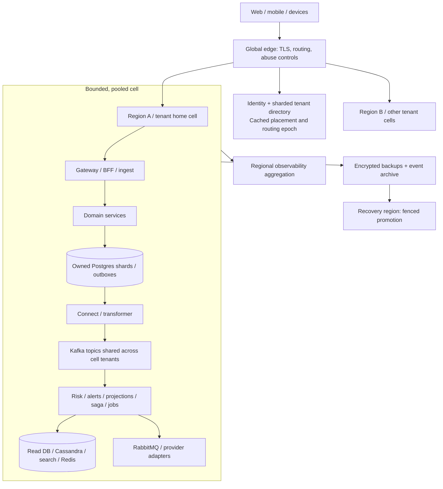

# GreenGuard platform contracts and operations

**Status: proposed target design; no application, capacity, provider integration or production readiness is demonstrated by this document.** It extends [the blueprint](REBUILD_BLUEPRINT.md), [the first vertical slice](FIRST_VERTICAL_SLICE.md), [the coverage matrix](COVERAGE_MATRIX.md), and [the staged backlog](IMPLEMENTATION_BACKLOG.md). Source implementation, scaffolds, historical dependencies and document-only capabilities remain distinguished in those records.

The requested scale has three independent dimensions: **10 million registered accounts, 10 million organizations/tenants, and 10 million simultaneously active users**. These are goals, not inferred request rates or proof of a feasible deployment. [Scale and production readiness](SCALE_AND_PRODUCTION_READINESS.md) owns workload assumptions, sizing scenarios, cell counts, costs and qualification evidence. Every numerical operating target below is proposed unless explicitly identified as the user's target.

## 1. Ownership and consistency boundaries

A service owns its domain writes, migration history, credentials and outbox/inbox. Other services consume contracts or call its authorized API. A shared physical database in local development does not grant cross-service write permission. Production cells contain pooled tenant data partitioned by tenant and measured shard capacity; **no database, Kafka topic, identity realm, Kubernetes namespace or deployment per tenant** is assumed.

| Owner | Authoritative state / storage ownership | Read or external dependencies |
|---|---|---|
| `device-service`, initial tenancy module | Stage 02 tenant profile/membership/roles plus sites, bins, grain lots, devices, binding versions, receipts/audit/outbox; `greenguard_inventory` per cell; tenancy authority extracted at Stage 09 | Identity subject IDs and signed control-plane placement; no passwords |
| Tenant control plane, Stage 09 | Authoritative tenant profile/membership/role partitions, placement directory and lifecycle workflows; separately owned sharded control-plane storage | Cell-local membership/profile projections; provider identity linkage; single fenced placement writer per directory partition |
| `telemetry-ingest` | Accepted observations, source-message receipts, per-device stream versions, local binding projection, audit/outbox; `greenguard_telemetry` | Inventory events; device credential verifier |
| `asset-registry` | Provisioning reservation, external binding, configuration generation and command receipts; `greenguard_assets` | Inventory contracts; equipment/provider adapters |
| `risk-engine` | Scoring configuration versions, input window/checkpoint, result revisions, model references and outbox; `greenguard_risk` | Telemetry and inventory events; immutable model artifacts |
| `workflow-alerts` | Rule versions, incident episodes, alert state, acknowledgement, escalation deadlines, audit/outbox; `greenguard_alerts` | Risk and inventory events; notification outcomes |
| `saga-orchestrator` | Saga state/version, step attempts, deadlines, compensation state and command outbox; `greenguard_sagas` | Participant result events; no participant table writes |
| `billing-service` | Stage 09 sharded billing control owns subscription/entitlement/provider state; cell metering modules own unique usage ledgers; separate logical partitions/credentials under the billing boundary | Stripe; unique accepted-usage events; versioned entitlement distribution to cells |
| `jobs-worker`, dispatcher module | Task/delivery intent, durable relay state, export jobs, retry metadata and inbox; `greenguard_jobs` | Kafka, RabbitMQ, notification/integration command APIs |
| `notification-service` | Preferences, verified destinations, templates, delivery attempts/provider receipts; `greenguard_notifications` | Provider adapters and secrets; no alert state ownership |
| `integration-gateway` | Import/export runs, external ID mappings, adapter checkpoints, receipts/outbox; `greenguard_integrations` | S3 and external systems; owner APIs for imported domain changes |
| `projection-builder` | Rebuildable device/site/lot/risk/alert views, source receipts, watermarks and projection notifications; `greenguard_read` | Canonical events; BFF has restricted read access |
| `cassandra-writer`, `search-indexer` | Rebuildable history/index representations, delivery checkpoints and versioned rebuild metadata | Kafka; Cassandra; selected Elasticsearch/OpenSearch profile |
| `gateway`, `bff`, dashboard, mobile | No authoritative domain tables; bounded session/cache state only | Owner APIs and scoped read models; no bypass through shared ORM |
| `cdc-transformer`, `dlq-reprocessor` | Transport/checkpoint or authorized replay state, not domain truth | Scoped outboxes, registry, Kafka; replay preserves original identity |

The global control plane owns a sharded tenant placement directory `(tenant_id, home_region, cell_id, routing_epoch, state)`, public identity linkage, cell inventory, configuration rollout and placement/migration workflows. Stage 02's first-slice tenancy module begins inside device-service behind an explicit interface. Stage 09 extracts authoritative membership/profile/placement and billing control responsibilities before fleet rollout; home cells retain authorized projections and bounded caches. Migrate ownership with one writer, versioned events and reconciliation; the gateway never becomes the database owner. Directory caches cannot independently promote a second owner.

The first slice has only inventory, telemetry and read logical databases. Later databases above arrive with their owning stage. Its `app.tenant_id` PostgreSQL setting is the new-project convention; archived `app.current_tenant_id` code must be adapted. Use transaction-local `set_config`, forced RLS, tenant-aware foreign keys, non-owner/non-BYPASSRLS runtime roles and PgBouncer transaction-pooling tests.

Inventory `binding_version` and telemetry `aggregate_version` are independent decimal-string counters. The first slice registers an inventory device as active while its ingest binding is still pending. Stage 07 introduces a versioned provisioning lifecycle (`provisioning → active`, or `failed/compensating`); it must migrate that contract and existing records explicitly, not silently redefine `device.registered`.

## 2. Cell architecture and deployment boundaries



Home-cell routing is validated server-side from authorized tenant context; clients cannot choose a cell or advance an epoch. Cache directory results with bounded lifetime and explicit invalidation. A write carries the current placement epoch; old owners reject stale epochs after a migration fence. Shared DNS/edge routing and pooled identity structures avoid ten-million-per-tenant infrastructure objects. Gateway/WS connection pools, tenant directory lookups, membership caches and identity-provider limits need independent capacity tests.

Cell-local synchronous dependencies bound blast radius. Cross-cell analytics and global billing reconciliation consume asynchronous exports/events; ordinary telemetry acceptance and alert acknowledgement do not require synchronous fan-out to all cells. Define per-tenant and per-cell quotas, reserved headroom, admission shedding and noisy-neighbor isolation. Dedicated placement for exceptional tenants is a capacity decision, not the default tenant provisioning path.

Use one Kubernetes namespace per environment/cell/service group, scoped service accounts, workload identity, default-deny network policy and explicit egress allowlists. Only the public gateway, device ingress and signed provider-webhook endpoints are exposed through ingress. Kafka, Connect, Registry, databases, RabbitMQ, Redis, exporters and administration UIs remain private. Restrict operator access through audited short-lived credentials.

| Network path | Authentication and permitted traffic |
|---|---|
| Client → edge | HTTPS/WSS; OIDC bearer/session policy for humans; scoped device credential or client certificate for devices |
| Edge → owner/BFF | TLS; verified end-user context bound to audience, tenant and expiry; reject caller-supplied internal identity headers |
| Service → service | Workload mTLS identity plus operation authorization; device/config gRPC additionally authorizes tenant/resource; encryption alone is not permission |
| Producer/consumer → broker | TLS and workload-scoped broker credentials/ACLs; only intended topics/groups; tenant boundaries enforced in application contracts |
| Service → database | TLS and owner-specific least-privilege role; transaction tenant context; migration role separate from runtime role |
| Service → provider | Bounded HTTPS egress, provider-specific credentials; signatures on incoming webhooks; no arbitrary user-supplied internal URL fetch |

Select **one** production mesh profile after qualification: Istio or Linkerd. Their comparison labs stay isolated. Pin CA/trust-domain policy, certificate lifetimes, rotation overlap and service identity authorization; verify peer hostname/identity and test expired/revoked certificates. Local development can use generated development CA material in ignored files, never production keys.

AWS Secrets Manager with External Secrets is the proposed deployment path; workload identity/IRSA avoids static cloud keys. Separate secret scopes by environment, cell, owner and provider. Git and logs hold names/references only. Rotation tests cover DB reconnects, broker clients, webhook verification overlap and device credential revocation. Terraform owns shared platform/network/state; CDK owns a distinctly named serverless stack; ownership tags and CI forbid both tools managing the same resource.

## 3. Canonical event and command catalog

Retain the first slice's UTF-8 JSON envelope, exact decimal-string versions, tenant-plus-aggregate key, immutable event ID, registry subject `<topic>-value`, explicit schema headers and validator checks. This is the documented application JSON convention, not Confluent binary framing. Strict v1 schemas reject unrecognized fields; evolution requires actual old/new fixture checks, consumer-first rollout and a new contract/topic where necessary.

Every row below is **proposed**, except the telemetry schema and fixture already exist as design artifacts. Each listed family contains a finite reviewed event set. Topics are per cell and contract family, never per tenant; their identical logical names may exist in different cell clusters. Partition count, retention and cross-region replication follow measured workloads.

| Canonical topic | Owner / event types | Aggregate/key; principal consumers |
|---|---|---|
| `greenguard.inventory.tenant.v1` | Tenancy module, extracted to control plane at Stage 09: `tenant.created`, `tenant.updated`, `membership.changed`, `tenant.suspended` | Tenant; authorization/entitlement projections, audit export; restrict membership payload access; retain contract through owner migration |
| `greenguard.inventory.facility.v1` | Inventory: `site.changed`, `bin.changed`, `lot.changed`, `lot.retired` | Site/bin/lot; projections, risk, integrations |
| `greenguard.inventory.device.v1` | Inventory: `device.registered`, `device.binding_changed`, `device.disabled`; versioned activation addition later | Device/binding version; ingest binding, projections, saga, search |
| `greenguard.telemetry.recorded.v1` | Ingest: `telemetry.recorded` | Device telemetry stream; read projection, risk, Cassandra, selected indexing/usage consumers |
| `greenguard.risk.assessment.v1` | Risk: `risk.assessed`, `risk.assessment_invalidated` | Assessment stream for tenant/bin or device; alerts, projections, search |
| `greenguard.alerts.lifecycle.v1` | Alerts: `alert.opened`, `alert.updated`, `alert.acknowledged`, `alert.escalated`, `alert.resolved` | Alert; projections, dispatcher, search, AWS mirror |
| `greenguard.assets.provisioning.v1` | Asset registry: `asset.reserved`, `asset.configured`, `asset.released`, `asset.command_failed` | Provisioning reservation/configuration; saga, inventory integration |
| `greenguard.sagas.lifecycle.v1` | Orchestrator: `provisioning.started`, `provisioning.completed`, `provisioning.compensated`, `provisioning.intervention_required` | Saga; operator views, audit, integration consumers |
| `greenguard.billing.lifecycle.v1` | Billing: `subscription.changed`, `entitlements.changed`, `usage.accepted`, `billing.reconciliation_required` | Subscription or metering batch; gateway entitlement projection, views, audit |
| `greenguard.jobs.lifecycle.v1` | Jobs: `job.requested`, `job.completed`, `job.failed`, `export.ready` | Job; notification delivery, views, integration clients |
| `greenguard.notifications.delivery.v1` | Notifications: `delivery.requested`, `delivery.provider_accepted`, `delivery.confirmed`, `delivery.failed` | Delivery; alert escalation, audit, preferences UI |
| `greenguard.integrations.lifecycle.v1` | Integration: `import.started`, `import.completed`, `import.failed`, `external_binding.changed` | Import run or external binding; views and operators |
| `greenguard.platform.config.v1` | Configuration control plane: `flag.configuration_changed`, `cell.placement_changed` | Config/placement record; authorized local cache refreshers; restricted ACL |
| `greenguard.commands.results.v1` | Participant owners: `command.completed`, `command.rejected` | Command result keyed by tenant/command ID; requester/saga; owner/topic ACL and origin allowlist enforced |
| `greenguard.quarantine.v1` | Transport: invalid event bytes and source coordinates/error/attempt/schema metadata | Source coordinate; operator tooling only; tenant present only if verified |

Each event schema defines payload, owner, key, authorization classification, causal IDs, deterministic replay behavior and retention before its producer is implemented. Search and read models do not originate alternative inventory/alert truth. Audit rows are written locally with mutations; a separately authorized audit exporter assembles them without publishing credentials or unrestricted personal data on general topics.

Raw CDC topics retain `greenguard.raw.inventory.outbox` and `greenguard.raw.telemetry.outbox`; add `greenguard.raw.<owner>.outbox` only for an introduced database owner. One scoped connector/slot per owned database in the first profile; shard expansion supplies explicit mappings. Capture outbox insert records, not every internal table by default. Transformer routes against an allowlist and preserves identity/version/trace. Initial single raw partitions are a learning profile, not the final scale topology.

Commands are requests to one owner, while events report committed facts. Introduce `command_id`, `command_type`, `tenant_id`, `target_id`, `expected_version`, `deadline`, `idempotency_key`, correlation/causation/trace and validated payload in a separately versioned command envelope. Do not call the command a successfully completed event.

| Command topic / target owner | Commands | Durable completion evidence |
|---|---|---|
| `greenguard.commands.inventory.v1` | `ActivateDevice`, `DisableDevice`, `ApplyBinding`, `RetireLot` | Inventory event with originating command ID; rejection recorded in receipt/result event |
| `greenguard.commands.assets.v1` | `ReserveAsset`, `ConfigureAsset`, `ReleaseAsset`, `RevertConfiguration` | Asset result event and idempotent receipt |
| `greenguard.commands.alerts.v1` | `EvaluateEscalation`, `ResolveAlert` | Alert transition or recorded no-op for obsolete expected version |
| `greenguard.commands.jobs.v1` | `RequestNotification`, `GenerateExport`, `DeliverWebhook` | Durable task intent then job/delivery result |
| `greenguard.commands.billing.v1` | `RecordUsageBatch`, `ReconcileSubscription` | Unique ledger acceptance or reconciliation result |
| `greenguard.commands.integrations.v1` | `StartImport`, `CancelImport`, `ValidateUpload` | Import/job state and result |

Persist command dispatch in a dedicated `command_outbox` with unique command ID and `(saga_id, step, attempt)` or owner command-stream sequence. This preserves the first slice's **one domain event per aggregate version** outbox uniqueness. Commands and events may share a physical broker, not an ambiguous schema. Add command-outbox CDC mappings explicitly; participants atomically commit command receipt, effect and result outbox. A retry of the same logical command preserves its command ID; a deliberate new business attempt gets a new ID and linkage.

Completed/rejected command results use their own `command_result` aggregate keyed by command ID and version `1`, with owning service, status/reason and resulting domain event/version references. They never consume a second event at the domain aggregate's existing version. Re-delivery returns the original terminal result; timeout alone is not a terminal rejection if a participant may still commit. Repeated transport attempts are attempt metadata, not new business command IDs.

The dispatcher is a module of `jobs-worker`, not an unowned extra service. It consumes authorized intents into its inbox/task ledger, then a durable relay publishes to RabbitMQ with publisher confirms before marking publication. A crash after confirm may duplicate a message; task identity makes that safe. Use durable queues, bounded backoff/dead-letter routing, explicit acknowledgements and a tested quorum profile. Provider tasks run outside SQL transactions.

## 4. Public API boundaries and authorization

| Public route / transport | Owning boundary and behavior |
|---|---|
| `/v1/tenants`, `/v1/memberships`, `/v1/sites`, `/v1/bins`, `/v1/lots`, `/v1/devices` | Gateway → device-service tenancy/inventory APIs; versioned DTOs and explicit command receipts |
| `/v1/telemetry/readings`; gRPC `TelemetryService.RecordReading` | Same ingest domain handler and atomic write path; accepted receipt is not projected visibility |
| `/v1/provisioning`, `/v1/provisioning/{id}` | Gateway → saga start/status API; asynchronous accepted operation and progress |
| `/v1/risk-configurations` | Gateway → risk owner; authorized versioned configuration; measured agronomic calibration required |
| `/v1/alerts/{id}/acknowledgements`, `/v1/alerts/{id}/resolution` | Gateway → alert owner; expected version, scoped actor, durable receipt/audit/event |
| `/v1/billing/checkout`, `/v1/billing/portal`, `/v1/usage`, `/v1/entitlements` | Gateway → billing owner; server-authorized tenant/customer relation and return URLs |
| `/v1/notification-preferences`, `/v1/destinations` | Gateway → notification owner; destination verification and scoped preferences |
| `/v1/imports`, `/v1/exports`, `/v1/uploads` | Gateway → integrations/jobs; authorized object keys, bounded signed URL lifetime, content validation |
| `/graphql`, `/graphql` over WSS | Gateway → BFF; tenant-scoped views/DataLoader/search and invalidation subscriptions |
| `/webhooks/stripe`, `/webhooks/notifications/{provider}` | Narrow provider routes; raw-body signature verification and durable deduplicated webhook inbox |
| `/internal/health/live`, `/internal/health/ready`, `/metrics` | Internal only; readiness reflects required dependency/contract state, not always-200 stubs |

Command endpoints require an idempotency key and normalized-body comparison where retries may cause effects; version-sensitive mutations require an expected version/ETag. Reject conflicting key reuse with `409`, malformed input with `400/422`, unauthenticated with `401`, denied scope with the consistently chosen `403/404`, and admission shedding with `429/503` plus retry guidance. `201` denotes completed creation; `202` returns an operation/receipt ID after durable acceptance. Never report success before commit.

BFF queries remain read-only initially. Future GraphQL mutations may forward explicitly to the owning command API and expose its receipt; they cannot write domain tables. HTTP and WebSocket use the same OIDC issuer/audience/algorithm/expiry and membership normalization. Tokens are revalidated on expiry and membership revocation refresh. Subscription tenant/resource scope is server-derived; reconnect refetches state/cursors because Redis invalidations are ephemeral.

| Principal / tenant-scoped role | Read | Domain writes | Administration / billing |
|---|---|---|---|
| `viewer` | Permitted sites, readings, risk and alerts | None | Own profile/preferences only |
| `operator` | Assigned sites and devices | Register/configure assigned devices; acknowledge alerts; permitted lot operations | No membership, pricing or scoring-policy change |
| `agronomist` | Assigned farm/lot observations and risk history | Versioned risk/rule proposals and approved configuration; alert resolution | No tenant membership/payment permissions |
| `tenant_admin` | Tenant domain data | Inventory/rule administration subject to policy | Teams/roles/API keys; billing only if separately granted `billing_admin` |
| `billing_admin` | Tenant plan, usage and invoices | Subscription/checkout/portal actions | No automatic access to sensor payloads or memberships |
| Device principal | Its binding/allowed configuration | Its own telemetry only | No human APIs, search or other-device access |
| Workload principal | Named operation, topic/group and tenant scope | Specific service contract permission | No inherited human administrator authority |
| Platform operator | Fleet/cell health and redacted diagnostics | Authorized recovery operations | Tenant access only through time-bounded, reasoned, audited support grant |

Roles compose; optional site/lot restrictions form ABAC checks after tenant membership. Deny wins for suspension/revocation. Membership changes increment an authorization version and invalidate scoped caches; establish a measured maximum revocation delay before production. High-impact administration can require recent authentication. Hash API keys with a keyed lookup/verifier design and constant-time verification; expose a prefix/last-used metadata, never the stored verifier. Historical bcrypt password patterns stay in an explicit identity lab if Auth0 owns production passwords.

GreenGuard's tenant membership is first-party state, distinct from Auth0 Organizations. The provider-limit review in the [scale plan](SCALE_AND_PRODUCTION_READINESS.md) records a documented limit of 100,000 Organizations per Auth0 tenant; a single Auth0 tenant is not the proposed mapping for ten million business tenants. Require a provider-approved identity/SSO topology, organization mapping, MAU/login/refresh/Management API quotas and commercial agreement before production selection. Verify JWT signatures through bounded JWKS caches rather than an identity-provider request on every API call. The historical Keycloak comparison remains an isolated adapter profile, not an assumed shortcut around capacity proof.

## 5. End-to-end flow examples

**Risk → alert → delivery.** (1) Ingest commits observation, receipt, audit and outbox. (2) CDC publishes `telemetry.recorded`; risk deduplicates input and computes against a versioned window/config/model. (3) Risk commits result and outbox; result includes source window, model/config version, input quality and evaluation timestamp. (4) Alerts atomically open/update a deduplicated rule/subject/episode and publish its transition. (5) Jobs persists delivery intent before Rabbit dispatch. (6) Notifications records provider attempt/result; alert escalation consumes confirmed outcomes or reaches a durable deadline. Late data creates a reviewed assessment revision and cannot silently overwrite a newer authoritative result.

Temperature/humidity v1 is the initial observation contract. Moisture, equipment state, additional units and new aggregates require reviewed schema evolution. Isolation Forest and clinical NEWS2/qSOFA remain separately labeled experiments; no unvalidated score becomes an agricultural safety guarantee. Grain thresholds and calibration acceptance need domain evidence.

```mermaid
sequenceDiagram
  participant U as User / gateway
  participant S as Durable saga
  participant A as Asset registry
  participant I as Inventory
  participant T as Telemetry binding
  U->>S: Start provisioning (idempotency key)
  S->>S: Save saga + ReserveAsset command
  S-->>A: Durable command / repeated safely
  A->>A: Reservation + receipt + result outbox
  A-->>S: asset.reserved
  S-->>A: ConfigureAsset
  A-->>S: asset.configured
  S-->>I: ActivateDevice (expected binding version)
  I-->>T: Committed activation/binding event
  I-->>S: Command completion event
  S->>S: Complete; readiness may still be pending
  Note over S,A: On timeout/failure persist compensation commands; never pretend cross-service rollback
```

Reservations use explicit expiration, ownership token and fencing where external configuration requires it. TCC exercises distinguish try/reserve, confirm and cancel; late confirms after cancel are rejected or reconciled. Saga completion tracks business provisioning; ingestion readiness separately tracks binding application. The UI shows both. Serializability/OCC prevents conflicting device assignments; Redis or etcd leadership cannot substitute for an authoritative database invariant.

**Billing.** Count unique billable facts from accepted reading/job events into a tenant-period ledger with source-event identity. Do not increment usage per Kafka delivery. Aggregate meter submissions and persist provider idempotency keys before calls. Checkout selects server-known price/customer mappings; signed webhooks enter an inbox before subscription state changes. Reconcile out-of-order notifications against provider state; publish versioned entitlements, then refresh cell caches. Define grace/suspension policy explicitly: billing disruption must not silently discard already-accepted telemetry or erase audit.

**Acknowledgement and escalation.** An operator acknowledges through the alert command API with expected version and request identity. Alert owner commits actor/time/state/audit/outbox together; dashboard is eventually updated. Durable scheduled commands check current alert version, acknowledgement and due time before escalation. DynamoDB/Lambda/EventBridge profiles mirror this contract and conditional-write behavior, not a second competing alert owner.

Provider acceptance, confirmed delivery and user acknowledgement are different states. After an ambiguous provider timeout, reconcile or retry with supported idempotency; do not switch providers blindly and promise one SMS/email. Exports/webhooks use the same receipt/attempt ledger pattern, tenant-bound signed URLs and explicit delivery policy.

## 6. Profiles and proposed local ports

These are reserved design values, **not a runnable Compose file**. Bind optional published ports to `127.0.0.1`; internal containers address service DNS and container ports. Production uses private service discovery/ingress on TLS 443, not these host mappings. Version/image pins are selected and vulnerability-checked during implementation.

| Profile / component | Proposed local host port(s) | Dependency / purpose |
|---|---|---|
| Core UI/gateway/BFF | `5173`, `8080`, `4000` | BFF is internal except explicit local debugging |
| Inventory / alerts / billing | `3100`, `3101`, `3102` | Scoped owner APIs; core then Stages 06/09 |
| Ingest / asset registry | HTTP `8082` / `8084`; gRPC `9095` / `9096` | Common ingest handler; provisioning Stage 07 |
| Risk / integration gateway | `8001`, `8002` | Scoring then integration labs |
| Saga / jobs / notifications | `8085`, `4001`, `4002` | Status/health APIs, no public direct access |
| Postgres / PgBouncer / Redis | Optional `15432`, `16432`, `16379` | Container `5432`, `6432`, `6379`; bounded pools per cell |
| Kafka / Connect / Registry | `19092`, `18083`, `18081` | Broker advertised listeners tested for host/container clients |
| RabbitMQ | `15672` management; optional `15673` protocol | Container protocol `5672`; workflows profile |
| Cassandra | `19042` | Container `9042`; timeseries profile |
| Elasticsearch + Kibana | `19200`, `15601` | Search-elastic profile |
| OpenSearch + dashboard | `29200`, `25601` | Alternative search-opensearch profile; adapter equivalence |
| MySQL / Memcached / etcd | `13306`, `11211`, `12379` | Separate integration/cache/coordination labs |
| OTel / Prometheus / Grafana / Loki / Tempo | `14317/14318`, `19090`, `3000`, `13100`, `13200` | Internal scrape/export routes; observation profile |
| Citus / Redis cluster / mesh / profiling | Assigned by profile manifest | Isolated capacity or Kubernetes labs; avoid implicit simultaneous enablement |
| AWS / notifications / clinical reference | No required core host port | Sandbox providers or stubs, signed fixtures, synthetic clinical data only |

One profile selection file records active search/cache/mesh/provider variants and compatibility. Core+events reaches the first slice; workflows/timeseries/search expand it. Named labs exercise every cataloged technology without forcing all variants into the latency-critical path. A port-conflict/profile validation check becomes part of `make verify` once manifests exist.

## 7. SLOs, performance and operational signals

The user's API performance targets are **p95 < 500 ms, p99 < 1 s and errors < 1%**. Evaluate each critical operation and overall mixed workload at declared offered load, concurrency, payload, dataset, tenant skew, geography and cache state. The normative boundary in the scale plan is regional edge arrival through response at nominated probes; report client-observed geography/network latency separately. Do not average percentiles or omit timed-out requests. The workload is specified in the scale plan, not derived merely from ten million accounts.

| Signal / proposed acceptance | Measurement and action |
|---|---|
| API latency/error targets above | Baseline cold/warm reads, durable ingest acceptance, alert acknowledgement and commands separately; unexpected 5xx/protocol failures/timeouts are errors; report 4xx/429 and shed load separately, never hide overload in exclusions |
| Availability objective: proposed `99.95%` over 30 days for core accepted workload | Distinct from the `<1%` release-load error bound; classify dependency/maintenance impact explicitly; burn-rate alerts and release freeze policy |
| Async freshness: candidate p95 < 2 s, p99 < 5 s under qualified normal load | Accepted reading→queryable projection/alert decision, measured cumulatively and by stage; proposed values require baseline approval; UI exposes stale/pending/gap status; no medical response promise |
| Durable correctness | Zero unexplained loss among acknowledged receipts during fault/restore tests; reconcile accepted IDs against owner rows, outbox, projections and billing |
| AZ failure | No lost acknowledged writes inside the verified synchronous store/broker failure domain; measure component recovery and reconcile all identities under load; do not extend this guarantee to async regional replication |
| Backlog/recovery | Track oldest outbox age, WAL/slot growth, consumer lag, retry/DLQ age and drain rate; shed admission before disk exhaustion; never drop committed work silently |
| Tenant/cell fairness | Per-cell saturation and sampled/aggregated tenant quotas; cap cardinality rather than use every tenant/device as a Prometheus label |
| Provider delivery | Queue age, attempts, provider acceptance, confirmation and ambiguous outcomes separately; page on sustained actionable failure |
| Control plane / identity / WS | Directory lookup/cache/epoch errors, revocation lag, login/refresh rates, connection counts/reconnect storms and fan-out bytes |

OpenTelemetry propagates original and processing trace context across HTTP/gRPC/Kafka/Rabbit; retries retain business causation but have distinct attempt spans. Logs are structured and redact tokens, destination data and unnecessary payloads. Prometheus/Grafana own service metrics; Loki logs and Tempo traces connect to runbooks; Sentry and profiling require sampling/data controls. Collector/backends have quotas so an incident does not exhaust the cell through telemetry volume.

Alert on symptoms and impending saturation with an owner/runbook: database pool/replication/WAL, connector stall, partition skew, inbox conflicts, schema quarantine, RLS failures, provider backlog and backup age. Alert routing integrations are tested with a sink before enabling real destinations. Infrastructure health alone never certifies the user flow.

## 8. Backup, restore, failover and retention

Proposed **regional-disaster** objectives are **RPO ≤ 5 minutes and RTO ≤ 30 minutes**, subject to workload, replication mode, provider limits and verified restore exercises. They are design goals, not present guarantees. Ordinary in-cell/AZ failures must preserve acknowledged writes within the certified synchronous failure domain; the regional RPO is not permission to lose acknowledged local commits. A zero-loss regional promise would require a separately costed cross-region commit design; asynchronous replication cannot establish it. Local RF1 development has no HA claim.

1. Back up authoritative Postgres with encrypted full backups and continuous WAL/PITR; record schema version, cell/routing epoch and recovery metadata. Test independently of the original cluster/credentials.
2. Maintain immutable contract/model/config artifacts and an event archive or reproducible authoritative export sufficient for the declared rebuild horizon. Coordinate outbox, inbox, receipt and Kafka retention; Kafka retention alone is not a permanent backup.
3. Protect S3 with versioning/lifecycle and access controls; enable/test DynamoDB PITR where used. Cassandra snapshots/repair policy and search rebuild checkpoints are explicit. Redis and disposable caches can be rebuilt; do not store sole authoritative state there.
4. Restore an isolated cell, keep external delivery disabled, restore owner DBs/roles/policies and verify integrity/tenant isolation. Establish connector slots/offsets against the restored database state; blindly reusing old offsets can skip events or reference absent WAL.
5. Reconcile outbox/event archive and replay into new projection/search versions with existing event IDs. Keep dedup history for the replay horizon; rebuilding authoritative billing/notification effects needs separate reconciliation, not indiscriminate external resend.
6. Fence the former writer and advance placement epoch before traffic promotion. Verify broker lineage, identity/secrets, control-plane placement and provider webhook routing. Resume staged traffic and compare receipts/lag before unrestricted admission.
7. Measure actual lost-data interval, restore duration, backlog catch-up and failback behavior. Save evidence and unmet objectives; a backup job succeeding is not a restore test.

Multi-region MirrorMaker2, database replicas and Redis replication are separate technology profiles until failover semantics are proven. Replicated offsets/topics do not create global ordering or shared transactions. Tenant migration pauses/fences writes at an explicit boundary, copies/reconciles state, advances epoch, drains old traffic and validates counts before retiring the old placement. Prevent split brain during network partition and operator error.

Retention is a product/operating policy per telemetry, audit, receipt, export, destination and backup class. Define restore/deletion conflicts and maximum replay age. No healthcare retention period is inherited from CarePulse. Tombstone/retirement events must remove data from search/cache/read models within a stated measured interval.

## 9. Flags, development and release workflow

OpenFeature is the application evaluation port; DynamoDB-backed configuration and a local static provider are target adapters. Evaluate using authorized tenant/cohort context with typed defaults and last-known-good cache. Record configuration version in decisions that affect scoring, billing or behavior. Flag outages cannot bypass authorization, outbox durability or receipt checks. Emergency flags can stop new optional processing/provider sends while preserving queued accepted work.

Use stable tenant cohorts for canaries; globally deploying a flag change does not mean synchronously querying one global store on every request. Regional/cell configuration refresh has a measured propagation bound. Destructive schema transitions are deployment migrations, not a reversible boolean. Remove expired flags through reviewed cleanup with evidence.

1. Implement in [backlog](IMPLEMENTATION_BACKLOG.md) order with a pinned toolchain, lockfiles, documented environment contract and synthetic seed fixtures. `make bootstrap`, `make dev`, full application `make verify`, and `make reset-local` are proposed interfaces; the existing planning-check target only validates scaffold bookkeeping.
2. Generate event/API clients from reviewed schemas, run formatting/static checks, real-store contract/integration tests, adversarial two-tenant cases and focused failure tests. No ignored exit codes, empty security reports or skipped required checks passing a release gate.
3. Pull request evidence links changed contracts, migration compatibility, relevant coverage IDs and reproducible transcripts. Build immutable images with SBOM/provenance, vulnerability policy and signature verification; do not deploy mutable tags by convention alone.
4. Apply expand-first database/contract changes; deploy compatible consumers, then producers, then backfill/verify before removing old shape. Migration jobs use bounded locks and separate credentials. Rollback application images only while old contract/schema support remains; irreversible migration recovery is forward repair or tested restore.
5. Terraform plans and CDK diffs are reviewed against resource ownership/cost; ArgoCD reconciles approved desired state. Argo Rollouts uses real per-cell latency/error/lag analysis, minimum sample size and automatic pause/rollback conditions.
6. Promote one internal tenant cohort/cell, then bounded cohorts/regions with observation windows. Release capacity headroom and failure budgets are explicit. No simultaneous fleet-wide data migration, broker upgrade and application rollout.
7. Record commit, image digests, schema/contract IDs, migration version, flags, cell placement and qualification results under stage/release evidence. Maintain searchable ADRs, Docusaurus/Mintlify documentation profiles, operator runbooks and developer troubleshooting.

## 10. Production qualification gates

| Gate | Required proof before the capability is called production ready |
|---|---|
| Ownership/contracts | Every owner/topic/command/API above has schema, authorization, compatibility fixtures, active consumer wiring and a traced end-to-end test |
| Correctness/security | Real SQL RLS/pooling tests, cross-tenant API/cache/search/WS attacks, duplicate/reordered delivery, ambiguous provider outcomes, credential rotation and scoped recovery tests pass |
| Capacity | Independently qualify 10m account records, 10m tenant lifecycle/directory records and 10m active users under declared behavior; demonstrate API/WS/device rates and regional/cell failure headroom, not just synthetic table cardinality |
| Reliability | Broker/database/process/AZ failures, network partitions, overload, reconnect storms, replay and fenced regional promotion meet measured error/freshness/recovery bounds |
| Operability | Actionable dashboards/alerts, tested on-call runbooks, capacity and cost limits, restore evidence, upgrade strategy, audit access and incident ownership exist |
| Supply chain/release | Required CI is fail-closed; deploy artifacts are scanned/signed/provenanced; migration, canary, rollback and multi-cell rollout are exercised |
| Full technology coverage | Every catalog/coverage entry has implementation or isolated lab evidence; historical/document-only items remain labeled until demonstrated; unsupported historical versions never become an implicit production requirement |

Open decisions are recorded rather than guessed: actual customer activity/device mix; per-cell tested capacity and count; identity-provider commercial/rate limits; grain-model calibration; retention/cost budgets; production regions and residency; selected mesh/search/cache variants; provider delivery semantics; exact revocation/freshness thresholds. Owners and evidence deadlines belong in the stage/release backlog. A complete architecture plan makes those decisions reviewable; it does not replace implementation, measurement or operation.
