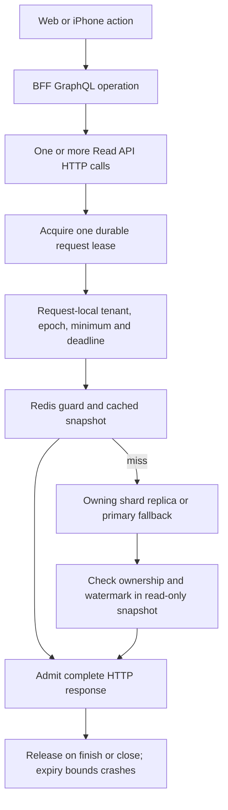

# Read admission overhead and optimization

## Decision

One lease per **Read API HTTP operation** is the current correctness baseline.
SQL queries reuse its request-local context. This avoids a lease per SQL query,
and the persisted `DeviceCurrent` operation now shares one aggregate HTTP call
and one SQL statement for device plus latest reading. Other GraphQL operations
may still fan out into several HTTP calls. The central
control-plane database still participates in every sharded read, including Redis
hits. Do not describe this as proven for the platform's long-term traffic target.

First reduce duplicate checks and upstream fanout. Then measure throughput and
tail latency before introducing reusable grants across requests. Keep membership
authorization, local write fencing and replica watermark checks independent.

## Actual path

### Request scope

- `services/read-api/src/app.ts` acquires in authenticated router middleware and
  stores the lease in `AsyncLocalStorage`. Its finish/close handler releases once.
- `services/read-api/src/shards.ts` reuses that lease for every snapshot. Its
  `ReplicaProvider.acquire` means **acquiring a database snapshot**, not creating
  another control-plane lease.
- Multiple snapshots certify the **oldest** sequence used in the response. One
  lease does not turn separate database transactions into one consistent snapshot.
- `services/read-api/src/replicas.ts` checks local ownership and the requested
  sequence in the same repeatable-read, read-only transaction. A request minimum
  cannot select an old retained ownership identity.

### BFF fanout

| Operation | Normal Read API HTTP calls / leases | Retry exposure |
| --- | --- | --- |
| `DeviceCurrent`, ordinary | 1: request-local shared current snapshot | Up to 3 safe GET attempts |
| `DeviceCurrent`, minimum supplied | 1: same aggregate with the validated minimum | Up to 3 safe GET attempts |
| N ordinary device aliases | Deduplicated batches of at most 100 IDs | Batch POST is not retried |
| N distinct minimum-sensitive device aliases | N GETs; current loader is bypassed | Up to 3N attempts |
| Other PostgreSQL root read field | Generally 1 per field | GET up to 3 attempts |
| Live subscription refresh | One latest request per coalesced refresh | No lease for the entire socket lifetime |

These are source-derived counts, not latency or throughput measurements. The
persisted GraphQL allowlist and field budget also bound what a caller can request.
Alerts, notification history and provisioning use separate clients and owner
services; the Read API projection watermark does not certify those stores.

## Current costs and bottlenecks

1. **Central admission on the read path.** A normal successful operation needs
   acquire, final admit and release: three internal HTTP calls and three central
   database transactions. Release is asynchronous after transport completion.
   Redis guard initialization and cache filling have additional admission checks.

2. **Tenant row contention.** Acquisition takes the organization's `FOR UPDATE`
   lock, removes expired leases, counts leases and inserts a lease. Issuance is
   serialized per tenant. There is a hard cap of 100 unexpired leases per tenant;
   raising it alone does not remove lock contention or central database load.

3. **Redis command fanout.** A warm guarded hit now uses four sequential
   Redis commands: recovery epoch GET, tenant metadata Lua, guarded-hit Lua,
   recovery epoch GET. This replaces seven commands. Cold guard initialization
   still requires a separate primary metadata snapshot and additional admission. The global epoch and tenant keys use different cluster slots.

4. **Deadline mismatch.** BFF GET attempts last at most two seconds (eight-second
   overall call budget); the Read API operation budget is capped at four seconds
   including authentication and admission, with five-second durable leases. The original operation deadline now propagates across retries and identity
   recovery; each attempt sends a relative budget bounded by the server cap.
   Disconnect closes admission, discards an active PostgreSQL connection and
   removes queued work. SQL termination is bounded by server statement timeout;
   cancellation is not a promise of instantaneous server-side termination.

5. **Extra leases for shared stores.** Router middleware currently also leases
   Cassandra/OpenSearch requests. Their data is not moved by PostgreSQL tenant
   migration. Search and history need separate analysis of membership and
   primary-owned entitlement checks before selectively removing this dependency.

6. **Long operations have different rules.** Audit exports pin inventory placement
   across pages and restart after a move. Writers/workers hold SQL ownership
   admission locks; provider effects also require stable idempotency and drain.
   Do not use a long-lived browser or socket lease for these operations.

7. **Metrics need the new path.** The current `/metrics/cache` exposes the v1
   cache wrapper's counters. Sharded PostgreSQL goes through the separate v2 guard,
   so those counters alone do not establish its hit ratio or admission cost.
   `/metrics/read` now exposes authority acquire/admit/release RPC count and
   duration histograms with fixed operation/outcome labels; local Prometheus is
   configured to scrape it. A live cloud scrape is not yet proven.
   Control-plane internal lock wait and full v2 latency still need load profiling.

## Safe changes already made

- Removed the extra authority admission on a Redis **hit**. Cached data is still
  internal at this point; the complete HTTP response performs its final admission.
  A warm hit therefore drops from four control-plane calls to three. Retained
  checks before cache guard initialization and cache fill protect side effects.
- Added request-scope coverage: ten backend reads reuse one lease, one response
  admission and one release. Separate PostgreSQL acceptance proves ownership and
  retained-epoch snapshot selection; Redis acceptance proves stale-fill rejection.
- Preserve Redis for ordinary legacy primary reads; requested minima bypass
  uncertified v1 cache entries. Sharded reads keep their v2 epoch/watermark guard.
- Read lease endpoints reject routing hints and set `Cache-Control: no-store`.

## Implemented optimization slice

- `GET /api/v1/read/devices/:deviceId/current` returns bounded device plus latest
  data in one SQL statement. Both explicit tenant predicates and forced RLS remain.
  The two persisted `DeviceCurrent` root fields share one request-local promise.
- Original BFF deadlines survive retries, subscription recovery and frontend
  identity recovery. The relative read budget includes Read API authentication
  and admission and cannot extend the four-second server cap. Caller cancellation
  does not count as an upstream circuit-breaker failure.
- Pool checkout, ownership and watermark admission, business SQL, primary guard
  rebuild and entitlement metadata use cancellation-aware snapshots. Metadata
  snapshots deliberately do not certify Cassandra or search application rows.
- One fair PostgreSQL queue covers both guarded cache and database paths. Queued
  work retains its original async context and is removed on disconnect.
- Per-shard endpoint pool capacity is configurable using `READ_SHARD_POOL_MAX`
  (default five, range one to 32). Four shards with one replica each can consume
  up to eight times this many connections per pod. Budget pod autoscaling against
  database connection limits; a larger pool is not automatically more efficient.
  Local pool saturation returns `read_busy` with bounded retry advice and does
  not quarantine a healthy database endpoint.
- Redis metadata/hit/fill scripts use explicitly declared same-slot keys, revision
  CAS, exact decimal identity checks and original cached JSON payloads. Concurrent
  misses use separate child contexts before merging completed snapshot proofs.
- Authenticated changed identity triggers at most one bounded fresh snapshot;
  outage or lag cannot silently discard an existing minimum. Empty results retain
  the actual snapshot certificate in the GraphQL response extensions.

## Remaining optimization decisions

### 1. Batch the user operation

The device-plus-latest operation is implemented. Extend typed aggregate operations
only to other common views supported by measurements. BFF makes one HTTP call and
receives one actual token for the implemented operation.
For related PostgreSQL queries, execute them inside one admitted database snapshot.
Bound query count, input size, response size and execution deadline. Keep normal
JWT/OIDC and membership authorization before admission.

Extend request-local loaders to group minimum-sensitive reads by tenant and
ownership identity, using the greatest requested sequence in that group. Never
merge different identities or authentication contexts. Shared Cassandra/search
proofs must not be grouped under a PostgreSQL watermark.

### 2. Align deadlines and cancel unused work

Bounded operation budgets and disconnect handling are implemented for this
read path. Extend cancellation tests for any newly added store/client path. Client disconnect prevents new work and cache fills; in-flight SQL has a
matching bounded timeout and, where supported, cancellation. Retries consume the
original budget. Test disconnect during lookup, pool acquisition, SQL, cache fill
and response admission before changing existing timeout values.

### 3. Combine tenant-slot Redis checks

Guard/revision/recovery stamp now share one Lua operation; hit and fill scripts
atomically check the corresponding tenant metadata. Keep the global recovery epoch check
separate: a cross-slot `MGET` is invalid in Redis Cluster. Preserve revision CAS,
identity checks, exact decimal BIGINT comparisons and expired-lock rejection.
The objective is fewer round trips, not weaker recovery or freshness semantics.

### 4. Profile before introducing reusable grants

Measure lease RPC count, acquire/final-admit p50/p95/p99, organization lock wait,
live lease count, release failures, cache hit latency, primary fallback, cancelled
SQL and per-shard pool usage. Avoid tenant IDs as metric labels. Test hot-tenant
load, cold-cache recovery, control-plane failure and quiesce under load.

If central admission still dominates, a bounded **per-tenant, per-pod read grant**
can amortize issuance across requests. This is a separate protocol change:

- Authenticate the holder and bind grant to tenant, shard, incarnation and epoch.
- Do not renew or issue grants after quiesce. Cutover waits for every issued grant
  to close or expire, including disconnected pods and lost acknowledgments.
- Bound local request counts and prevent admission/fill after conservative expiry.
  Use a proved monotonic deadline and clock-drift margin; wall-clock caching alone
  is not sufficient.
- Preserve response and Redis fencing when a request outlives its grant. A shared
  lease alone does **not** remove the remote final-admit call; removing that call
  requires a proved local admission capability and corresponding cutover rules.
- Test crash, partition, pod termination, missed quiesce notice, expiry races,
  restore incarnation changes and stale cache fills before enabling it.

Keep the request lease baseline until this proof and a benchmark justify that
complexity. Do not replace durable leases with a Redis lock, cached placement TTL,
or synchronous control-plane validation before every SQL statement.

## Validation boundary

Local source review and focused/scratch PostgreSQL/Redis tests support the baseline
and the duplicate-hit removal. No production throughput benchmark, full-stack
tenant move acceptance, AWS deployment or physical-iPhone acceptance is implied.
The device aggregate, budget propagation and combined Redis scripts are implemented
locally. Broader view batching, production profiling and reusable pod grants remain
follow-up work. Request-scoped leases remain the enabled correctness baseline.

## Cutover guarantee

Quiesce rejects new read leases. Existing leases may still admit their responses
while draining. The database CAS guard prevents epoch/shard cutover with any live
read lease; released or expired leases cannot admit another response. An already
admitted response can finish transport after cutover. This is not a promise that
all old SQL has stopped instantly or that a browser has received the latest data.

Full tenant movement additionally needs verified copy, writer fencing/drain,
accepted external-effect reconciliation and target/cache activation. Control-plane
lease tests use synthetic trusted copy receipts; they do not prove those stages.
The resumable mover/full migration acceptance remain pending.
