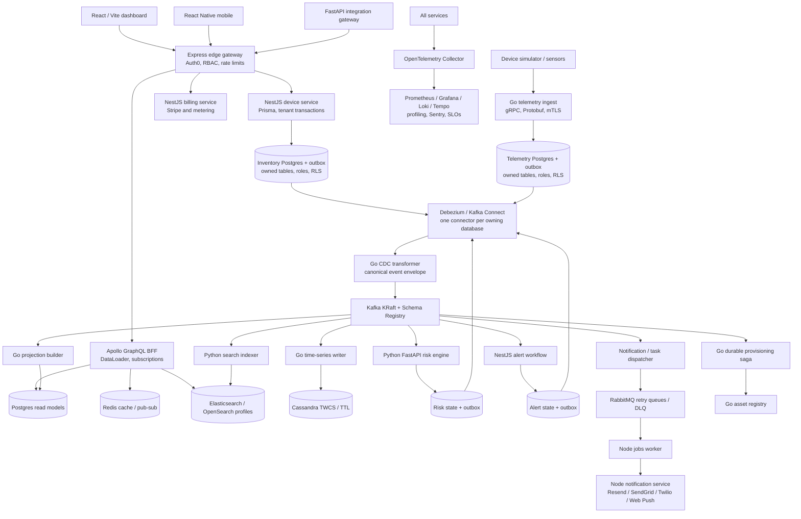

# GreenGuard: complete combined rebuild blueprint

## Objective and evidence

Build **one GreenGuard agricultural SaaS platform from scratch**, using the combined technologies and patterns of GrainGuard- and CarePulse. The learning and implementation scope includes the basics, the BFF, all service boundaries, transactional outbox, CDC, CQRS, sagas, data stores, security, reliability, operations, infrastructure, developer tools, and delivery practices.

The confirmed scale target is **10 million registered accounts, 10 million tenant organizations and 10 million concurrent active users**. See [scale and production readiness](SCALE_AND_PRODUCTION_READINESS.md) for workload assumptions, regional cells, capacity arithmetic and mandatory release gates. This is a target to demonstrate, not existing capacity. The service diagram below depicts the domain flow inside a cell; the regional/control-plane topology is defined in that scale document.

Source snapshots: GrainGuard- `c00a3810897921a4bf4d1065014776ff45dbc044`; CarePulse `3c4b79688182fe5ee29baa0d106fc2536ea0c852`. Full available refs include 376 and 103 reachable commits respectively (including additional history recovered from Actions/PR commit references). The historical manifest index covers 292 GrainGuard path/blob versions and 101 CarePulse path/blob versions. These are source observations, not an assurance that the old code is fully working.

The source audits and machine-readable catalog are part of this blueprint, not optional appendices. The catalog records individual dependencies and historical versions; the coverage matrix gives architectural families an owner, stage, and acceptance target. Blueprint-only and historical capabilities must stay explicitly labeled. New architecture described below is **proposed**, not already deployed.

## Product and domain

Tenants operate farms, sites, grain bins/silos, lots, and sensor devices. Devices emit temperature, humidity, moisture and equipment readings. The platform validates and stores observations, computes spoilage risk, raises alerts, delivers notifications, tracks acknowledgements and escalation, and supports search, analytics, teams, SSO, metering, subscriptions and audit.

Domain boundaries: identity/tenancy; assets/devices; telemetry; risk; alerts/incidents; notifications/jobs; search/read models; billing; integrations. Clinical patient records, NEWS2 and qSOFA do not become grain-scoring formulas. Preserve their validation, scoring strategy and interoperability lessons in a clearly labeled synthetic FHIR lab. Agricultural risk thresholds require separate product calibration and versioning.

## Target architecture

An arrow to CDC denotes each owning database's independently configured outbox connector, not a shared cross-service transaction. Rabbit dispatch and saga commands also need durable publication and deduplication. Redis subscription fan-out is ephemeral; clients recover state through read models and cursors after disconnects.

## Service ownership

| Component | Runtime / framework | Responsibility and boundary |
|---|---|---|
| dashboard | React, TypeScript, Vite, Tailwind | Device/site views, live risk and alerts, admin, billing, audit. TanStack Query for REST; Apollo Client for GraphQL. Storybook and virtualized lists. |
| mobile | React Native | Mobile alert and acknowledgement flow using the same public contracts. |
| gateway | Node/TypeScript, Express | Edge authentication, tenant membership, authorization, quotas, API keys, CORS/CSP/Helmet, CSRF where cookie credentials are used; routing and request correlation. |
| bff | Node/TypeScript, Express, Apollo | UI-specific GraphQL composition, DataLoader, pagination, cache-aside, tenant-bound WebSocket subscriptions; no domain writes hidden in resolvers. |
| device-service | NestJS, Prisma, Postgres | CarePulse's CRUD/transaction model adapted to farms, sites, bins, devices and ownership; one authoritative write owner per aggregate. |
| telemetry-ingest | Go, gRPC/Protobuf, grpc-gateway / HTTP | Authentication, validation, device binding, idempotency and atomic reading/outbox transaction. One durable ingest path even when transports differ. |
| asset-registry | Go, gRPC | Provisioning/configuration commands and external asset bindings. Device-service owns inventory facts; commands interact through versioned contracts. |
| cdc-transformer | Go | Convert Debezium envelopes into canonical domain events; preserve ID, tenant, aggregate version and tracing. |
| projection-builder | Go | CQRS device dashboard, site/lot summaries, risk/alert aggregates and replay; combines the projection/read-model responsibilities from both sources. |
| cassandra-writer | Go | Append time-bucketed readings with tenant partition keys, retention and query-shaped tables. |
| risk-engine | Python, FastAPI, Pydantic, NumPy / scikit-learn | Versioned agricultural risk scoring; input validation, feature extraction, deduplication, reproducible results, atomic scoring state/outbox. |
| workflow-alerts | NestJS, Prisma | Alert rules, acknowledgement routes, deduplication, escalation and lifecycle state; transactional event publication. |
| saga-orchestrator | Go | Durable device provisioning state machine, deadlines, retries, idempotent commands and compensations. |
| billing-service | NestJS, Prisma, Stripe | Metering ledger, plans/entitlements, Checkout, webhook inbox, Customer Portal. |
| jobs-worker | Node, Express health API, amqplib | Email/webhook/export tasks, explicit ack, bounded retry, idempotency, poison-message isolation and DLQ tooling. |
| notification-service | Node, Express | Provider adapters and templates, delivery ledger, preferences and escalation destinations. |
| search-indexer | Python asyncio | Bulk indexing with per-document failures, tenant-safe mapping and rebuild into versioned index aliases. |
| integration-gateway | Python, FastAPI, SQLAlchemy Core / Alembic where appropriate | Agricultural imports/exports and external schema adapters; MySQL CDC comparison and synthetic FHIR preserved in explicit lab profiles. |
| dlq-reprocessor | Go | Audited selective replay with original identity, replay metadata, dry run, bounds and authorization. |

Shared packages: event types/generated clients; tenant/auth context; OTel bootstrap for Go/Node/Python; structured logging; audit logger; idempotency/inbox helpers; test fixtures. Avoid a shared ORM model that lets services bypass ownership.

At fleet scale, add the tenant control-plane and cell-router modules described in the scale plan. The first-slice tenant module can begin inside device-service with an explicit interface; Stage09 extracts authoritative membership/placement/billing control responsibilities before fleet rollout. Placement has a single fenced writer per directory partition; an eventually replicated cache cannot independently promote a second owner.

## Core data and event rules

1. **Transactional outbox:** persist the domain change and outbox row in the same local database transaction. Publish only after commit through CDC. A crash must result in retry or duplicate delivery, never a silently missing event.
2. **Inbox / idempotent consumer:** transactionally apply a projection or state transition with its `(consumer, tenant_id, event_id)` receipt, then acknowledge the broker. Duplicate receipt handling cannot commit half a business operation.
3. **Canonical envelope:** `event_id`, `event_type`, `schema_version`, `occurred_at`, `tenant_id`, `aggregate_type`, `aggregate_id`, `aggregate_version`, `correlation_id`, `causation_id`, `traceparent`, `payload`. Version contracts explicitly and test backward compatibility.
4. **Ordering:** Kafka key includes tenant and aggregate; no promise of global ordering. Detect obsolete/out-of-order aggregate versions. Define late telemetry and event-time windows.
5. **Delivery guarantee:** at-least-once transport with idempotent effects. Do not claim end-to-end exactly-once across databases, Kafka, RabbitMQ and notification providers.
6. **Outbox recovery:** CDC is the normal relay. If a fallback polling relay is retained from CarePulse, it must share event IDs, use safe leasing/fencing, and tolerate racing CDC. Retention must respect broker/connector recovery checkpoints.
7. **CQRS:** command state is authoritative. Read stores are rebuildable, tenant-scoped and eventually consistent with visible freshness/lag. Replays write versioned projections and switch after validation.
8. **Saga:** save state plus outbound command in the same transaction. Compensations are business actions, not database rollback across services. Test repeated, late and reordered success/failure messages.
9. **Tenant isolation:** derive tenant from authenticated membership/device credentials, never trust an arbitrary request tenant. Postgres non-owner roles, forced RLS where needed, transaction-local tenant settings, PgBouncer tests, and tenant keys in every cache/search/Cassandra/DynamoDB operation.
10. **Concurrency:** aggregate versions/optimistic locking for normal writes; serializable transactions plus bounded retries for critical invariants. Redis leases require owner checks and fencing where protected effects need it; etcd leadership requires lease expiry/fencing tests. No distributed two-phase commit is planned; preserve the ADR explaining why.

## Storage and provider profiles

| Technology family | Role in the unified project | Profile |
|---|---|---|
| Postgres 16 family + PgBouncer | Authoritative relational state, outbox/inbox, audit, projections, RLS; separate owner credentials | core |
| Kafka KRaft, Connect, Debezium, Schema Registry | Domain event backbone, schema compatibility, replay and CDC | events |
| Redis single-node and cluster | Cache, quotas/rate limits, short-lived dedup helpers, pub/sub and guarded leases | core; cluster reliability |
| RabbitMQ | Work queues, explicit acknowledgement, TTL/backoff retry queues and DLQs | workflows |
| Cassandra | Long telemetry history, time buckets, TWCS/STCS comparison, TTL and LWT examples | timeseries |
| Elasticsearch + Kibana | Original GrainGuard search backend and diagnostics | search-elastic |
| OpenSearch | CarePulse search backend implementing the same tested port | search-opensearch |
| DynamoDB | Feature flags / alert mirror / escalation records, tenant keys, conditional writes and TTL | aws |
| S3, Lambda, SQS, EventBridge | Exports, validation, scheduled escalation and event integration | aws |
| MySQL 8 + Debezium binlog | External-import/legacy integration with normalized contracts | integration-lab |
| Memcached | Compare a simple read cache with Redis through one cache port | cache-lab |
| Citus | Explicit multi-tenant sharding/routing exercise with RLS and migration tests | scale-lab |
| etcd | Singleton coordination and fencing exercise beyond Redis leases | coordination-lab |
| Terraform + AWS CDK | Terraform owns shared platform; CDK owns a separately named serverless stack. Never let both manage one resource | aws |
| Istio + Linkerd | Separate service-mesh profiles to compare mTLS, traffic policy and metrics | mesh-istio; mesh-linkerd |
| Pyroscope + Parca | Separate continuous-profiling profiles, plus pprof and py-spy investigations | profiling |
| Resend / SendGrid / Twilio / Web Push | Distinct notification adapters with contract tests and sandbox delivery ledgers | notifications |
| FHIR R4 / NEWS2 / qSOFA | Preserve CarePulse-specific contracts/scoring as synthetic reference fixtures; not agricultural decision logic | clinical-reference-lab |

“Use all technologies” means every discovered capability has an explicit implementation or comparison exercise and acceptance evidence. It does not mean installing every historical package version or running redundant caches, meshes and search engines on every request. The core flow remains explainable. Full coverage includes executing each named profile later.

## Security, quality and operations

Auth0 OIDC/JWKS is consistent across HTTP and WebSockets. RBAC and optional ABAC protect commands, queries and subscriptions. API keys are hashed and scoped. Validate payloads at edges and contracts at brokers. mTLS protects selected internal RPCs; secrets enter through AWS Secrets Manager / External Secrets. Audit records exclude credentials and unnecessary payloads. Stripe/provider webhooks verify signatures and persist receipts before processing. Exports and signed URLs have tenant authorization and bounded lifetime.

Instrument with OpenTelemetry and W3C propagation across HTTP/gRPC/Kafka/RabbitMQ. Use structured Go/Node/Python logs correlated to traces. Prometheus, Grafana, Loki and Tempo provide metrics/logs/traces; exporters and synthetic probes validate user flows. Add Sentry and profiling with data minimization. SLOs need measured baselines, burn-rate alerts, error budgets, on-call ownership and tested runbooks.

CI includes language unit tests, integration tests with real stores, Pact/contract compatibility, migration-from-empty and upgrade tests, tenant adversarial tests, Testcontainers, Playwright, property/fuzz tests, k6 and chaos/Toxiproxy. CI must fail when required checks are skipped or fail. Include CodeQL, Trivy, ZAP, GitLeaks, dependency checks, SonarCloud, SBOM and Cosign signatures with verifiable provenance. Developer tooling includes formatters, linters, hooks, AI/MCP integration configs and CodeRabbit; tool configuration is not proof that an external integration is installed.

Deploy in stages: local Compose; images; Kubernetes/Helm; Terraform platform and CDK serverless stacks; ArgoCD GitOps; Argo Rollouts with real metric-based analysis; backup/restore; multi-region failover with RDS/Aurora, Redis replication and Kafka MirrorMaker2. Local-first planning does not require cloud spending to begin.

## What is already accomplished in this restart

- Source code and full available Git ref histories downloaded; commit and historical manifest evidence indexed.
- Fresh GreenGuard directory created with service ownership scaffolds, this blueprint, detailed coverage and ordered backlog.
- Historical defects and incomplete integrations recorded as acceptance requirements for the new implementation.

The new application has not been built, dependencies have not been installed, and end-to-end capability has not been claimed. [Stage 01](IMPLEMENTATION_BACKLOG.md) is the starting implementation task. Archive availability, including missing/expired console logs, is reported separately in the archive manifest.

Concrete implementation design: [first vertical slice](FIRST_VERTICAL_SLICE.md), [platform contracts and operations](PLATFORM_CONTRACTS_AND_OPERATIONS.md), and [10-million-scale production gates](SCALE_AND_PRODUCTION_READINESS.md).
