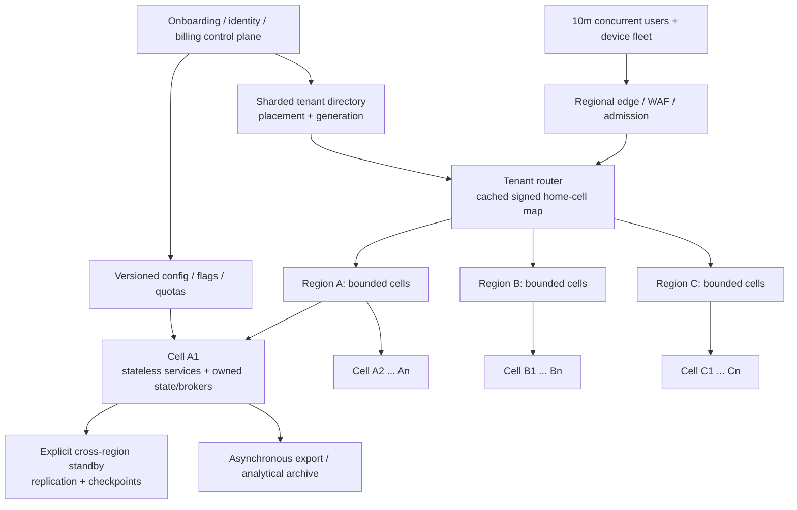

# Scale target: 10 million accounts, tenants and concurrent users

## Confirmed goal and current status

The user explicitly selected **all three**: 10,000,000 registered user accounts, 10,000,000 customer organizations/tenants, and 10,000,000 concurrently active users. These are separate dimensions to validate together. Active users can belong to multiple organizations; a tenant is an authorization/business boundary, not a Kubernetes namespace or an identity-provider installation.

**This is a proposed architecture and capacity model. It is not a verified capacity claim or a production deployment.** The original repositories contain useful implementations and substantial gaps. The fresh GreenGuard project must earn production readiness through the gates below. The workload rates, device counts, payloads and service levels in this document are explicit planning assumptions until measured or approved as product requirements.

## Capacity tiers and governing acceptance

**Tier 1 is the FIRST CERTIFIED TIER target, currently UNMEASURED:** 100,000
registered users, 10,000 concurrent active users, 1,000,000 connected devices,
20,000 normal / 50,000 peak telemetry events/s and typical encoded events ≤2 KB
(decimal 2,000 bytes). It requires API p95 <300ms, ingest-commit to canonical-topic
visibility and queryable projection p95 <1s, availability ≥99.9% over 30 days, and
zero acknowledged-event loss within its certified failure domain.

Assume 10,000 organizations in one independently operated cell across three AZs
in one region, surviving one component or AZ failure. This tenant count, placement
and failure scope need owner confirmation and Stage 13 evidence. Total regional
destruction is excluded from Tier 1's zero-loss certification. An unqualified
regional zero-loss requirement would require a new durability design.

**Tier U remains 10M accounts / 10M organizations / 10M concurrent active users.**
The workload, illustrative cell sizing and proposed SLO tables below describe Tier U;
they are retained, not overwritten by Tier 1. Tier U certification requires Stages
12–14 cell/fleet/recovery evidence through G8; a Tier 1 pass does not establish it.

The [capacity model](CAPACITY_MODEL.md) records the exact reconciliation and Stage
13 k6 certification matrix with durations, pass criteria and planned evidence names.
Tier 1 changes per-device normal reporting from 60s to 50s, burst factor from 5× to
2.5×, typical payload budget from 1 KiB to 2 KB, and p95 targets from 500ms/2s to
300ms/1s. Its 99.9% availability target does not replace Tier U's proposed 99.95%.
The legacy five-minute regional RPO is explicitly incompatible with zero regional
loss; it governs Tier U's asynchronous regional recovery only. Both tiers require
zero loss inside their tested synchronous component/AZ boundary.

Stage 13 must report offered/accepted load, dropped iterations, per-endpoint latency,
commit-to-projection timing, skew, retention, fault recovery and ACK-ID reconciliation.
Certify Tier 1 with the full joint population, 24h normal soak, three 30min peak runs,
a 2h fault campaign and a 30-day availability window. Candidate replica counts and
write amplification remain UNMEASURED; today's RF1 local stack and sequential raw
transformer do not establish the Tier 1 envelope.

## Workload model (Tier U)

| Dimension                       |                   Initial sizing assumption | Consequence                                                                                                               |
| ------------------------------- | ------------------------------------------: | ------------------------------------------------------------------------------------------------------------------------- |
| Registered accounts             |                                  10 million | Identity, recovery, consent/preferences and membership storage; not 10m requests/s by itself                              |
| Tenant organizations            |                                  10 million | Sharded tenant directory, pooled storage, billing/onboarding quotas and lifecycle automation                              |
| Concurrent active users         |                                  10 million | Session/socket state, API throughput, fan-out and reconnection capacity                                                   |
| Foreground API request interval | One request per active user every 5 seconds | 2,000,000 API requests/s before retries and telemetry                                                                     |
| Devices per organization        |                                          10 | 100,000,000 devices; assumption, not user-supplied inventory                                                              |
| Device reporting interval       |                One reading every 60 seconds | About 1,666,667 readings/events/s                                                                                         |
| Encoded event size              |                                       1 KiB | About 1.707 GB/s and 147.456 TB/day of logical event payload, before compression/replication/indexes                      |
| Kafka replica count             |                                           3 | 442.368 TB of replicated payload per day; 3.097 PB for seven days before compression/overhead                             |
| Connected sessions              |               One WebSocket per active user | 10,000,000 sockets plus reconnect/TLS/login work                                                                          |
| Delivered UI updates            |         0.1 messages/s per session at 1 KiB | 1,000,000 messages/s; 1.024 GB/s payload egress before protocol overhead                                                  |
| Device burst                    |               5× baseline, bounded duration | About 8,333,333 events/s during burst; size buffering and drain capacity explicitly                                       |
| API burst                       |               2× baseline, bounded duration | 4,000,000 API requests/s; all expensive query classes still have admission budgets                                        |
| Token refresh example           |      15-minute interval, distributed evenly | About 11,111 refreshes/s; jitter avoids synchronized spikes. This is not a proposed default until IdP limits are verified |

Units here are decimal GB/TB/PB; the payload assumption is binary KiB = 1,024 bytes. Replication arithmetic describes payload copies, not billed provisioned disk. Postgres rows, outbox copies, WAL, indexes, read stores, broker metadata and backups add amplification. Compression ratios must be measured on actual payloads. Seven days of raw broker retention is an example to price and test, not a free default.

The reproducible [capacity model](../scripts/capacity_model.py) and [assumption input](capacity_assumptions.json) reproduce the legacy Tier U arithmetic in [CAPACITY_MODEL.md](CAPACITY_MODEL.md). The document also contains curated tier/certification sections: run the unchanged generator in an isolated copy to avoid overwriting them. The new `tiers` JSON structure is additive; existing top-level keys remain valid. It reports arithmetic, not observed service throughput. Device telemetry and human traffic are independently scalable; never estimate one solely from account count.

## Regional cells and tenant routing

Use **bounded, independently operated cells**. Each holds a subset of tenants and has its own application capacity, relational shards, event backbone, work queues, cache and projections. An enterprise tenant with disproportionate load can receive a dedicated placement. Core domain calls remain inside the tenant's cell; cross-cell analytics and management are asynchronous.

This applies AWS's cell/bulkhead guidance to the GreenGuard design: bounded independent workload instances limit failure propagation, and deployments should progress across cells rather than update every cell at once. The exact cell boundary and capacity are GreenGuard design decisions to test. [AWS cell architecture guidance](https://docs.aws.amazon.com/wellarchitected/2025-02-25/framework/rel_fault_isolation_use_bulkhead.html).



- **Control plane:** account/tenant lifecycle, placement directory, subscription/entitlement distribution, provider account assignment, global config and fleet rollout coordination. Partition and replicate it; its outage must not stop every existing tenant request. Onboarding/relocation can pause independently.
- **Data plane:** gateway/BFF, device/ingest/risk/alerts/saga/jobs and tenant-owned data in a cell. Signed/validated placement generation prevents stale routers from sending writes to the wrong owner. Cached routing is not a bypass for authorization or revoked tenant state.
- **Isolation:** a shared Kafka cluster or relational writer across all “cells” would undermine the failure boundary. A Kubernetes cluster can host several workload groups, but those groups share cluster failure risk; only independently bounded infrastructure is counted as a cell for resilience certification.
- **Placement:** consistent-hash/virtual-bucket directory plus explicit hot-tenant overrides. Membership lookup and placement lookup are separate from a user-provided tenant header. Cell capacity is bounded in accounts, tenants, devices, bytes and request rates.
- **Tenant movement:** prepare target; snapshot and stream changes; reconcile counts/checksums; drain/fence old writes; persist ownership-generation change; route new traffic; retain recoverable source state. Never dual-write an aggregate into two active owners without a separately designed conflict protocol.
- **Region strategy:** active regions serve different home tenants. Each tenant still has one authoritative write owner. Failover uses an explicit fenced promotion and checkpoint policy; this is not a claim of conflict-free active-active writes to the same tenant.

Pooling, dedicated tenancy and hybrid placement are separate isolation/cost choices. GreenGuard uses pooled cells by default and dedicated placement where required, rather than creating ten million databases or per-tenant clusters. [AWS multitenant architecture guidance](https://docs.aws.amazon.com/solutions/multi-tenant-architectures-on-aws/).

## Capacity certification per cell

Define a **safe measured cell envelope** for each workload mix: API RPS, concurrent sockets, telemetry EPS, payload bytes/s, DB write/read rate, CPU/memory/IO, tenant/device count and replay backlog. Safe capacity includes operational headroom and successful component-failure tests; a single benchmark maximum is not the safe envelope.

Illustrative targets to benchmark—not known hardware capabilities—are 20,000 API RPS, 20,000 telemetry EPS, 100,000 connected sessions and 100,000 tenant placements per cell. Treat the joint workload as one test, not four independent best-case results added together.

```text
required_cells = max(
  ceil(API_RPS / safe_cell_API_RPS),
  ceil(telemetry_EPS / safe_cell_telemetry_EPS),
  ceil(concurrent_sessions / safe_cell_sessions),
  ceil(tenant_count / safe_cell_tenant_count),
  capacity bounds for DB, storage, bandwidth, devices and replay
)
```

The four illustrative dimensions yield 100 cells for baseline traffic and 417 for the stated simultaneous API/telemetry burst. Those are lower bounds until the omitted storage/device/network/replay dimensions are measured. With three evenly provisioned regions and a requirement to survive one region's loss without exceeding the safe cell envelope, the simple reserve formula is `ceil(required_cells / (1 - 1/3))`: 150 baseline cells or 626 burst cells. Placement fragmentation, unavailable tenants' replicas, migration capacity and AZ failures can increase these counts. A spare slot does not contain the tenant's replicated data automatically.

If short bursts are buffered, calculate maximum queue depth and drain time explicitly and keep the ingestion acceptance/alert freshness SLOs. Capacity to process backlog must exceed ongoing arrival rate. Autoscaling cannot repair a saturated database or increase a consumer group's concurrency beyond its effective partition parallelism.

## Data and messaging at this scale

| Component           | Production scaling rule                                                                                                                                         | Required experiment                                                                               |
| ------------------- | --------------------------------------------------------------------------------------------------------------------------------------------------------------- | ------------------------------------------------------------------------------------------------- |
| Postgres/PgBouncer  | Tenant-hash shards within cells, time-partitioned telemetry, bounded app pools, batch writes preserving atomic receipts/outbox; dedicated ownership credentials | Joint ingest/outbox/WAL/CDC test with skew and failover, not insert-only benchmarking             |
| RLS                 | Non-owner, non-superuser application roles without BYPASSRLS; forced policies where needed; transaction-local tenant context                                    | Cross-tenant reads/writes through pooled connections, migrations and maintenance paths            |
| Outbox/inbox        | Partition/retain based on recovery horizon and delivery state; archival and compact receipts must not allow harmful old replays                                 | Replay past retention, connector downtime, fallback relay races and dedupe policy tests           |
| Kafka               | Shared domain topics per cell, partitions keyed by tenant/aggregate—not one topic or partition per customer                                                     | Mixed producer/consumer byte rate, rebalance, broker loss, lag, replication and skew              |
| Cassandra           | Tenant/device/time buckets with event identity and bounded partitions; compression/TTL/tombstone/repair policy                                                  | Late arrivals, equal timestamps, compaction/repair during peak load, rollup reconciliation        |
| Search              | Bounded cell indexes with tenant filtering, routing and lifecycle tiers—not ten million small indexes                                                           | Mixed search/index load, per-item failures, shard relocation and alias rebuild                    |
| Redis               | Clustered where appropriate, bounded TTLs and memory, tenant-scoped keys, safe degradation, no authoritative business state                                     | Hot key, slot imbalance, failover, cache miss storm, revoked-key propagation                      |
| RabbitMQ            | Partition task queues by cell/work class; consumer limits, publisher confirms, quorum queues where chosen                                                       | Leader failover with publish/ack races, bounded retries and drain after provider outage           |
| WebSockets          | Regional connection gateways, consistent tenant authorization, coalesced latest-state updates and bounded send queues                                           | 10m joint connections with traffic, slow clients, deploy drain, reconnect and token refresh storm |
| Metrics/traces/logs | Bounded metric labels; tenant/event IDs belong in controlled logs/traces, not unbounded Prometheus labels; sampling and retention budgets                       | Cardinality/memory/storage/cost budget, trace continuity for sampled failures                     |
| Object archive      | S3 lifecycle/export partitions with tenant ownership; replay manifests and checksums                                                                            | Rebuild from durable source after retention expiry of broker hot data                             |

Postgres table owners normally bypass RLS unless configured otherwise; enabling a policy alone is insufficient to establish tenant isolation. [PostgreSQL RLS documentation](https://www.postgresql.org/docs/17/ddl-rowsecurity.html).

For MSK, validate broker/partition sizing against the chosen broker type. The published guidance recommends replication of at least three and explains `min.insync.replicas=2` with RF3; clients and operational headroom also affect availability. GreenGuard will benchmark the whole replication/consumer workload, not derive broker counts from a generic EPS claim. [MSK sizing and availability guidance](https://docs.aws.amazon.com/msk/latest/developerguide/bestpractices.html).

## External-provider and infrastructure quota gates

- **Identity:** retain Auth0/OIDC and the historical Keycloak adapter in named profiles. Keep GreenGuard tenant membership/placement in its own control plane; do not assume each business tenant can be one Auth0 Organization in a single Auth0 tenant. Auth0 currently documents 100,000 Organizations per tenant. Ten million organizations require a provider-approved partitioning/contract strategy or a different first-party membership mapping; ten million SSO connections are a separate challenge. Validate MAU, login, refresh, Management API and enterprise-connection entitlements before selecting the production topology. [Auth0 entity limits](https://auth0.com/docs/troubleshoot/customer-support/operational-policies/entity-limit-policy).
- **Authorization:** verify JWTs locally using bounded JWKS caches; do not synchronously call the IdP for each API request. Define revocation freshness, issuer mapping and strict issuer/audience/algorithm validation. Administrative changes propagate through durable events.
- **Billing/notification vendors:** cache distributed entitlements; batch or aggregate metering; durable provider queues, receipts and reconciliation. Confirm Stripe/email/SMS/push throughput and commercial contracts before load tests. Do not send synthetic scale traffic to real users.
- **Cloud:** maintain a quota register per account/region for VPC/IPs/ENIs, EC2/vCPU, EKS API/pods/controllers, ALB/NLB targets/connections, MSK, RDS connections/storage, Lambda/SQS/EventBridge, S3 requests, KMS, IAM and DNS. Distribute service accounts and quotas by bounded fleet unit where necessary.
- **Kubernetes:** an HPA definition is not fleet capacity. Certify control plane, network/IP allocation, DNS, scheduling, controllers, telemetry agents and node startup alongside pods. AWS's EKS guidance identifies distinct control-plane, data-plane, cluster-service and workload limits and requires validation. [EKS scalability guidance](https://docs.aws.amazon.com/eks/latest/best-practices/scalability.html).

## SLOs and measurable production acceptance (Tier U legacy proposals)

The following are **proposed launch targets**, to be ratified against the product's economics and failure policy. The user's p95/p99/error values remain the performance target; stricter availability budgets are additional proposed requirements.

| Surface                  | Proposed target and measurement boundary                                                                                 | Gate                                                                                                                             |
| ------------------------ | ------------------------------------------------------------------------------------------------------------------------ | -------------------------------------------------------------------------------------------------------------------------------- |
| Interactive API          | p95 <500ms, p99 <1s; edge arrival to response at nominated regional probes; report by critical endpoint/query class      | Full specified joint load and workload mix, including auth/cache miss cases; do not hide slow endpoints in aggregate percentiles |
| Valid-request error rate | <1% under nominated load; report 429/load shedding, timeouts and 5xx separately; no silent denominator exclusion         | Define valid input and client cancellation handling; count offered traffic and dropped requests                                  |
| Ingest durability        | Return accepted only after owning database commit of reading+receipt+outbox                                              | Crash/duplicate/failover matrix and reconciliation establish no lost acknowledged writes inside the certified failure domain     |
| Pipeline freshness       | Candidate p95 <2s and p99 <5s from accepted reading to queryable projection/alert decision under normal load             | Measure each stage plus cumulative lag; record degraded/recovery envelope separately                                             |
| API/ingest availability  | Candidate 99.95% over 30 days for core accepted workload                                                                 | Synthetic + real request SLIs, burn alerts, owner and error-budget release policy; not equivalent to <1% load-test error         |
| Notifications            | Durable enqueue and processing latency SLO; provider delivery tracked separately                                         | A successful queue write is not evidence the customer received a message                                                         |
| AZ failure               | No lost acknowledged writes within verified synchronous store/broker guarantees; bounded recovery measured per component | Kill/drain an AZ during load and reconcile all event identities                                                                  |
| Regional disaster        | Candidate RPO ≤5min and RTO ≤30min, subject to measured cross-region replication and promotion                           | Async replication cannot promise zero regional data loss; explicit fence/promote/reconcile drill                                 |
| Security                 | No unresolved release-blocking findings, verified tenant boundaries and signed immutable build provenance                | Adversarial tests and review of risk exceptions with owner/expiry; zero scanner findings alone is not proof of safety            |
| Quality                  | Meaningful tests of critical invariants; enforce agreed new-code gates                                                   | Retain dated branch/commit reports before claiming 100% coverage or zero duplication/issues/hotspots                             |

## Validation ladder and production-readiness gates

| Gate                       | Evidence required before progressing                                                                                                                                      |
| -------------------------- | ------------------------------------------------------------------------------------------------------------------------------------------------------------------------- |
| G0: reproducible baseline  | Fresh machine and empty database bootstrap, pinned tools/images, migrations and secret-free config; all required CI gates actually fail when broken                       |
| G1: correctness            | Tenant/device/outbox slice; atomic inbox/projection; saga/notification/billing crash races; backward-compatible contracts and schema migration proof                      |
| G2: secure single cell     | Threat model, tenancy adversarial tests across every store/transport, cert/key rotation, secrets/IAM, vulnerability gates and audit retention                             |
| G3: measured cell envelope | Distributed load generators; mixed API/device/socket traffic; burst and at least 24h soak; saturation curves, memory bounds, replay and component failures                |
| G4: cell fleet             | Routing hot spots, placement skew, control-plane outage, tenant movement, staged rollout and quota changes; 1%,10%,100% target-scale progression                          |
| G5: regional resilience    | AZ/broker/database/cache/node failures at load; capacity after failure; isolated bad rollout; no fleetwide shared choke point                                             |
| G6: multi-region recovery  | Replicated tenant state, fenced promotion, forced split-brain prevention, measured RPO/RTO, failback and event reconciliation                                             |
| G7: commercial operations  | Provider quota/contract approval, abuse response, incident rotation, cost budgets/alerts, usage/billing reconciliation, support/onboarding/deletion workflows             |
| G8: 10m certification      | Simultaneous 10m accounts +10m tenant dataset +10m active sessions at the stated request/device rates, regional distribution and duration; archived reproducible evidence |

Run synthetic tests with controllable clocks, seeded skew and recorded generator headroom. Use open-loop arrival rates where appropriate to reveal queueing; report coordinated-omission handling. Ten million idle sockets alone do not validate ten million active customers. Summed per-cell benchmarks are a forecast; validate fleet routing, shared control services and provider bottlenecks as well.

## Cost and phased build order

Estimate monthly cost from measured cell compute, replicated storage, broker/read/search copies, database IO, inter-AZ/inter-region transfer, internet fan-out, observability volume, identity MAU/SSO, notification delivery and support capacity. Model baseline, burst, one-region-loss and replay scenarios. Track cost per active tenant, device-million-readings and user session. Provider prices and discounts are inputs to refresh when choosing regions; no dollar estimate or affordable budget has been assumed.

Start with one local cell and the same domain/tenant/contract boundaries, then a production pilot, certified cell, regional fleet and multi-region scale. Do not provision hundreds of cells to begin learning. The existing 14-stage backlog remains the implementation sequence, with these gates required at Stages 01/02 (scale-aware boundaries), 09 (identity/billing quotas), 11 (SLIs), 12 (cell deployment), 13 (capacity) and 14 (regional recovery/certification).

Every technology from the two source projects remains in the coverage matrix. A production deployment uses a coherent selected provider profile; required comparison/historical profiles still have separate reproducible tests. Combining all educational alternatives into one critical request path would add failure modes without establishing scale.
